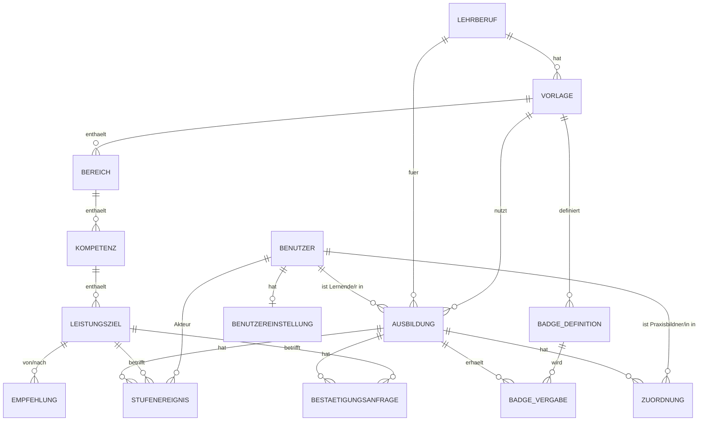

# Skilltree-Prototyp – Anforderungen und Entwicklungsauftrag

|         |                                                                                                                                                                              |
| ------- | ---------------------------------------------------------------------------------------------------------------------------------------------------------------------------- |
| Version | 0.6 (Frontend-first mit Angular 22, backend-fähige Architektur, Angular-Richtlinien)                                                                                         |
| Stand   | 02.11.2026                                                                                                                                                                   |
| Basis   | «Entwicklungsübergabe Skilltree-Prototyp» vom 29.10.2026, Bildungspläne APP 2021, PLA 2021, MED 2018/LZK 2019, Erkenntnisse und Feedback aus den HTML-Prototypen 0.1 bis 0.4 |
| Zweck   | Einzige Quelle für die Entwicklung durch Coding-Agents. Wer dieses Dokument hat, braucht keine weiteren Unterlagen.                                                          |

Markierungen im Dokument:

- **[NEU]** Festlegung, die gegenüber der Entwicklungsübergabe neu ist oder sie ändert.
- **[ANNAHME]** Begründete Annahme. Umsetzen wie beschrieben und in `docs/decisions.md` aufführen.
- **[OFFEN O-x]** Fachlich nicht entschieden. Der beschriebene Default wird umgesetzt, aber konfigurierbar oder leicht änderbar gehalten.

---

## 0 Auftrag an den Coding-Agent

Lies dieses Kapitel vollständig, bevor du Code schreibst. Es legt fest, wie du arbeitest. Die Kapitel 1 bis 11 legen fest, was du baust. Die Anhänge A bis C enthalten die vollständigen Bildungspläne als Seed-Daten.

### 0.1 Ziel

Baue eine lauffähige Webapplikation, die den Ausbildungsstand von Lernenden als Skilltree zeigt, Praxisbildner/innen Stufen bestätigen lässt und Meilenstein-Badges vergibt. Die Applikation dient der Validierung in einer wissenschaftlichen Arbeit (Forschungsfragen FF1 bis FF4, siehe 1.2). Sie muss korrekt rechnen, nachvollziehbar sein und mit Testpersonen benutzbar sein. Produktionsreife ist nicht verlangt.

### 0.2 Arbeitsregeln

1. **Dieses Dokument ist die Quelle der Wahrheit.** Bei Widerspruch zwischen Kapiteln gilt: Regeln (Kap. 5) vor User Stories (Kap. 4) vor UI-Beschreibung (Kap. 8). Melde jeden Widerspruch in `docs/decisions.md`.
2. **Nichts Fachliches erfinden.** Fehlt eine fachliche Regel, setze den dokumentierten Default um. Gibt es keinen, wähle die einfachste Lösung, kennzeichne sie im Code mit `// ANNAHME:` und trage sie in `docs/decisions.md` ein (Format in 0.6).
3. **Regeln zuerst.** Das Regelmodul (Kap. 5) ist eine eigene Bibliothek aus reinen Funktionen ohne Datenbank- und Framework-Abhängigkeit. Schreibe zuerst die Tests aus Kapitel 10, dann die Funktionen.
4. **Zustand nie speichern, immer berechnen.** Stufe, Fortschritt, Ampel, Empfehlungen und Badges werden aus den Stufenereignissen berechnet. Stufenereignisse werden nur angefügt, nie geändert oder gelöscht.
5. **Rechte in den Anwendungsdiensten prüfen, nie nur in der UI.** Jede schreibende und lesende Operation prüft Rolle und Zuordnung (Kap. 3) in der Dienstschicht (0.7). Komponenten blenden Aktionen nur zusätzlich aus. Ein späteres Backend prüft dieselben Regeln noch einmal und ist dann massgebend.
6. **Arbeite in den Meilensteinen aus 0.4**, in der angegebenen Reihenfolge. Ein Meilenstein ist erst fertig, wenn seine Definition of Done (0.5) erfüllt ist.
7. **Kleine, überprüfbare Schritte.** Ein Commit pro abgeschlossener Teilaufgabe, Commit-Message auf Englisch im Imperativ mit Story- oder Regel-ID, z. B. `Add stage calculation (R-S1, R-S2)`.
8. **Keine zusätzlichen Features.** Insbesondere nichts aus 1.3 «Bewusst nicht enthalten». Ideen gehören in `docs/backlog.md`.
9. **Sprache:**
   - UI-Texte Deutsch in Schweizer Rechtschreibung: «ss» statt «ß», Anführungszeichen « ».
   - Fachbegriffe im Code und in der Datenbank Deutsch wie im Datenmodell (`Stufenereignis`, `Leistungsziel`, `BESTAETIGT`). Umlaute in Bezeichnern ausschreiben (ae, oe, ue).
   - Technische Begriffe, Kommentare und Commit-Messages Englisch.
10. **Architektur und Angular-Richtlinien** aus 0.7 und 0.8 sind verbindlich. Abweichungen nur mit Eintrag in `docs/decisions.md`.
11. **Barrierefreiheit von Anfang an:** Stufen und Ampel nie nur über Farbe (immer Symbol und Text; Ausnahme Skilltree-Graph nach R-F4), alle Aktionen per Tastatur, sichtbarer Fokus.
12. **Wenn du blockiert bist** (fehlende Information, die eine Entscheidung mit Datenmodell-Folgen verlangt): Arbeite an einem anderen Teil weiter, dokumentiere die Frage in `docs/open-questions.md` und erwähne sie in deiner Zusammenfassung.

### 0.3 Technologie und Projektstruktur **[GEÄNDERT 0.6]**

**Entscheid: Frontend-first.** Der Prototyp wird als reine Angular-Anwendung gebaut. Daten liegen im Browser (IndexedDB). Ein Backend ist im MVP **nicht** enthalten, die Architektur muss aber erlauben, später eines anzuhängen, ohne Komponenten oder Dienste umzubauen (0.7, Kap. 6.4). Grund: Für Laborsessions mit Rollenwechsel an einem Gerät reicht lokale Persistenz; ob die Validierung mehrere Geräte oder eine Feldstudie braucht, ist noch offen (O-14).

| Schicht            | Technologie                                                                                                                                                                 |
| ------------------ | --------------------------------------------------------------------------------------------------------------------------------------------------------------------------- |
| Frontend           | **Angular 22** (aktuelle Hauptversion, aktive Unterstützung bis 30.06.2027, LTS bis 30.06.2028), Standalone Components, Signals, Angular CDK; Angular Material nur wo nötig |
| Persistenz MVP     | IndexedDB über einen dünnen Adapter (z. B. Bibliothek `idb`), nur im Adapter `lokal` (0.7)                                                                                  |
| Regelmodul         | TypeScript-Paket `@skilltree/regeln` ohne Abhängigkeiten (kein Angular, kein RxJS), später auch im Backend verwendbar                                                       |
| Verträge           | TypeScript-Paket `@skilltree/vertraege`: Datentypen (DTOs), Befehle, Fehlercodes; gemeinsame Sprache von Frontend und späterem Backend                                      |
| Import             | Excel-Import im Browser (SheetJS oder ExcelJS) auf einer Admin-Route; Fixture-Skript (Node) für die Anhänge                                                                 |
| Tests              | Vitest (Standard-Testrunner der Angular CLI) für Regeln, Dienste und Komponenten; Playwright für End-to-End; axe für Barrierefreiheit                                       |
| Qualität           | `angular-eslint`, Prettier, TypeScript `strict`, Angular `strictTemplates`                                                                                                  |
| Betrieb            | `pnpm start` startet die App; Build ist eine statische Website (beliebiger Webserver)                                                                                       |
| Anmeldung          | Lokale Testkonten aus den Seed-Daten, Auswahl auf einer Login-Seite ohne Passwort. Kein externes Identity-System.                                                           |
| Später (nicht MVP) | Backend nach Vertrag 6.4, z. B. NestJS + PostgreSQL oder Backend-Dienst (Supabase, PocketBase), Adapter `http`                                                              |

Exakte Versionen beim Projektstart fixieren und in `README.md` festhalten [OFFEN O-7: Betriebsstandards BIT].

Projektstruktur (pnpm-Workspace, eine Angular-Anwendung, Ordner nach Fachthema gemäss Angular Style Guide):

```text
skilltree/
├─ src/                              # Angular-Anwendung (nur UI-Code)
│  ├─ main.ts
│  ├─ styles.css
│  └─ app/
│     ├─ app.ts / app.html / app.css
│     ├─ app.config.ts               # Provider, Wahl des Datenadapters
│     ├─ app.routes.ts               # Lazy Routes pro Fachthema
│     ├─ anmeldung/                  # Login-Seite, Sitzung, Rollen-Guards
│     ├─ skilltree/                  # Graph, Knoten, Seitenleiste, Leistungsziele
│     ├─ anfragen/                   # Anfragen stellen, beantworten, Liste S-L05
│     ├─ uebersicht/                 # Übersicht Praxisbildner/in S-L01
│     ├─ meilensteine/
│     ├─ badges/
│     ├─ meine-daten/
│     ├─ admin-import/               # nur Rolle ADMIN
│     ├─ demo-steuerung/             # nur DEMO_MODE, violett (N-11)
│     ├─ dienste/                    # Anwendungsdienste (0.7), je Datei ein Dienst
│     └─ daten/
│        ├─ ports.ts                 # Repository-Schnittstellen + InjectionTokens
│        ├─ lokal/                   # IndexedDB-Adapter (MVP)
│        └─ http/                    # leer bzw. Platzhalter für später
├─ packages/
│  ├─ regeln/                        # @skilltree/regeln, reine Funktionen (Kap. 5) + Tests
│  └─ vertraege/                     # @skilltree/vertraege, DTOs, Befehle, Fehlercodes
├─ tools/
│  └─ fixtures-aus-markdown.ts       # erzeugt public/vorlagen/*.json aus Anhang A–C (7.4)
├─ public/
│  └─ vorlagen/                      # vorlage-inf-app.json, vorlage-inf-pla.json, vorlage-med.json
├─ e2e/                              # Playwright
├─ docs/
│  ├─ decisions.md
│  ├─ open-questions.md
│  └─ backlog.md
└─ README.md
```

Pflicht-Skripte im Root-`package.json`: `start`, `build`, `test`, `test:e2e`, `lint`, `fixtures` (erzeugt die Vorlagen-JSON aus diesem Dokument).

### 0.4 Meilensteine **[GEÄNDERT 0.6]**

| #    | Meilenstein                  | Inhalt                                                                                                                                                                               | Ergebnis                                                       |
| ---- | ---------------------------- | ------------------------------------------------------------------------------------------------------------------------------------------------------------------------------------ | -------------------------------------------------------------- |
| M0   | Gerüst                       | Angular-22-Workspace (`ng new`, strict, Vitest), `packages/regeln`, `packages/vertraege`, ESLint, Prettier, Playwright, README                                                       | `pnpm start` zeigt leere App; `pnpm lint` und `pnpm test` grün |
| M1   | Regelmodul                   | Kap. 5 vollständig, Tests aus Kap. 10.1 grün, Abdeckung ≥ 90 %                                                                                                                       | `pnpm test` grün                                               |
| M2   | Daten                        | Verträge (DTOs, Befehle, Fehlercodes), Ports, IndexedDB-Adapter, Fixtures aus Anhang A–C (7.4), Seed mit Testpersonen (Kap. 9), Export/Import des Datenstands als JSON, Zurücksetzen | Beim ersten Start sind 3 Lehrberufe und 7 Benutzer vorhanden   |
| M3   | Anwendungsdienste und Rechte | Dienste nach 0.7 mit Rechteprüfung und Fehlercodes, Tests 10.2                                                                                                                       | Dienst-Tests grün, TF4/TF5 erfüllt                             |
| M4   | UI Lernende                  | Anmeldung, Skilltree-Graph (Kap. 8.2), S-A01 bis S-A08, S-Q01                                                                                                                        | E2E «Lernende» grün                                            |
| M5   | UI Praxisbildner/in          | S-L01 bis S-L06                                                                                                                                                                      | E2E «Praxisbildner/in» grün                                    |
| M6   | Excel-Import                 | T-I1 bis T-I7 für INF-Vorlagen im Browser, Trockenlauf                                                                                                                               | TF6 grün für APP und PLA                                       |
| M7   | Feinschliff                  | T-A1 (axe), T-P1, Demo-Steuerung (N-11), README                                                                                                                                      | Checkliste 0.5 vollständig                                     |
| (M8) | Backend (nicht MVP)          | Adapter `http` + Backend nach Vertrag 6.4; Regeln serverseitig wiederverwenden                                                                                                       | nur nach separatem Entscheid (O-14)                            |

### 0.5 Definition of Done (pro Meilenstein)

- `pnpm lint`, `pnpm test` und, ab M4, `pnpm test:e2e` laufen ohne Fehler.
- `ng build` (Produktion) läuft ohne Fehler und ohne Budget-Warnungen.
- Kein `any`, keine `@ts-ignore`, kein deaktivierter Lint-Regel ohne Begründung im Code.
- Die Prüfpunkte aus 0.7 (Architektur) und 0.8 (Angular) sind eingehalten.
- Jede umgesetzte Story oder Regel hat mindestens einen Test, der ihre ID im Testnamen trägt.
- Neue Annahmen stehen in `docs/decisions.md`.
- README beschreibt, wie man den Stand startet und prüft.
- Kurze Zusammenfassung: was umgesetzt ist, was offen ist, welche Annahmen neu sind.

### 0.6 Format für `docs/decisions.md`

```markdown
## D-007 Rundung des Fortschritts

- Bezug: R-F3
- Entscheid: Math.round(summe * 100 / (6 * n)) mit Epsilon 1e-9
- Grund: kaufmännische Rundung, Fliesskomma-Fehler vermeiden
- Status: ANNAHME | BESTÄTIGT
```

### 0.7 Architektur: backend-fähiges Frontend **[NEU 0.6]**

Ziel: Heute läuft alles im Browser. Später soll ein Backend angehängt werden können, indem **nur ein Datenadapter ausgetauscht** wird. Komponenten, Dienste und Regeln bleiben unverändert.

**Schichten** (Abhängigkeiten nur von oben nach unten):

| Schicht                                      | Inhalt                                                                                                                                                                   | Darf verwenden                                                                                          | Darf nicht                                              |
| -------------------------------------------- | ------------------------------------------------------------------------------------------------------------------------------------------------------------------------ | ------------------------------------------------------------------------------------------------------- | ------------------------------------------------------- |
| UI (Fachthemen-Ordner)                       | Komponenten, Routen, Guards, Signal-Zustand für die Anzeige                                                                                                              | Anwendungsdienste, `@skilltree/regeln` (nur reine Berechnungen für die Anzeige), `@skilltree/vertraege` | Ports, Adapter, IndexedDB, `localStorage`, `HttpClient` |
| Anwendungsdienste (`dienste/`)               | Ein Dienst pro Anwendungsfall-Gruppe: `SkilltreeDienst`, `BestaetigungDienst`, `AnfrageDienst`, `MeilensteinDienst`, `UebersichtDienst`, `ImportDienst`, `SitzungDienst` | Ports, Regeln, Verträge, `Uhr`                                                                          | Adapter direkt, Browser-APIs                            |
| Ports (`daten/ports.ts`)                     | Schnittstellen + `InjectionToken`                                                                                                                                        | Verträge                                                                                                | –                                                       |
| Adapter (`daten/lokal`, später `daten/http`) | Umsetzung der Ports                                                                                                                                                      | Verträge, IndexedDB bzw. `HttpClient`                                                                   | Regeln (keine Fachlogik im Adapter)                     |
| Regeln (`@skilltree/regeln`)                 | Reine Funktionen aus Kap. 5                                                                                                                                              | nichts ausser Verträgen                                                                                 | Angular, RxJS, I/O                                      |

**Ports** (alle Methoden asynchron mit `Promise` oder `Observable`, auch wenn der lokale Adapter sofort antworten könnte):

```ts
export interface VorlageRepository {
  liste(): Promise<VorlageKopf[]>;
  laden(id: VorlageId): Promise<Vorlage>;
  speichern(v: VorlageImport): Promise<VorlageId>;
}
export interface AusbildungRepository {
  fuerLernende(id: BenutzerId): Promise<Ausbildung | null>;
  fuerPraxisbildner(id: BenutzerId, stichtag: string): Promise<Ausbildung[]>;
  laden(id: AusbildungId): Promise<Ausbildung>;
  zuordnungen(id: AusbildungId): Promise<Zuordnung[]>;
}
export interface EreignisRepository {
  stufenereignisse(az: AusbildungId): Promise<Stufenereignis[]>;
  meilensteinereignisse(az: AusbildungId): Promise<MeilensteinEreignis[]>;
  anfuegen(e: NeuesEreignis): Promise<Stufenereignis | MeilensteinEreignis>;
}
export interface AnfrageRepository {
  fuerAusbildung(az: AusbildungId): Promise<Bestaetigungsanfrage[]>;
  offeneFuerPraxisbildner(pb: BenutzerId): Promise<Bestaetigungsanfrage[]>;
  erstellen(a: NeueAnfrage): Promise<Bestaetigungsanfrage>;
  statusSetzen(id: AnfrageId, s: AnfrageStatusAenderung): Promise<Bestaetigungsanfrage>;
}
export interface BenutzerRepository {
  alle(): Promise<Benutzer[]>;
  laden(id: BenutzerId): Promise<Benutzer>;
  einstellungen(id: BenutzerId): Promise<Benutzereinstellung>;
  einstellungenSpeichern(e: Benutzereinstellung): Promise<void>;
}
export interface DatenbestandPort {
  exportieren(): Promise<DatenbestandJson>;
  importieren(d: DatenbestandJson): Promise<void>;
  zuruecksetzen(): Promise<void>;
}
export const VORLAGE_REPOSITORY = new InjectionToken<VorlageRepository>('VorlageRepository'); // usw. für jeden Port
```

Die Signaturen sind ein Vorschlag; massgebend ist die Trennung. Jede Port-Methode entspricht einem Aufruf aus 6.4, damit der spätere `http`-Adapter 1:1 abbildbar ist.

**Regeln für die Backend-Fähigkeit:**

1. **Adapterwahl an genau einer Stelle:** `app.config.ts` registriert die Adapter per `InjectionToken`, gesteuert über `environment.datenquelle: 'lokal' | 'http'`. Kein anderer Code kennt die Adapter.
2. **Befehle statt Zustandsänderungen:** Schreibende Operationen sind Befehle aus `@skilltree/vertraege` (`StufeBestaetigen`, `BestaetigungZuruecknehmen`, `AnfrageStellen`, `AnfrageZurueckziehen`, `AnfrageAblehnen`, `MeilensteinBestaetigen`, `MeilensteinZuruecknehmen`, `EinstellungAendern`). Ein Dienst prüft Rechte und Regeln und übergibt dann neue Ereignisse an den Port. Es gibt keine «Speichere den ganzen Stand»-Operation.
3. **Nur anfügen:** Ereignisse werden nie geändert oder gelöscht (T-D3). Der lokale Adapter bietet dafür keine Methode an. Ein späterer Umzug ins Backend überträgt nur die Ereignislisten.
4. **IDs und Zeit:** IDs werden im Client als UUID (v7, zeitlich sortierbar) erzeugt. Zeitstempel als ISO-8601 in UTC. Die aktuelle Zeit kommt aus einem `Uhr`-Dienst (`InjectionToken`), damit Tests und Seed die Zeit festlegen können.
5. **Gleiche Datenform:** Der lokale Adapter speichert exakt die DTOs aus `@skilltree/vertraege`. Ein Schema-Versionsfeld im Datenbestand erlaubt Migrationen (`datenbestand.version`).
6. **Fehler als Codes:** Dienste werfen typisierte Fehler aus den Verträgen: `KEINE_BERECHTIGUNG`, `NICHT_GEFUNDEN`, `STUFE_NICHT_HOEHER`, `ANFRAGE_BEREITS_OFFEN`, `BEGRUENDUNG_ZU_KURZ`, `UNGUELTIGE_EINGABE`. Ein späterer `http`-Adapter bildet HTTP 403/404/409/400 auf dieselben Codes ab. Die UI zeigt pro Code einen deutschen Text.
7. **Antworten mit neuem Stand:** Schreibende Dienstmethoden geben den neu berechneten Ausschnitt zurück (Stufe, Prozent, Ampel, neue oder inaktive Badges), wie es auch die API (6.4) tun wird.
8. **Sitzung als Port:** Wer angemeldet ist, liefert der `SitzungDienst` über einen Port. Lokal: Auswahl eines Seed-Kontos. Später: Token aus dem Backend. Dienste lesen die angemeldete Person nur von dort.
9. **Ereignis-Hook:** Nach jedem erfolgreich angefügten Ereignis meldet der Dienst ein Domänenereignis über einen `DomaenenEreignisse`-Dienst (`Observable`). Die App selbst braucht ihn nur für die Aktualisierung der Anzeige; spätere Erweiterungen (z. B. ein Studien-Add-on) hängen sich dort an, ohne die App zu ändern.
10. **Keine Browser-APIs ausserhalb der Adapter:** `indexedDB`, `localStorage`, `window` und `document` nur in Adaptern oder in klar gekapselten UI-Hilfen (z. B. Tooltip-Positionierung).

**Bewusste Einschränkung im MVP:** Ohne Backend liegen alle Daten im Browser. Die Rechteprüfung in den Diensten verhindert Fehlbedienung, schützt aber nicht vor Manipulation. Das ist nur mit pseudonymisierten Demo-Daten zulässig (T-D4) und in der Arbeit so zu dokumentieren.

**Prüfpunkte (automatisiert, z. B. mit ESLint-Regel `no-restricted-imports` oder `dependency-cruiser`):**

- Kein Import aus `daten/lokal` oder `daten/http` ausserhalb von `app.config.ts`.
- Kein Import von Angular oder RxJS in `packages/regeln`.
- Keine Verwendung von `indexedDB`, `localStorage`, `HttpClient` in Komponenten oder Diensten.
- Ein Testlauf der Dienste mit einem In-Memory-Adapter (dritte Umsetzung der Ports) ist grün. Das beweist, dass die Dienste nicht vom Speicher abhängen.

### 0.8 Angular-Richtlinien **[NEU 0.6]**

Verbindlich ist der offizielle Angular Style Guide (angular.dev/style-guide) und die Best Practices der eingesetzten Angular-Version. Bei Widerspruch zu diesem Dokument gilt der Style Guide, ausser bei den Benennungsregeln für Fachbegriffe (0.2, Punkt 9). Die wichtigsten Punkte:

**Struktur und Benennung**

- Ordner nach Fachthema, nicht nach Typ (keine Ordner `components/`, `services/`). Ein Konzept pro Datei. Tests neben dem Code (`*.spec.ts`).
- Dateinamen in Kleinbuchstaben mit Bindestrich, benannt nach dem Hauptbezeichner der Datei. Keine Sammeldateien wie `utils.ts`, `helpers.ts`, `common.ts`.
- Dateien und Klassen so benennen, wie `ng generate` der fixierten CLI-Version sie erzeugt.
- Komponenten-Präfix `st` (z. B. `st-skilltree-graph`), auch für Attribut-Direktiven (`[stTooltip]`).

**Komponenten und Templates**

- Ausschliesslich Standalone Components; keine NgModules.
- Signals für Zustand: `signal()`, `computed()`, `input()`, `output()`, `model()`, Signal-Queries (`viewChild()` usw.). Abgeleitete Werte (Prozent, Ampel, «Als Nächstes») als `computed()` aus den Regeln, nicht als Methodenaufruf im Template.
- `ChangeDetectionStrategy.OnPush`, sofern nicht ohnehin Standard; die Anwendung läuft zoneless.
- Eingebauter Kontrollfluss (`@if`, `@for` mit `track`, `@switch`), keine `*ngIf`/`*ngFor`.
- `class`- und `style`-Bindings statt `NgClass`/`NgStyle`. Host-Bindings im `host`-Objekt des Decorators statt `@HostBinding`/`@HostListener`.
- Nur vom Template genutzte Member sind `protected`; von Angular initialisierte Felder (`input`, `output`, `model`, Queries) sind `readonly`.
- Event-Handler nach der Aktion benennen (`anfrageSenden()`), nicht nach dem Ereignis (`handleClick()`).
- Komponenten nur für Darstellung; Logik in Dienste oder Regeln. Lifecycle-Hooks kurz halten und die passenden Interfaces implementieren.
- Templates enthalten nur einfache Ausdrücke; komplexe Logik als `computed()`.

**Dependency Injection und Dienste**

- `inject()` statt Konstruktor-Parameter.
- Dienste mit `providedIn: 'root'`, ausser sie sind bewusst an eine Route gebunden.
- Ports über `InjectionToken`, nicht über konkrete Klassen.

**Routing, Formulare, Sonstiges**

- Lazy Loading pro Fachthema (`loadComponent` / `loadChildren`), funktionale Guards (`CanActivateFn`) für Rollen.
- Formulare typisiert (Reactive Forms, oder Signal Forms, falls in der fixierten Version stabil). Validierung (Längen, Pflichtfelder) entspricht den Regeln in Kap. 4/5.
- `NgOptimizedImage` für Bilder.
- Keine direkten DOM-Zugriffe ausser über Angular-APIs (z. B. für die Tooltip-Position über `afterRenderEffect` oder CDK Overlay).
- TypeScript nach dem Google TypeScript Style Guide; `strict`, `noImplicitOverride`, `noPropertyAccessFromIndexSignature`; Angular `strictTemplates`.

**Prüfpunkte:** `angular-eslint` mit den empfohlenen Regeln inklusive Template-Regeln und Barrierefreiheitsregeln (`@angular-eslint/template/accessibility`). Lint muss ohne Fehler und Warnungen laufen.

---

## 1 Zielbild und Scope

### 1.1 Zielbild

Lernende sehen ihren Ausbildungsstand als echten Skilltree: Knoten, die mit Kanten verbunden sind. Der Baum wächst von unten nach oben: Er beginnt beim Basismeilenstein Bbc (Wurzel), verzweigt in einen Ast pro Handlungskompetenzbereich und mündet oben in die Abschlussmeilensteine IPA und Lehrabschluss (Krone). Im Baum stehen nur Kürzel, Titel und Fortschrittsring; Prozente, Status und Leistungsziele stehen im Tooltip und in der Seitenleiste. Auf einen Blick ist erkennbar, was wonach kommt und wo Defizite bestehen. Praxisbildner/innen bestätigen pro Leistungsziel die Stufen erklärt, geübt und selbständig. Die Stufen bauen aufeinander auf. Meilenstein-Badges würdigen Fortschritt, ohne Lernende zu vergleichen.

### 1.2 Forschungsfragen, die der Prototyp prüfbar machen muss

| ID  | Frage (Kurzform)                                           | Was der Prototyp dafür braucht                                           |
| --- | ---------------------------------------------------------- | ------------------------------------------------------------------------ |
| FF1 | Finden sich Lernende im Skilltree zurecht?                 | Vollständiger, realistischer Bildungsplan; Kompetenzmatrix; Empfehlungen |
| FF2 | Wirken Badges motivierend oder als Druck?                  | Badges privat, ausblendbar, keine Vergleiche                             |
| FF3 | Ist die Bestätigung für Praxisbildner/innen schnell genug? | Bestätigung in ≤ 3 Klicks, gesammelte Anfragen                           |
| FF4 | Ist der Stand nachvollziehbar und vertrauenswürdig?        | Verlauf mit Person, Zeit, Kommentar, Rücknahmen                          |

### 1.3 Scope

| Bereich                 | MVP                                                                                                                                                             | Später                                                           |
| ----------------------- | --------------------------------------------------------------------------------------------------------------------------------------------------------------- | ---------------------------------------------------------------- |
| Lehrberufe              | **[NEU]** Informatiker/in EFZ Applikationsentwicklung (INF-APP), Informatiker/in EFZ Plattformentwicklung (INF-PLA), Mediamatiker/in EFZ (MED)                  | ICT-Fachkraft, weitere Fachrichtungen                            |
| Lernende                | Skilltree, Fortschritt, Ampel, Defizitanzeige, Stufen, Verlauf, Badges, Bestätigung anfragen                                                                    | Lernortfilter, Export Bildungsbericht, E-Mail-Benachrichtigungen |
| Praxisbildner/innen     | Übersicht eigener Lernender, Bestätigen, Kommentieren, Zurücknehmen, offene Anfragen, Ablehnen mit Begründung                                                   | Semesterübersicht Bildungsbericht, Stellvertretungen             |
| Administration          | Excel-Import auf einer geschützten Admin-Route im Browser (INF-Vorlagen), Vorlagen-JSON-Import (alle), Zuordnungen, Seed-Daten, Export/Import des Datenbestands | Vollständige Admin-Oberfläche, Versionsmigration mit Vorschau    |
| Anmeldung               | Lokale Testkonten                                                                                                                                               | Identitätsverbund des Bundes (O-7)                               |
| Bewusst nicht enthalten | Ranglisten, Punktewettbewerb, Avatare, Narrative, Selbstbewertung als Ersatz für Bestätigung, Vergleiche mit anderen Lernenden                                  | Kooperative Elemente als Option prüfen                           |

---

## 2 Glossar

| Begriff                             | Bedeutung                                                                                                         | Im Code                  |
| ----------------------------------- | ----------------------------------------------------------------------------------------------------------------- | ------------------------ |
| Lehrberuf                           | Beruf inkl. Fachrichtung, z. B. Informatiker/in EFZ Applikationsentwicklung                                       | `Lehrberuf`              |
| Vorlage                             | Importierte Version eines Bildungsplans für einen Lehrberuf                                                       | `Vorlage`                |
| Handlungskompetenzbereich (Bereich) | Oberste Ebene, Code A–H                                                                                           | `Bereich`                |
| Handlungskompetenz (Kompetenz)      | Code a1, b2 …                                                                                                     | `Kompetenz`              |
| Leistungsziel                       | Code a1.1 …, mit Taxonomiestufe K1–K6                                                                             | `Leistungsziel`          |
| Stufe                               | 0 keine, 1 erklärt, 2 geübt, 3 selbständig; kumulativ                                                             | `stufe: 0..3`            |
| Taxonomiestufe                      | K1 Wissen, K2 Verstehen, K3 Anwenden, K4 Analyse, K5 Synthese, K6 Beurteilen                                      | `taxonomie`              |
| Lernort                             | Basislehrjahr, Berufsfachschule, überbetrieblicher Kurs (ÜK), Lehrbetrieb                                         | `lernorte`               |
| Lernende/r                          | Person in Ausbildung (Rolle `LERNENDE`)                                                                           | `LERNENDE`               |
| Praxisbildner/in                    | **[NEU]** Fachperson im Lehrbetrieb, die bestätigt. Ersetzt den Begriff «Lehrende» überall (O-2 entschieden).     | `PRAXISBILDNER`          |
| Ausbildung                          | Verbindung Lernende/r – Lehrberuf – Vorlage                                                                       | `Ausbildung`             |
| Zuordnung                           | Praxisbildner/in ↔ Ausbildung mit Gültigkeit von/bis                                                              | `Zuordnung`              |
| Stufenereignis                      | Unveränderlicher Eintrag: bestätigt, zurückgenommen, übernommen                                                   | `Stufenereignis`         |
| Ampel                               | rot «nicht – kaum», orange «teilweise», grün «mehrheitlich – vollständig»                                         | `ampel`                  |
| Ast                                 | **[NEU]** Darstellung eines Bereichs im Skilltree: Kette seiner Kompetenz-Knoten                                  | –                        |
| Knoten                              | **[NEU]** Kompetenz (Kreis) oder Meilenstein (Sechseck) im Skilltree                                              | –                        |
| Kante                               | **[NEU]** Pfeil «kommt danach» zwischen zwei Knoten; Folgekante (im Ast) oder Querkante (Verweis im Bildungsplan) | `KompetenzAbhaengigkeit` |
| Meilenstein                         | **[NEU]** Bbc (Basismeilenstein, Wurzel), IPA (individuelle praktische Arbeit), Lehrabschluss (Code `LAP`)        | `Meilenstein`            |

---

## 3 Rollen und Rechte

| Aktion                                                      | Lernende            | Praxisbildner/in             | Admin/Dev                                     |
| ----------------------------------------------------------- | ------------------- | ---------------------------- | --------------------------------------------- |
| Eigenen Skilltree, Verlauf, Badges sehen                    | ja                  | –                            | ja (Support)                                  |
| Skilltree zugeordneter Lernender sehen                      | –                   | ja, nur gültig zugeordnet    | ja                                            |
| Bestätigung anfragen, eigene Anfrage zurückziehen           | ja (eigene)         | –                            | –                                             |
| Stufe bestätigen, kommentieren, zurücknehmen                | –                   | ja (gültig zugeordnet, R-S3) | nein [ANNAHME: Trennung Technik/Fachlichkeit] |
| Anfrage ablehnen                                            | –                   | ja (gültig zugeordnet)       | nein                                          |
| **[NEU]** Meilenstein als erreicht bestätigen, zurücknehmen | –                   | ja (gültig zugeordnet)       | nein                                          |
| Daten anderer Lernender sehen                               | nein                | nur gültig zugeordnete       | ja                                            |
| Badges ausblenden                                           | ja (eigene Anzeige) | –                            | –                                             |
| Vorlage importieren, Versionen verwalten                    | –                   | –                            | ja                                            |
| Lehrberufe, Lernende, Zuordnungen verwalten                 | –                   | –                            | ja                                            |

«Gültig zugeordnet» heisst: Es gibt eine `Zuordnung` mit `gueltig_von ≤ jetzt` und (`gueltig_bis` leer oder `≥ jetzt`). Praxisbildner/innen mit abgelaufener Zuordnung sehen die Ausbildung nicht mehr. Ihre früheren Bestätigungen bleiben im Verlauf sichtbar.

Verstösse liefern den Fehlercode `KEINE_BERECHTIGUNG` ohne Daten (TF4, TF5). Ein späteres Backend antwortet mit HTTP 403 und prüft dieselben Regeln serverseitig; dann ist das Backend massgebend (0.7).

---

## 4 User Stories mit Akzeptanzkriterien

Must-Stories bilden den MVP. Bezüge (U-…, D-…) verweisen auf Teil 1 der Arbeit.

### 4.1 Lernende

**S-A01 Skilltree nach dem Login** · Must · U-A-01, D-08

- Mit Ausbildung: Nach dem Login erscheint direkt der Skilltree mit allen Bereichen des Bildungsplans. Kein Einrichtungsschritt.
- Ohne Ausbildung: Hinweis «Dir ist noch kein Lehrberuf zugeordnet. Bitte an die Berufsbildung wenden.»
- Kopfzeile: Name, Lehrberuf und Fachrichtung, Lehrjahr, Bildungsplanjahr, aktuelle Praxisbildner/innen.
- **[NEU]** Das Lehrjahr wird aus `lehrbeginn` berechnet (volle Jahre seit Lehrbeginn + 1, höchstens Lehrdauer), nicht gespeichert.

**S-A02 Gesamtfortschritt und Stand pro Bereich** · Must · U-A-02, D-05

- Gesamtfortschritt als Balken mit Prozentzahl (R-F3).
- Pro Bereich: Prozent, Ampel mit Symbol und Text (R-F5), Anzahl roter Kompetenzen (R-F6).
- Legende der drei Ampelstufen ist sichtbar.

**S-A03 Skilltree mit Knoten und Kanten** · Must · U-A-03, D-02, D-04

- **[GEÄNDERT 0.4]** Der Skilltree ist ein Graph, der **von unten nach oben wächst** (Details Kap. 8.2):
  1. Unten die Wurzel: Meilenstein **Bbc** (Basismeilenstein).
  2. Von Bbc je eine Kante nach oben zur Basis jedes Asts. Die Ast-Basis zeigt den Bereichsbuchstaben und rechts daneben den Bereichstitel (max. 2 Zeilen).
  3. Im Ast die Kompetenz-Knoten übereinander, die erste Kompetenz (a1) unten, die letzte oben, verbunden mit Pfeilen nach oben (R-T1).
  4. Vom obersten Knoten jedes Asts eine Kante zur **IPA**, darüber der **Lehrabschluss** (R-M2, R-M3).
- **[GEÄNDERT 0.5] Information im Baum:** Ein Kompetenz-Knoten zeigt den Code im Kreis, einen Fortschrittsring (Füllung = Prozent, Farbe = Ampel) und rechts daneben den Kompetenztitel (max. 3 Zeilen, danach «…»). Lernende kennen die Codes nicht auswendig, deshalb ist der Titel Pflicht. Nicht im Baum: Prozentzahlen, Ampeltext, Status, Leistungsziele. Zusätzlich nur zwei Markierungen: gestrichelter Rahmen = «Als Nächstes» (R-T3), Zahl am Kreis = offene Anfragen.
- Meilensteine: Sechseck mit Kürzel (Bbc, IPA, LAP), gefüllt wenn erreicht; rechts daneben Name und Untertitel («Bbc · Basismeilenstein», «IPA · Individuelle praktische Arbeit», «Lehrabschluss · Qualifikationsverfahren»).
- Tooltip bei Hover oder Tastaturfokus: Code, Titel, Prozent, Ampeltext, «Als Nächstes», offene Anfragen. Für Ast-Basis: Bereichstitel, Prozent, Anzahl rote Kompetenzen. Für Meilensteine: Titel, Status bzw. Bereitschaft.
- Unter dem Baum, ausserhalb der Grafik: eine einzeilige Legende (Ring, Als Nächstes, Kantenarten).
- Über dem Baum ein einziger Satz: «Knoten antippen, um deine Leistungsziele zu sehen und eine Bestätigung anzufragen.»
- Kanten: durchgezogen, wenn der Vorgänger grün bzw. der Meilenstein erreicht ist; sonst gestrichelt (R-T4). Querkanten (R-T2) erscheinen nur, solange ein beteiligter Knoten per Hover, Fokus oder Auswahl aktiv ist. Hover/Fokus hebt alle Kanten des Knotens hervor.
- Klick auf einen Knoten öffnet die Seitenleiste mit: Ast, Titel, Prozent, Ampel, Kompetenzwert; «Davor» und «Danach» als klickbare Knoten-Chips; Kurzanleitung in drei Schritten (rollenabhängig); Liste der Leistungsziele (Code, Text, Stufe E/G/S + Text, Status, Aktion); Lernorte; Beschreibung (eingeklappt).
- Klick auf ein Leistungsziel klappt in der Liste auf: Taxonomie, Lernorte, Formular (Anfrage bzw. Bestätigung), Verlauf.
- Spaltenbreite 150–196 px pro Ast. Ist der Bildschirm schmaler als der Baum (Handy), scrollt nur die Baumkarte waagrecht. Sie startet mittig, sodass Bbc, IPA und Lehrabschluss sichtbar sind; Hinweis «Den Baum seitlich wischen». Die Scrollposition bleibt beim Öffnen und Schliessen der Seitenleiste erhalten.

**S-A04 Als Nächstes** · Must · U-A-04, D-03

- **[GEÄNDERT]** Pro Ast ist der unterste Knoten, der nicht grün ist, «Als Nächstes» (R-T3): gestrichelter Rahmen um den Kreis. Keine zusätzliche Liste oder Chip-Zeile.
- Alle anderen Knoten bleiben normal dargestellt und bestätigbar (R-E1).

**S-A05 Verlauf pro Leistungsziel** · Must · U-A-05, D-06

- Seitenleiste mit: Text, Taxonomie, Lernorte, aktuelle Stufe, Aktionen, Verlauf.
- Verlauf neueste zuerst: Aktion («geübt bestätigt», «selbständig aus Bildungsplan übernommen», «Rücknahme selbständig»), Person, Datum und Uhrzeit, Kommentar bzw. Begründung.
- Zurückgenommene Bestätigungen bleiben sichtbar und sind durchgestrichen.
- **[NEU]** Erledigte, abgelehnte und zurückgezogene Anfragen erscheinen im Verlauf, abgelehnte mit Begründung (N-06).

**S-A06 Bestätigung anfragen** · Should · U-A-06

- Formular in der Seitenleiste: Zielstufe (nur Stufen über der aktuellen, vorausgewählt: nächste), Freitext 10 bis 1000 Zeichen mit Zähler, «Anfrage senden».
- Status «angefragt: <Zielstufe>» erscheint in Liste und Seitenleiste.
- Solange offen: «Anfrage zurückziehen» (Status `ZURUECKGEZOGEN`).
- **[NEU]** Pro Ausbildung und Leistungsziel höchstens eine offene Anfrage (N-07). Bei Stufe 3 gibt es kein Formular.

**S-A07 Badges** · Must · U-A-07, D-07

- Reiter «Badges»: zuerst erhaltene Badges mit Symbol, Titel, Kriterium als Satz und Datum.
- Danach inaktive Badges (nach Rücknahme) neutral mit «Derzeit nicht erfüllt seit …» und aktuellem Stand.
- Danach noch offene Badges mit Kriterium und eigenem Fortschritt («4 von 7 Leistungszielen selbständig»), sortiert nach Fortschritt absteigend.
- Schalter «Badges ausblenden» blendet Badges in allen eigenen Ansichten aus und wird gespeichert (N-04).

**S-A08 Keine Vergleiche** · Must · U-A-08, D-09

- Keine Ansicht zeigt Daten, Ränge, Durchschnitte oder Anteile anderer Lernender.
- Die Anwendungsdienste liefern Lernenden nur eigene Daten. Zugriffe auf fremde Ausbildungen liefern `KEINE_BERECHTIGUNG` (TF4); später HTTP 403.

### 4.2 Praxisbildner/innen

**S-L01 Übersicht meiner Lernenden** · Must · U-L-01

- Tabelle aller gültig zugeordneten Lernenden: Name (Link), Lehrberuf + Fachrichtung, Lehrjahr, Gesamtfortschritt (Balken + %), Ampel pro Bereich (Bereichscode + Symbol + Farbe, Text im Tooltip und für Screenreader), **[NEU]** Anzahl roter Kompetenzen, Anzahl offener Anfragen.
- Sortierbar nach allen Spalten ausser «Bereiche». Default: Name aufsteigend.
- Leere Liste: «Keine Lernenden mit gültiger Zuordnung.»

**S-L02 Skilltree öffnen und direkt bestätigen** · Must · U-L-02, U-L-03, D-06

- Gleiche Ansicht wie S-A03, mit Link zurück zur Übersicht.
- Pro Leistungsziel mit Stufe < 3 eine Schaltfläche «Bestätigen». Klick öffnet in der Zeile: Stufenauswahl (nur Stufen über der aktuellen), optionaler Kommentar, «Bestätigen», «Abbrechen».
- **[NEU]** Vorausgewählt ist die angefragte Zielstufe, sonst die nächste Stufe. Damit braucht die Standardbestätigung 2 Klicks, mit anderer Stufe 3 Klicks.
- Kein Seitenwechsel. Stufe, Fortschritt, Ampel, Defizitzahl und Badges aktualisieren sich sofort.
- Rückmeldung als kurze Meldung: «a2.3 als «selbständig» bestätigt. Fortschritt 45 % → 47 %.» plus neu erreichte Badges.
- Bestätigen erfolgt in der Seitenleiste des Knotens: «Bestätigen» beim Leistungsziel (Klick 1) → Stufe ist vorausgewählt (optional ändern, Klick 2) → «Bestätigen» (Klick 3). Bei offener Anfrage zusätzlich «Anfrage ablehnen».
- Badges der Lernenden sind unterhalb des Baums sichtbar (R-B7), unabhängig von deren Ausblende-Einstellung.

**S-L03 Bestätigung zurücknehmen** · Must · U-L-04

- In der Seitenleiste hat jede aktive Bestätigung (auch übernommene, N-03) «Zurücknehmen».
- Pflichtfeld Begründung, mindestens 10 Zeichen, Fehlermeldung nennt die aktuelle Länge.
- Der ursprüngliche Eintrag bleibt im Verlauf (durchgestrichen), die Rücknahme erscheint als eigener Eintrag.
- Badges werden nach R-B5 neu berechnet; inaktiv gewordene Badges werden in der Rückmeldung genannt.

**S-L04 Kommentar beim Bestätigen** · Should · U-L-05

- Optionales Feld, max. 500 Zeichen, für Lernende im Verlauf sichtbar.

**S-L05 Offene Anfragen gesammelt** · Should · U-L-06

- Reiter «Offene Anfragen (n)» über alle gültig zugeordneten Lernenden, älteste zuerst.
- Karte: Name, Lehrberuf, Alter der Anfrage («vor 9 Tagen»), Code + Text, aktuelle Stufe → Zielstufe, Text der Lernenden.
- «Bestätigen» öffnet inline optionalen Kommentar + «Bestätigen» (bestätigt die Zielstufe). **[NEU]** «Im Baum zeigen» öffnet den Skilltree der Person mit geöffnetem Knoten und Leistungsziel.
- **[NEU]** «Ablehnen» öffnet inline: drei Vorschlagstexte zum Anklicken («Bitte genauer beschreiben, was du gemacht hast.», «Noch nicht im Betrieb beobachtet.», «Zielstufe ist noch zu hoch.»), Textfeld (Pflicht, 10 bis 500 Zeichen), «Ablehnen». Die Begründung ist für Lernende sichtbar (N-06).

**S-L06 Meilensteine bestätigen** · Must · **[NEU]**

- Klick auf Bbc, IPA oder Lehrabschluss öffnet die Seitenleiste: Beschreibung, Bereitschaftsanzeige (R-M1–R-M3), Status, Verlauf.
- Praxisbildner/innen mit gültiger Zuordnung: «Als erreicht bestätigen» mit optionalem Kommentar; aktive Bestätigung «Zurücknehmen» mit Begründung (≥ 10 Zeichen).
- Lernende sehen den Status und den Hinweis, dass die Praxisbildnerin / der Praxisbildner bestätigt.

### 4.3 Alle

**S-Q01 Meine Daten** · Must · U-Q-02, U-Q-03

- Aus jeder Ansicht über die Kopfzeile erreichbar.
- Tabelle «Datenart – wer sieht sie», rollenabhängig. Inhalt für Lernende:

| Datenart                                                   | Wer sieht sie                                                             |
| ---------------------------------------------------------- | ------------------------------------------------------------------------- |
| Name, Login, Lehrberuf, Lehrbeginn                         | Du, zugeordnete Praxisbildner/innen, Administration                       |
| Stufen und Verlauf (Bestätigungen, Rücknahmen, Kommentare) | Du, zugeordnete Praxisbildner/innen, Administration (Support)             |
| Anfragen mit deinem Text                                   | Du, zugeordnete Praxisbildner/innen                                       |
| Badges                                                     | Du, zugeordnete Praxisbildner/innen. Ausblenden ändert nur deine Ansicht. |

- Hinweis: keine Nutzungsanalyse, kein Tracking (T-D1).

---

## 5 Regeln

Alle Werte werden bei jedem Ereignis aus den Stufenereignissen neu berechnet. Umsetzung als reine Funktionen in `packages/rules`. Signaturen sind Vorschläge.

### 5.1 Stufen

| Regel | Beschreibung                                                                                                                                                                                                                                                                                                                                                                                                                         |
| ----- | ------------------------------------------------------------------------------------------------------------------------------------------------------------------------------------------------------------------------------------------------------------------------------------------------------------------------------------------------------------------------------------------------------------------------------------ |
| R-S1  | **[GEÄNDERT]** Stufen: 0 keine, 1 erklärt, 2 geübt, 3 selbständig. Aktive Bestätigungen sind Ereignisse mit Aktion `BESTAETIGT` **oder `UEBERNOMMEN`**, auf die kein `ZURUECKGENOMMEN`-Ereignis verweist. Stufe eines Leistungsziels = Maximum der Stufen aktiver Bestätigungen, sonst 0.                                                                                                                                            |
| R-S2  | Eine höhere Stufe schliesst die tieferen ein (selbständig ⇒ erklärt und geübt erfüllt). Entspricht der kumulativen Markierung der Vorlage.                                                                                                                                                                                                                                                                                           |
| R-S3  | Bestätigen, Zurücknehmen und Ablehnen dürfen nur Praxisbildner/innen mit gültiger Zuordnung zur Ausbildung zum Zeitpunkt der Aktion. Lernende können sich nie selbst bestätigen.                                                                                                                                                                                                                                                     |
| R-S4  | Eine Bestätigung mit Stufe ≤ aktueller Stufe erzeugt kein Ereignis und liefert den Hinweis «a2.3 ist bereits «geübt». Es wurde nichts gespeichert.» Eine Rücknahme verlangt eine Begründung (≥ 10 Zeichen) und verweist auf genau ein aktives Ereignis (`ref_ereignis_id`). Eine zu hohe Stufe wird durch Rücknahme und neue Bestätigung korrigiert. Gibt es darunter keine weitere aktive Bestätigung, fällt die Stufe dabei auf 0. |
| R-S5  | Eine Bestätigung setzt offene Anfragen derselben Ausbildung und desselben Leistungsziels mit Zielstufe ≤ bestätigter Stufe auf `ERLEDIGT`.                                                                                                                                                                                                                                                                                           |
| R-S6  | **[NEU]** Pro Ausbildung und Leistungsziel ist höchstens eine Anfrage `OFFEN` (N-07). Eine Anfrage braucht Zielstufe > aktueller Stufe.                                                                                                                                                                                                                                                                                              |

```ts
type Aktion = 'BESTAETIGT' | 'ZURUECKGENOMMEN' | 'UEBERNOMMEN';
interface Stufenereignis {
  id: string;
  leistungszielId: string;
  stufe: 1 | 2 | 3;
  aktion: Aktion;
  refEreignisId?: string;
  zeitpunkt: Date;
}
function aktiveBestaetigungen(ereignisse: Stufenereignis[]): Stufenereignis[];
function stufenMap(ereignisse: Stufenereignis[]): Map<string, 0 | 1 | 2 | 3>; // leistungszielId → Stufe
```

### 5.2 Fortschritt, Ampel, Defizite

| Regel | Beschreibung                                                                                                                                                                                                                                                                                                                                                                                                       |
| ----- | ------------------------------------------------------------------------------------------------------------------------------------------------------------------------------------------------------------------------------------------------------------------------------------------------------------------------------------------------------------------------------------------------------------------ |
| R-F1  | Punktwert eines Leistungsziels: Stufe 0 → 0, 1 → 1, 2 → 3, 3 → 6 (kumulativ 1 + 2 + 3 wie in der Vorlage).                                                                                                                                                                                                                                                                                                         |
| R-F2  | Kompetenzwert = arithmetisches Mittel der Punktwerte aller nicht archivierten Leistungsziele der Kompetenz (0 bis 6).                                                                                                                                                                                                                                                                                              |
| R-F3  | Fortschritt in % (Kompetenz, Bereich, gesamt) = Summe der Punktwerte ÷ (6 × Anzahl Leistungsziele) × 100, kaufmännisch auf ganze Zahl gerundet. Bereich und gesamt rechnen über alle Leistungsziele, nicht über Kompetenzmittel.                                                                                                                                                                                   |
| R-F4  | Ampel pro Kompetenz: Kompetenzwert < 2 rot «nicht – kaum», 2 bis < 4 orange «teilweise», ≥ 4 grün «mehrheitlich – vollständig». Identisch mit der bedingten Formatierung der Vorlage. Immer mit Symbol und Text; **[NEU 0.4] Ausnahme Skilltree-Graph:** dort Farbe + Füllgrad des Rings, Text im Tooltip und im `aria-label`. Symbole: rot = leerer Kreis, orange = halb gefüllter Kreis, grün = gefüllter Kreis. |
| R-F5  | **[NEU]** Ampel pro Bereich: Bereichswert = Mittel der Punktwerte aller Leistungsziele des Bereichs; Schwellen wie R-F4. Damit passen Bereichsampel und Bereichsprozent zusammen (rot < 33,3 %, orange < 66,7 %, grün ab 66,7 %).                                                                                                                                                                                  |
| R-F6  | **[NEU]** Defizitanzeige: Rote Knoten sind im Baum direkt erkennbar (roter, kaum gefüllter Ring). Der Tooltip der Ast-Basis nennt die Anzahl roter Kompetenzen («2 rot»); die Übersicht der Praxisbildner/innen zeigt die Summe über alle Äste («Rote Knoten»).                                                                                                                                                    |

Begründung R-F5/R-F6: Ziel der Applikation ist, auf einen Blick zu sehen, wo Probleme und Defizite bestehen. Ein Mittelwert allein verdeckt einzelne Lücken. Im Prototyp hatte Lernende «Nora» Bereich A grün (68 %), obwohl Kompetenz a7 bei 0 % lag. Die Defizitzahl und die Feldreihe machen das sichtbar.

```ts
function punktwert(stufe: 0 | 1 | 2 | 3): 0 | 1 | 3 | 6;
function kompetenzwert(lzIds: string[], stufen: Map<string, number>): number; // 0..6
function fortschritt(lzIds: string[], stufen: Map<string, number>): number; // 0..100, Math.round(x + 1e-9)
function ampel(wert: number): 'ROT' | 'ORANGE' | 'GRUEN';
function anzahlRoteKompetenzen(bereich: Bereich, stufen: Map<string, number>): number;
```

### 5.3 Weiches Freischalten und Empfehlungen

| Regel | Beschreibung                                                                                                                                                                                                                                                            |
| ----- | ----------------------------------------------------------------------------------------------------------------------------------------------------------------------------------------------------------------------------------------------------------------------- |
| R-E1  | Kein Element ist gesperrt. Jedes Leistungsziel kann jederzeit angefragt und bestätigt werden (D-03).                                                                                                                                                                    |
| R-E2  | Kandidaten: Leistungsziele mit Stufe < 3 ohne offene Anfrage, deren Empfehlungsvorgänger (falls definiert) Stufe ≥ 2 haben.                                                                                                                                             |
| R-E3  | **[ERSETZT durch R-T3]** Empfehlungen werden auf Knotenebene bestimmt (ein Knoten pro Ast). Innerhalb eines Knotens gelten die Leistungsziele mit Stufe < 3 in Vorlagenreihenfolge. Grund: Die alte Sortierung empfahl nie rote, noch nicht begonnene Kompetenzen (E4). |

### 5.4 Skilltree-Struktur **[NEU]**

| Regel | Beschreibung                                                                                                                                                                                                                                                                                                                                                                                                                                                                 |
| ----- | ---------------------------------------------------------------------------------------------------------------------------------------------------------------------------------------------------------------------------------------------------------------------------------------------------------------------------------------------------------------------------------------------------------------------------------------------------------------------------- |
| R-T1  | Folgekanten: Innerhalb eines Bereichs folgt jede Kompetenz auf die vorherige in Vorlagenreihenfolge (a1 → a2 → … → a7). Die Reihenfolge bildet in allen drei Plänen den Arbeitsablauf ab (z. B. g1 Anforderungen → g2 Entwurf → … → g5 Implementieren → g6 Qualität prüfen). Gespeichert als `KompetenzAbhaengigkeit` mit `quelle = REIHENFOLGE`, durch Admin änderbar. [ANNAHME, OFFEN O-12]                                                                                |
| R-T2  | Querkanten: Verweist die Beschreibung einer Kompetenz auf eine Kompetenz eines anderen Bereichs, entsteht eine Kante vom Verweisziel zur verweisenden Kompetenz, `quelle = TEXTVERWEIS`. Erkennungsmuster: «Handlungskompetenz a1», «(a1)», «(→ a3)», «(→ a3.5)», «(gemäss d2)», «(vgl. a1)». Ergebnis: APP a1→g1, a3→g4, a3→h3; PLA a1→d1, a7→d4, a1→e1; MED keine. Verweise innerhalb desselben Bereichs zeigen alle in Reihenfolgerichtung und sind durch R-T1 abgedeckt. |
| R-T3  | «Als Nächstes»: pro Ast der unterste Knoten (erste Kompetenz in Reihenfolge), dessen Ampel nicht grün ist. Höchstens ein Knoten pro Ast; ist der ganze Ast grün, keiner.                                                                                                                                                                                                                                                                                                     |
| R-T4  | Kantenzustand: Eine Kante ist «erreicht» (durchgezogen), wenn ihr Startknoten grün ist bzw. der Start-Meilenstein erreicht ist; sonst «offen» (gestrichelt). Querkanten sind gepunktet und nur sichtbar, solange ein beteiligter Knoten aktiv ist (Hover, Fokus, geöffnete Seitenleiste). Der Kantenzustand ist nur Anzeige und sperrt nichts (R-E1).                                                                                                                        |

```ts
interface Kante {
  von: string;
  nach: string;
  typ: 'FOLGE' | 'VERWEIS' | 'MEILENSTEIN';
}
function kanten(vorlage: Vorlage): Kante[]; // inkl. BBC → Ast-Anfang, Ast-Ende → IPA, IPA → LAP
function naechsteKnoten(vorlage: Vorlage, stufen: Map<string, number>): string[]; // R-T3
function kantenzustand(
  k: Kante,
  stufen: Map<string, number>,
  meilensteine: MeilensteinStatus,
): 'ERREICHT' | 'OFFEN';
```

### 5.5 Meilensteine **[NEU]**

| Regel | Meilenstein            | Position                            | Bereitschaftsanzeige                                                                                                                                                                                           | Erreicht                       |
| ----- | ---------------------- | ----------------------------------- | -------------------------------------------------------------------------------------------------------------------------------------------------------------------------------------------------------------- | ------------------------------ |
| R-M1  | Bbc (Basismeilenstein) | Wurzel, unten mittig                | Hat die Vorlage Leistungsziele mit Lernort Basislehrjahr (MED): «x von y Leistungszielen mit Lernort Basislehrjahr mindestens erklärt». Sonst Hinweis, dass die Praxisbildnerin / der Praxisbildner bestätigt. | manuell durch Praxisbildner/in |
| R-M2  | IPA                    | Über den obersten Knoten aller Äste | «n von N Kompetenzen nicht rot»                                                                                                                                                                                | manuell (IPA bestanden)        |
| R-M3  | Lehrabschluss (`LAP`)  | Ganz oben, über der IPA             | «IPA bestanden / offen · Gesamtfortschritt x %»                                                                                                                                                                | manuell                        |

- Meilenstein-Ereignisse sind wie Stufenereignisse nur anfügend: `ERREICHT` oder `ZURUECKGENOMMEN` (mit `ref_ereignis_id` und Begründung ≥ 10 Zeichen). Ein Meilenstein ist erreicht, wenn es ein aktives `ERREICHT` gibt.
- Meilensteine gelten für alle Lehrberufe gleich. Sie fliessen nicht in R-F3 (Fortschritt) ein.
- [OFFEN O-13] Bedeutung und genaues Kriterium von «Bbc» sind fachlich zu bestätigen.

### 5.6 Badges

| Regel | Regeltyp                 | Bedingung                                                                                                                                                                                                                                                                                            | Anzahl APP / PLA / MED |
| ----- | ------------------------ | ---------------------------------------------------------------------------------------------------------------------------------------------------------------------------------------------------------------------------------------------------------------------------------------------------- | ---------------------- |
| R-B1  | `BEREICH_GESTARTET`      | Mindestens ein Leistungsziel des Bereichs hat Stufe ≥ 1                                                                                                                                                                                                                                              | 5 / 6 / 6              |
| R-B2  | `KOMPETENZ_SELBSTAENDIG` | Alle Leistungsziele der Kompetenz haben Stufe 3                                                                                                                                                                                                                                                      | 25 / 33 / 24           |
| R-B3  | `BEREICH_ABGESCHLOSSEN`  | Alle Leistungsziele des Bereichs haben Stufe 3                                                                                                                                                                                                                                                       | 5 / 6 / 6              |
| R-B4  | `MEILENSTEIN`            | Anteil Leistungsziele mit Stufe 3 ≥ 25 %, 50 %, 75 %, 100 %                                                                                                                                                                                                                                          | 4 / 4 / 4              |
| R-B5  | Neuberechnung            | Nach jedem Ereignis werden alle Bedingungen neu geprüft. Entfällt eine Bedingung durch Rücknahme, wird die Vergabe inaktiv (nicht gelöscht) und neutral angezeigt; wird sie wieder erfüllt, wird sie reaktiviert. `vergeben_am` = Zeitpunkt des Ereignisses, das die Bedingung erstmals erfüllt hat. | –                      |
| R-B6  | Ausschluss               | Keine Badges für Zeit, Geschwindigkeit, Rang, Anzahl Logins oder Aktivität (D-07, D-09).                                                                                                                                                                                                             | –                      |
| R-B7  | Sichtbarkeit             | Badges sehen nur die Person und ihre zugeordneten Praxisbildner/innen. Ausblenden ändert nur die eigene Anzeige.                                                                                                                                                                                     | –                      |
| R-B8  | **[NEU]** Startstand     | Auch `UEBERNOMMEN`-Ereignisse lösen Badges aus. `vergeben_am` ist dann das Importdatum; die Vergabe trägt `aus_startstand = true` und wird mit «aus Startstand» gekennzeichnet. [OFFEN O-11]                                                                                                         | –                      |

Summe Badge-Definitionen: APP 39, PLA 49, MED 40. Badge-Titel: «Meilenstein 25 %», «Bereich G abgeschlossen», «g5 selbständig», «Bereich G gestartet». Kriterium als Satz: «Alle Leistungsziele von g5 selbständig.»

Umsetzungshinweis: Badge-Vergaben werden aus den Ereignissen in zeitlicher Reihenfolge abgeleitet (Replay) und in `Badge-Vergabe` materialisiert. Eine Neuberechnung muss dasselbe Ergebnis liefern wie der gespeicherte Stand.

---

## 6 Datenmodell

Der Stand einer Ausbildung wird nie direkt gespeichert, sondern aus den Stufenereignissen berechnet (U-Q-04, U-L-07).

### 6.1 Übersicht



**[NEU]** Zusätzlich: `VORLAGE ||--o{ KOMPETENZ_ABHAENGIGKEIT`, `AUSBILDUNG ||--o{ MEILENSTEIN_EREIGNIS`.

Die Zuordnung ist fachlich eine n:m-Beziehung zwischen Praxisbildner/innen (Benutzer) und Ausbildungen, aufgelöst über `Zuordnung` mit Gültigkeit.

### 6.2 Entitäten

| Entität                | Attribute                                                                                                                                                                                                                                                 | Hinweise                                                                                                                                           |
| ---------------------- | --------------------------------------------------------------------------------------------------------------------------------------------------------------------------------------------------------------------------------------------------------- | -------------------------------------------------------------------------------------------------------------------------------------------------- |
| Lehrberuf              | id, code (`INF-APP`, `INF-PLA`, `MED`), name, fachrichtung (nullable), lehrdauer_jahre (4), aktiv                                                                                                                                                         | 1:n Vorlage                                                                                                                                        |
| Vorlage                | id, lehrberuf_id, bildungsplan_jahr, version, quelle (Dateiname), importiert_am, pruefsumme, aktiv                                                                                                                                                        | unveränderlich nach Import                                                                                                                         |
| Bereich                | id, vorlage_id, code (Grossbuchstabe), titel, reihenfolge                                                                                                                                                                                                 |                                                                                                                                                    |
| Kompetenz              | id, bereich_id, code (`a1`), titel, beschreibung, module_basislehrjahr[], module_bfs[], module_uek[], reihenfolge                                                                                                                                         | Module als Textlisten, z. B. «431: Aufträge im eigenen Umfeld selbstständig durchführen»                                                           |
| Leistungsziel          | id, kompetenz_id, code (`a1.1`), text, taxonomie (`K1`–`K6`), **[NEU]** lernorte (JSON, nullable: `{basislehrjahr[], bfs[], uek[]}`), reihenfolge, archiviert                                                                                             | Lernorte pro Leistungsziel, falls die Vorlage sie so führt (MED). Sonst gilt die Kompetenz (N-05).                                                 |
| Empfehlung             | von_ziel_id, nach_ziel_id                                                                                                                                                                                                                                 | optional; ohne Einträge gilt die Reihenfolge                                                                                                       |
| Kompetenz-Abhängigkeit | **[NEU]** id, vorlage_id, von_kompetenz_id, nach_kompetenz_id, quelle (`REIHENFOLGE`, `TEXTVERWEIS`, `MANUELL`)                                                                                                                                           | beim Import erzeugt (R-T1, R-T2); keine Zyklen                                                                                                     |
| Meilenstein-Ereignis   | **[NEU]** id, ausbildung_id, meilenstein (`BBC`, `IPA`, `LAP`), aktion (`ERREICHT`, `ZURUECKGENOMMEN`), akteur_id, zeitpunkt, kommentar, begruendung, ref_ereignis_id                                                                                     | nur anfügen                                                                                                                                        |
| Benutzer               | id, login, name, rolle (`LERNENDE`, `PRAXISBILDNER`, `ADMIN`), passwort_hash                                                                                                                                                                              |                                                                                                                                                    |
| Benutzereinstellung    | **[NEU]** benutzer_id (PK), badges_ausgeblendet (bool, default false)                                                                                                                                                                                     | N-04                                                                                                                                               |
| Ausbildung             | id, lernende_id, lehrberuf_id, vorlage_id, lehrbeginn, aktiv                                                                                                                                                                                              | Lehrjahr wird berechnet                                                                                                                            |
| Zuordnung              | id, ausbildung_id, praxisbildner_id, gueltig_von, gueltig_bis (nullable)                                                                                                                                                                                  | Kern der Zugriffsrechte                                                                                                                            |
| Stufenereignis         | id, ausbildung_id, leistungsziel_id, stufe (1–3), aktion (`BESTAETIGT`, `ZURUECKGENOMMEN`, `UEBERNOMMEN`), akteur_id, zeitpunkt, kommentar (≤ 500), begruendung (≥ 10 bei Rücknahme), ref_ereignis_id (Pflicht bei Rücknahme)                             | Nur anfügen (T-D3), DB-Trigger oder Repository ohne Update/Delete                                                                                  |
| Bestätigungsanfrage    | id, ausbildung_id, leistungsziel_id, zielstufe, text (10–1000), status (`OFFEN`, `ERLEDIGT`, `ABGELEHNT`, `ZURUECKGEZOGEN`), erstellt_am, **[NEU]** beantwortet_am, beantwortet_von, antwort (≤ 500; Pflicht bei `ABGELEHNT`, ≥ 10), ergebnis_ereignis_id | R-S6: im MVP vom `AnfrageDienst` geprüft; im späteren Backend als partieller Unique-Index (ausbildung_id, leistungsziel_id) WHERE status = 'OFFEN' |
| Badge-Definition       | id, vorlage_id, code (`MS-25`, `BA-G`, `KS-g5`, `BG-G`), titel, kriterium, regeltyp, parameter (JSON), reihenfolge                                                                                                                                        | als Seed pro Vorlage erzeugt                                                                                                                       |
| Badge-Vergabe          | id, ausbildung_id, badge_id, vergeben_am, aktiv, inaktiv_seit, **[NEU]** aus_startstand                                                                                                                                                                   | neu berechnet nach jedem Ereignis                                                                                                                  |

### 6.3 Versionierung (T-I6)

Neue Vorlagenversion: Leistungsziele werden über ihren Code zugeordnet. Bestätigungen bleiben erhalten. Entfernte Ziele werden archiviert (`archiviert = true`), nicht gelöscht, und zählen nicht mehr für R-F2/R-F3.

### 6.4 Ziel-API für ein späteres Backend (Vertrag) **[GEÄNDERT 0.6]**

Im MVP gibt es kein Backend. Die Tabelle ist trotzdem verbindlich: Sie ist der Vertrag, nach dem die Ports (0.7) geschnitten sind und den ein späterer `http`-Adapter und ein Backend umsetzen. Jede Zeile entspricht einer Dienst- bzw. Port-Methode; Fehlercodes nach 0.7, Punkt 6.

| Methode | Pfad                                             | Rolle                                                   | Zweck                                                                          |
| ------- | ------------------------------------------------ | ------------------------------------------------------- | ------------------------------------------------------------------------------ |
| POST    | `/auth/login`, `/auth/logout`                    | alle                                                    | Sitzung (lokal: Kontoauswahl)                                                  |
| GET     | `/me`                                            | alle                                                    | Benutzer, Rolle, Einstellungen                                                 |
| PATCH   | `/me/einstellungen`                              | Lernende                                                | `badgesAusgeblendet`                                                           |
| GET     | `/ausbildungen/:id/skilltree`                    | Lernende (eigene), Praxisbildner/in (zugeordnet), Admin | Struktur, Kanten mit Zustand, Meilensteine, Stufen, Kennzahlen, «Als Nächstes» |
| POST    | `/ausbildungen/:id/meilensteine`                 | Praxisbildner/in                                        | `{meilenstein, kommentar?}`                                                    |
| POST    | `/ausbildungen/:id/meilensteine/ruecknahmen`     | Praxisbildner/in                                        | `{ereignisId, begruendung}`                                                    |
| GET     | `/ausbildungen/:id/leistungsziele/:lzId/verlauf` | wie oben                                                | Ereignisse + Anfragen                                                          |
| POST    | `/ausbildungen/:id/bestaetigungen`               | Praxisbildner/in                                        | `{leistungszielId, stufe, kommentar?}`                                         |
| POST    | `/ausbildungen/:id/ruecknahmen`                  | Praxisbildner/in                                        | `{ereignisId, begruendung}`                                                    |
| POST    | `/ausbildungen/:id/anfragen`                     | Lernende                                                | `{leistungszielId, zielstufe, text}`                                           |
| POST    | `/anfragen/:id/zurueckziehen`                    | Lernende (eigene)                                       |                                                                                |
| POST    | `/anfragen/:id/ablehnen`                         | Praxisbildner/in                                        | `{antwort}`                                                                    |
| GET     | `/ausbildungen/:id/badges`                       | wie skilltree                                           | Vergaben + offene Badges mit Fortschritt                                       |
| GET     | `/praxisbildner/lernende`                        | Praxisbildner/in                                        | Übersicht S-L01                                                                |
| GET     | `/praxisbildner/anfragen`                        | Praxisbildner/in                                        | offene Anfragen S-L05                                                          |
| GET     | `/meine-daten`                                   | alle                                                    | S-Q01                                                                          |
| POST    | `/admin/import?dryRun=true`                      | Admin                                                   | Excel oder Vorlagen-JSON (lokal: Import im Browser)                            |
| GET/PUT | `/admin/datenbestand`                            | Admin                                                   | Export/Import des gesamten Datenbestands (lokal: JSON-Datei)                   |

Antworten auf schreibende Aufrufe enthalten den neu berechneten Stand (Stufe, Prozentwerte, Ampeln, neue oder inaktive Badges), damit die UI ohne zweiten Aufruf aktualisieren kann.

---

## 7 Import

### 7.1 Grundsatz **[NEU]**

Der Import hat zwei Stufen:

1. **Adapter** lesen eine Quelldatei und erzeugen ein normalisiertes **Vorlagen-JSON** (7.3) plus Meldungen.
2. **Loader** validiert das Vorlagen-JSON und schreibt es versioniert in die Datenbank.

Für INF-Vorlagen gibt es einen Excel-Adapter (7.2). MED liegt nur als PDF vor; PDF-Parsing ist nicht Teil des MVP. MED wird als Vorlagen-JSON aus Anhang C eingespielt. Weitere Berufe folgen per neuem Adapter oder direkt als JSON (T-I7).

### 7.2 Excel-Adapter für INF-Vorlagen (APP, PLA)

Die Vorlagen APP 2021 und PLA 2021 sind gleich aufgebaut (O-5 für PLA bestätigt). Positionen gehören in eine Konfiguration pro Vorlagentyp, nicht in den Code (T-I7).

| Ort in der Vorlage                                               | Inhalt                                                                   | Ziel                                                                                 |
| ---------------------------------------------------------------- | ------------------------------------------------------------------------ | ------------------------------------------------------------------------------------ |
| «Start» A1 / G1                                                  | «Bildungsplan Informatiker/-in» / «Fachrichtung Applikationsentwicklung» | Lehrberuf                                                                            |
| «Start» ab Zeile 7, Spalte A                                     | Bereichscode (A, B, C, g, h …; endet bei leerer Zelle)                   | Bereich.code, in Grossbuchstaben normalisiert (stille Normalisierung, keine Warnung) |
| «Start» ab Zeile 7, Spalte B                                     | Bereichstitel                                                            | Bereich.titel                                                                        |
| «Start» ab Zeile 7, ab Spalte C                                  | «a1: Titel» bis zur ersten leeren Zelle                                  | Kompetenz.code, titel, Reihenfolge                                                   |
| «Start» ab «Legende Abdeckung» (APP Zeile 13, PLA Zeile 14)      | Ampellegende, Semester, Signaturen                                       | nicht importiert                                                                     |
| «Erklärung» A4:C9                                                | K1–K6 mit Begriff und Beschreibung                                       | Mapping Begriff → K-Stufe                                                            |
| Kompetenzblatt (Name = Kompetenzcode gross, z. B. «G5»), A2 / A3 | Titel / Beschreibung                                                     | Kompetenz                                                                            |
| Kompetenzblatt Zeile 5                                           | Formeln (COUNTA, gewichtete Summe)                                       | nicht importiert; Logik in R-F1–R-F4                                                 |
| Kompetenzblatt Zeilen 6–7                                        | Kopfzeilen                                                               | Strukturprüfung                                                                      |
| Kompetenzblatt ab Zeile 8, Spalte A                              | «a1.1: Text»                                                             | Leistungsziel.code, text                                                             |
| Spalte B                                                         | Taxonomiebegriff (Anwenden, Analyse, Synthese …)                         | Leistungsziel.taxonomie über «Erklärung»                                             |
| Spalten C–E                                                      | Markierungen erklärt/geübt/selbständig                                   | nur für T-I9 (Startstand)                                                            |
| Spalten F–H, ab Zeile 8 (verbundene Zellen)                      | Module Basislehrjahr / Berufsfachschule / ÜK, zeilenumbruchgetrennt      | Kompetenz.module_* (Vereinigung)                                                     |
| Spalte I «BIT – Ausgeführte Arbeiten»                            | individuelle Notizen                                                     | nur T-I9, als Anfrage-Text                                                           |

Textbereinigung: Das Steuerzeichen `_x0002_` (weiches Trennzeichen aus Word) entfernen. Trennstriche innerhalb von Wörtern aus Silbentrennung entfernen («Anfor-derungen» → «Anforderungen»), «X-und» → «X- und». Die Texte in den Anhängen sind bereits bereinigt.

Prüfregeln (T-I4):

| Typ              | Fall                                                                                                                                                                                                                                                                                                   |
| ---------------- | ------------------------------------------------------------------------------------------------------------------------------------------------------------------------------------------------------------------------------------------------------------------------------------------------------ |
| Fehler (Abbruch) | Kompetenz auf «Start» ohne Blatt; fehlende Kopfzeile; Leistungsziel ohne erkennbaren Code; gleicher Code mit unterschiedlichem Text                                                                                                                                                                    |
| Warnung          | exakt doppelte Zeile (zusammenführen); Code ohne Buchstabenpräfix (aus Kompetenz ergänzen); Code mit Zusatzpunkt («h2.2.:»); **[NEU]** Punkt statt Doppelpunkt nach dem Code («e6.5. Sie …»); Taxonomie im Text «(Kx)» weicht von Spalte ab; Kopfzeile nennt falsche Fachrichtung (eine Sammelwarnung) |

Jede Meldung nennt Blatt, Zeile/Zelle, Problem und Vorschlag auf Deutsch, ohne Stacktrace (T-I5).

**[NEU] Taxonomie (O-8 entschieden):** Die Spalte «Taxonomie» gilt. Eine abweichende Angabe «(Kx)» im Text wird als Warnung gemeldet; der Text bleibt unverändert.

Erwartete Trockenlauf-Ergebnisse (TF6):

| Vorlage  | Bereiche          | Kompetenzen | Leistungsziele (Einträge) | Fehler | Warnungen                                                                                                                                                                                                                           |
| -------- | ----------------- | ----------- | ------------------------- | ------ | ----------------------------------------------------------------------------------------------------------------------------------------------------------------------------------------------------------------------------------- |
| APP 2021 | 5 (A, B, C, G, H) | 25          | 145 (146)                 | 0      | 37: a5.2 doppelt (A5, Z10); «6.3» ohne Präfix (A6, Z10); «h2.2.» Zusatzpunkt (H2, Z9); 33 Taxonomie-Abweichungen (von 63 Leistungszielen mit «(Kx)» im Text); Fachrichtung «Systemtechnik» in allen 25 Kopfzeilen (1 Sammelwarnung) |
| PLA 2021 | 6 (A–F)           | 33          | 177 (178)                 | 0      | 4: a5.2 doppelt (A5, Z10); «6.3» ohne Präfix (A6, Z10); «e6.5.» Punkt statt Doppelpunkt (E6, Z12); Fachrichtung «Systemtechnik» in allen 33 Kopfzeilen                                                                              |

Die 33 Taxonomie-Abweichungen bei APP betreffen g1.1, g1.2, g1.4, g1.6, g1.8, g2.1, g2.4, g2.6, g3.1, g3.2, g3.3, g4.1, g4.4, g4.5, g5.2, g5.4, g5.5, g5.7, g6.3, g6.8, h1.1, h1.4, h1.6, h2.2, h2.3, h2.4, h3.2, h3.3, h3.6, h3.7, h4.2, h4.4, h4.5 (in Anhang A mit ⚠ markiert).

### 7.3 Vorlagen-JSON

```json
{
  "lehrberuf": {
    "code": "MED",
    "name": "Mediamatiker/in EFZ",
    "fachrichtung": null,
    "lehrdauerJahre": 4
  },
  "bildungsplanJahr": 2018,
  "quelle": "MED_BiPla_LZK_2019_1.pdf",
  "bereiche": [
    {
      "code": "A",
      "titel": "Produzieren von digitalen Medieninhalten",
      "kompetenzen": [
        {
          "code": "a1",
          "titel": "Produktion konzeptionell und organisatorisch vorbereiten",
          "beschreibung": "…",
          "module": { "basislehrjahr": [], "berufsfachschule": [], "uek": [] },
          "leistungsziele": [
            {
              "code": "a1.1",
              "text": "prüfen, ob …",
              "taxonomie": "K4",
              "lernorte": {
                "basislehrjahr": ["Fotografie, Multimedia"],
                "berufsfachschule": ["264 Digitale Medienproduktionen vorbereiten"],
                "uek": ["269 Fotografieprojekt realisieren"]
              }
            }
          ]
        }
      ]
    }
  ]
}
```

Bei MED ist `module` pro Kompetenz die Vereinigung der Lernorte ihrer Leistungsziele.

### 7.4 Fixtures aus den Anhängen erzeugen

Die Anhänge A–C sind maschinenlesbar. Lies erst ab der Überschrift `# Anhänge: Bildungspläne (Seed-Daten)`. Schreibe in M2 ein Skript `packages/importer/src/from-markdown.ts`, das aus diesem Dokument die drei Vorlagen-JSON in `fixtures/` erzeugt:

| Zeile beginnt mit          | Bedeutung                                                                                         |
| -------------------------- | ------------------------------------------------------------------------------------------------- |
| `## Anhang X:`             | neue Vorlage; die folgende Zeile mit «Lehrberuf-Code `…`» liefert Code, Quelle und Kontrollzahlen |
| `### Bereich X: Titel`     | Bereich                                                                                           |
| `#### a1: Titel`           | Kompetenz                                                                                         |
| `> `                       | Kompetenzbeschreibung                                                                             |
| `Module (pro Kompetenz): ` | Module, getrennt durch `\|` (Ort) und `; ` (Modul)                                                |
| ``- `a1.1` [K3] Text``     | Leistungsziel; ein angehängtes ` ⚠ Text nennt Kx` gehört nicht zum Text                           |
| ` Lernorte:`               | Lernorte des vorherigen Leistungsziels, `BLJ:` / `BFS:` / `ÜK:` getrennt durch `\|`               |

Das Skript prüft die Kontrollzahlen (Bereiche, Kompetenzen, Leistungsziele) und bricht bei Abweichung ab.

### 7.5 Weitere Import-Anforderungen

| ID   | Anforderung                                                                                                                                                                                                          | Prio   |
| ---- | -------------------------------------------------------------------------------------------------------------------------------------------------------------------------------------------------------------------- | ------ |
| T-I1 | Import nur durch Admin/Dev über die Admin-Route; Route-Guard und `ImportDienst` lehnen andere Rollen ab (`KEINE_BERECHTIGUNG`). Excel-Dateien werden im Browser gelesen, nicht hochgeladen.                          | Must   |
| T-I3 | Trockenlauf erzeugt einen Bericht ohne Datenänderung.                                                                                                                                                                | Must   |
| T-I6 | Versionierung nach 6.3.                                                                                                                                                                                              | Must   |
| T-I7 | Konfiguration pro Vorlagentyp; zweite Konfiguration (PLA) ohne Codeänderung lauffähig.                                                                                                                               | Should |
| T-I8 | Taxonomie, Lernorte, Module übernommen und im Leistungsziel sichtbar.                                                                                                                                                | Should |
| T-I9 | Optional: Startstand aus einem individuellen Excel-Bildungsplan (Spalten C–E) als `UEBERNOMMEN`; höchste markierte Stufe pro Leistungsziel; Akteur = importierende Person; im Verlauf «aus Bildungsplan übernommen». | Could  |

---

## 8 Kernansichten (UI)

Der HTML-Prototyp 0.1 setzt diese Ansichten um. Das Layout ist Vorgabe, die visuelle Gestaltung nicht.

### 8.1 Kopfzeile und Demo-Steuerung

App-Kopfzeile: Produktname, angemeldete Person mit Rolle, «Meine Daten», «Abmelden».

**[NEU] Demo-Steuerung (N-11):** Nur bei `DEMO_MODE=true` erscheint über der App-Kopfzeile eine eigene Leiste in Violett mit der Aufschrift «Prototyp-Steuerung · violett = nicht Teil der App». Sie enthält Rollenwechsler, Anforderungs-IDs ein/aus, Review und Zurücksetzen der Demo-Daten. Alle Steuerelemente der Leiste, die eingeblendeten Anforderungs-IDs und das Review-Panel verwenden ausschliesslich die Violett-Töne (`--ctl`). Die App selbst verwendet Violett nirgends. So ist für Testpersonen sofort erkennbar, was zur App gehört.

### 8.2 Skilltree (Lernende, auch für Praxisbildner/innen) **[GEÄNDERT 0.4]**

Reihenfolge auf der Seite:

1. **Kopf**: Name, Lehrberuf/Fachrichtung, Lehrjahr, Praxisbildner/in; rechts Gesamtfortschritt als grosse Zahl und Balken.
2. **Reiter** «Skilltree» und «Badges» (nur Lernende).
3. **Ein Satz** als Hinweis (S-A03).
4. **Baum** in einer Karte. Knoten als HTML-Schaltflächen (fokussierbar, `aria-label`, `data-tip` für den Tooltip) über einer SVG-Ebene für die Kanten.
5. **Fuss der Karte**: Bereichsschlüssel und Legende.

Geometrie (Referenz aus dem Prototyp, Werte in px; y wächst nach unten, der Baum nach oben):

| Element                                                             | Wert                                                                                                       |
| ------------------------------------------------------------------- | ---------------------------------------------------------------------------------------------------------- |
| Spaltenbreite pro Ast                                               | `clamp(150, (verfügbare Breite − 16) / Anzahl Äste, 196)`                                                  |
| Knotenkreis                                                         | Ø 44, links in der Spalte (Mitte bei Spaltenanfang + 32); Zeilenabstand 66                                 |
| Titel neben dem Knoten                                              | Breite = Spaltenbreite − 66, Schrift 0,76 rem, max. 3 Zeilen, Silbentrennung (`lang="de"`, `hyphens:auto`) |
| Lehrabschluss (Sechseck 60 × 52, Name rechts)                       | oben mittig, y = 14                                                                                        |
| IPA                                                                 | 34 unter dem Lehrabschluss                                                                                 |
| Oberste mögliche Knotenzeile                                        | 56 unter der IPA; Äste mit weniger Kompetenzen enden tiefer                                                |
| Ast-Basis (Buchstabe 30 × 30 + Bereichstitel rechts, max. 2 Zeilen) | unter der untersten Knotenzeile                                                                            |
| Bbc                                                                 | 54 unter den Ast-Basen, mittig                                                                             |
| Kanten Bbc → Ast-Basis, oberster Knoten → IPA                       | kubische Bézier-Kurven                                                                                     |
| Kanten im Ast                                                       | senkrecht nach oben mit kleiner Pfeilspitze                                                                |
| Querkanten                                                          | Bézier zwischen den Kreisseiten, gepunktet, nur bei aktivem Knoten                                         |

Die Grafik wird bei Grössenänderung des Fensters neu berechnet.

6. **Seitenleiste** rechts (mobil Vollbild) für Knoten und Meilensteine, Inhalt nach S-A03 bzw. S-L06. Schliessen mit ×, Klick daneben oder Esc.

### 8.3 Übersicht Praxisbildner/in

Reiter «Meine Lernenden» (Tabelle S-L01) und «Offene Anfragen (n)» (Karten S-L05). Klick auf einen Namen öffnet den Skilltree mit Bestätigungsaktionen (S-L02) und Link «← Meine Lernenden».

### 8.4 Badges (Lernende)

Raster aus Karten: Medaille (rund für Kompetenz/Bereich gestartet, sechseckig für Meilensteine und Bereich abgeschlossen), Titel, Kriterium, Datum oder Fortschritt. Offene Badges mit gestricheltem Rand.

### 8.5 Darstellungsregeln

- Stufen: drei Felder «E», «G», «S», gefüllt bis zur erreichten Stufe, plus Text.
- Ampel: Symbol (leer, halb, voll) + Farbe + Text. In engen Darstellungen («Bereiche»-Spalte) Text als Tooltip und `aria-label`.
- Kompetenz-Knoten: Code, Fortschrittsring in Ampelfarbe, Kurztitel; Meilensteine: Sechseck mit Kürzel und Name, gefüllt wenn erreicht. Prozent, Ampeltext und Status im Tooltip und in der Seitenleiste.
- Kanten: durchgezogen (erreicht), gestrichelt (offen), gepunktet (Verweis im Bildungsplan, nur bei aktivem Knoten).
- Nichts ausgrauen oder sperren (R-E1).
- Hell- und Dunkelmodus.
- Ab 760 px Breite zweispaltig, darunter einspaltig; keine horizontale Scrollleiste der Seite. Tabellen und die Baumkarte dürfen in sich waagrecht scrollen (8.2).

---

## 9 Seed-Daten (T-V5)

Pseudonymisierte Testpersonen. Das Referenzdatum ist der Tag des Seeds. SJ = Jahr, in dem das laufende Schuljahr begann (ab August).

| Login    | Name        | Rolle           | Ausbildung | Lehrbeginn          | Ziel-Fortschritt | Zuordnungen                                                       |
| -------- | ----------- | --------------- | ---------- | ------------------- | ---------------- | ----------------------------------------------------------------- |
| `nora`   | Nora Frei   | Lernende        | INF-APP    | 01.08.(SJ−2), 3. LJ | 45 %             | Petra Lang 01.08.(SJ−2)–31.07.(SJ−1); Daniel Roth ab 01.08.(SJ−1) |
| `luca`   | Luca Meier  | Lernende        | INF-PLA    | 03.08.SJ, 1. LJ     | 10 %             | Daniel Roth ab Lehrbeginn                                         |
| `sara`   | Sara Huber  | Lernende        | MED        | 01.08.(SJ−3), 4. LJ | 80 %             | Petra Lang ab Lehrbeginn                                          |
| `jan`    | Jan Bühler  | Lernende        | keine      | –                   | –                | – (prüft S-A01 ohne Zuordnung)                                    |
| `daniel` | Daniel Roth | Praxisbildner   | –          | –                   | –                | –                                                                 |
| `petra`  | Petra Lang  | Praxisbildnerin | –          | –                   | –                | –                                                                 |
| `admin`  | Admin       | Admin           | –          | –                   | –                | –                                                                 |

Erzeugung der Stufen (deterministisch, fester Seed pro Person):

1. Jede Kompetenz erhält einen Zufallsfokus 0–1. Leistungsziele werden nach `0,85 × Fokus + 0,35 × Zufall − 0,15 × Position` absteigend sortiert. So entstehen realistische Schwerpunkte und einzelne rote Kompetenzen.
2. Stufen nach Rang verteilen und so lange anpassen, bis die Punktsumme höchstens ±3 Punkte vom Ziel-Fortschritt abweicht.
3. Pro Leistungsziel mit Stufe > 0: Ereignisse für die Endstufe und mit Wahrscheinlichkeit 0,45 je Zwischenstufe; Zeitpunkte zufällig zwischen Lehrbeginn + 25 Tage und heute − 4 Tage, an Werktagen 06–15 Uhr UTC; Akteur = zum Zeitpunkt gültige Zuordnung; zufällige Kommentare aus einer Liste.
4. Sara: Ereignisse vor dem 01.09.(SJ−1) werden als ein `UEBERNOMMEN`-Ereignis (höchste Stufe) mit Zeitpunkt 01.09.(SJ−1) und Akteur `admin` angelegt (Startstand-Import, T-I9).
5. Meilensteine: Nora Bbc erreicht am 27.06.(SJ−1) durch Petra Lang («Basislehrjahr erfolgreich abgeschlossen.»); Sara Bbc erreicht am 30.06.(SJ−2); Luca kein Meilenstein. Niemand hat IPA oder Lehrabschluss.
6. Verteilung entlang des Baums: frühe Knoten eines Asts sind weiter als späte (Sortierschlüssel `0,55 × Astfokus − 0,6 × Position im Ast + 0,45 × Zufall`), damit der Baum von oben nach unten «wächst».
7. Nora: zusätzlich ein Leistungsziel mit Stufe 2, bei dem vor 30 Tagen «selbständig» bestätigt und vor 29 Tagen mit Begründung «Versehentlich beim falschen Leistungsziel bestätigt.» zurückgenommen wurde.
8. Anfragen: Nora 2 offen (vor 9 und 3 Tagen) und 1 abgelehnt mit Begründung; Luca 1 offen; Sara 1 offen. Texte konkret und berufsbezogen, z. B. «Im Projekt «Ferienplaner» habe ich die Anforderungen mit zwei Fachpersonen aufgenommen und als User Stories dokumentiert.»

---

## 10 Testfälle

### 10.1 Regelmodul (Pflicht in M1)

| Nr.  | Ausgangslage                                                                                                   | Aktion                                          | Erwartetes Ergebnis                                                                                                               |
| ---- | -------------------------------------------------------------------------------------------------------------- | ----------------------------------------------- | --------------------------------------------------------------------------------------------------------------------------------- |
| TF1  | Kompetenz a2 mit 3 Leistungszielen, Stufen 3, 2, 0                                                             | –                                               | Punktwerte 6, 3, 0; Kompetenzwert 3,0; Ampel orange; Fortschritt 50 %                                                             |
| TF2  | wie TF1, a2.3 Stufe 0                                                                                          | Bestätigung Stufe 3 für a2.3                    | a2.3 Stufe 3; Kompetenzwert 5,0; Ampel grün; Fortschritt 83 %                                                                     |
| TF3  | **[GEÄNDERT]** a2.1: «geübt» bestätigt (t1), dann «selbständig» (t2); a2.2 und a2.3 Stufe 3; Badge KS-a2 aktiv | Rücknahme des Ereignisses von t2 mit Begründung | a2.1 Stufe 2; Badge KS-a2 inaktiv mit `inaktiv_seit` = Zeitpunkt der Rücknahme; Verlauf von a2.1 zeigt 3 Einträge                 |
| TF3b | **[NEU]** a2.1 nur «selbständig» bestätigt (kein früheres Ereignis)                                            | Rücknahme                                       | a2.1 Stufe 0                                                                                                                      |
| TF3c | **[NEU]** nach TF3                                                                                             | erneute Bestätigung «selbständig»               | Badge KS-a2 wieder aktiv, `vergeben_am` unverändert                                                                               |
| TF7  | **[NEU]** a1.1 Stufe 2                                                                                         | Bestätigung Stufe 2                             | kein Ereignis, Hinweis R-S4                                                                                                       |
| TF8  | **[NEU]** offene Anfragen für a1.1 mit Zielstufe 2                                                             | Bestätigung Stufe 3                             | Anfrage `ERLEDIGT` (R-S5)                                                                                                         |
| TF9  | **[NEU]** a1.1 `UEBERNOMMEN` Stufe 3                                                                           | –                                               | Stufe 3; zählt für Badges mit `aus_startstand = true`                                                                             |
| TF10 | **[NEU]** Bereich mit 2 Kompetenzen: Werte 6,0 und 0,0 (gleich viele Leistungsziele)                           | –                                               | Bereichsampel orange (Wert 3,0), Defizitzahl 1                                                                                    |
| TF11 | **[NEU]** Rundung: 1 Leistungsziel Stufe 1 von 12                                                              | –                                               | 1 ÷ 72 × 100 = 1,39 → 1 %                                                                                                         |
| TF12 | **[GEÄNDERT]** Ast mit Knoten-Werten 6,0 · 5,0 · 2,5 · 0                                                       | –                                               | «Als Nächstes» = dritter Knoten (erster nicht grüner)                                                                             |
| TF16 | **[NEU]** Vorlage APP                                                                                          | `kanten()`                                      | 20 Folgekanten (25 Kompetenzen − 5 Äste), 3 Querkanten (a1→g1, a3→g4, a3→h3), 5 Kanten Bbc→Ast, 5 Kanten Ast→IPA, 1 Kante IPA→LAP |
| TF17 | **[NEU]** a1 grün, a2 orange                                                                                   | –                                               | Kante a1→a2 ERREICHT, a2→a3 OFFEN                                                                                                 |
| TF18 | **[NEU]** Bbc ERREICHT, danach ZURUECKGENOMMEN                                                                 | –                                               | Bbc nicht erreicht; Kanten Bbc→Ast OFFEN                                                                                          |
| TF19 | **[NEU]** Vorlage PLA / MED                                                                                    | `kanten()`                                      | PLA: 27 Folge-, 3 Querkanten; MED: 18 Folge-, 0 Querkanten                                                                        |

### 10.2 Anwendungsdienste und Rechte (gegen In-Memory-Adapter)

| Nr.  | Ausgangslage                               | Aktion                                           | Erwartetes Ergebnis                                                       |
| ---- | ------------------------------------------ | ------------------------------------------------ | ------------------------------------------------------------------------- |
| TF4  | Lernende Nora angemeldet                   | Skilltree der Ausbildung von Luca laden          | `KEINE_BERECHTIGUNG`, keine Daten (S-A08); später HTTP 403                |
| TF5  | Petra (Zuordnung zu Nora abgelaufen)       | Bestätigung für Nora                             | `KEINE_BERECHTIGUNG` (R-S3); Petras frühere Ereignisse bleiben im Verlauf |
| TF13 | **[NEU]** Nora hat offene Anfrage für a4.2 | zweite Anfrage für a4.2                          | `ANFRAGE_BEREITS_OFFEN` (R-S6); später HTTP 409                           |
| TF14 | **[NEU]** Daniel                           | Ablehnung mit 5 Zeichen Begründung               | `BEGRUENDUNG_ZU_KURZ`; später HTTP 400                                    |
| TF15 | **[NEU]** Nora                             | Befehl `StufeBestaetigen`                        | `KEINE_BERECHTIGUNG`                                                      |
| TF20 | **[NEU 0.6]** beliebiger Datenstand        | Export, Zurücksetzen, Import                     | identischer Stand, alle Kennzahlen gleich                                 |
| TF21 | **[NEU 0.6]** Dienst-Testsuite             | gegen In-Memory- und IndexedDB-Adapter ausführen | beide grün (0.7 Prüfpunkt)                                                |

### 10.3 Import

| Nr.  | Ausgangslage                | Aktion      | Erwartetes Ergebnis                                                        |
| ---- | --------------------------- | ----------- | -------------------------------------------------------------------------- |
| TF6  | Vorlage APP 2021            | Trockenlauf | Zahlen und Warnungen wie Tabelle in 7.2; keine Datenänderung               |
| TF6b | **[NEU]** Vorlage PLA 2021  | Trockenlauf | wie Tabelle in 7.2                                                         |
| TF6c | **[NEU]** Vorlagen-JSON MED | Import      | 6 Bereiche, 24 Kompetenzen, 158 Leistungsziele, Lernorte pro Leistungsziel |

Die Excel-Dateien liegen nicht im Repository-Seed. Lege sie für TF6/TF6b unter `fixtures/excel/` ab, sobald sie bereitgestellt werden; bis dahin sind diese Tests `skip` mit Hinweis.

### 10.4 End-to-End (Playwright)

- Lernende: Login → Baum sichtbar (Bbc unten, IPA und Lehrabschluss oben, Titel neben jedem Knoten; bei 390 px scrollt nur die Baumkarte und startet mittig) → Tooltip bei Hover → Knoten öffnen → Leistungsziel öffnen → Anfrage senden → Status «angefragt» → Anfrage zurückziehen → Badges ausblenden.
- Praxisbildner/in: Login → Übersicht → Anfragen-Reiter → Anfrage bestätigen (≤ 3 Klicks, kein Seitenwechsel) → Fortschritt aktualisiert → Rücknahme mit zu kurzer Begründung (Fehler) und gültiger Begründung → Badge inaktiv.
- axe-Prüfung auf allen Ansichten ohne Verstösse der Stufe «serious» oder «critical».

---

## 11 Nichtfunktionale Anforderungen

| ID   | Anforderung                                                                                                                                                            | Prio   |
| ---- | ---------------------------------------------------------------------------------------------------------------------------------------------------------------------- | ------ |
| T-D1 | Datensparsamkeit: nur Name, Login, Lehrberuf, Lehrbeginn, Zuordnung, Stufen, Bestätigungen, Kommentare, Anfragen, Einstellungen; keine Nutzungsanalyse, kein Tracking. | Must   |
| T-D2 | DSG und Vorgaben BIT; Hosting in der Schweiz [ANNAHME; PRÜFEN mit Datenschutzberatung BIT].                                                                            | Must   |
| T-D3 | Verlauf nur anfügend, unveränderlich; enthält Akteur, Aktion, Zeitstempel.                                                                                             | Must   |
| T-D4 | Löschkonzept nach Frist aus O-4; für die Validierung nur pseudonymisierte Daten.                                                                                       | Must   |
| T-W1 | Regeln als reine Funktionen mit Unit-Tests, Abdeckung Regelmodul ≥ 90 %.                                                                                               | Must   |
| T-W2 | Import-Tests mit den echten Vorlagen APP und PLA als Fixture.                                                                                                          | Must   |
| T-W3 | Start mit einem Befehl (`pnpm start`); README mit Setup.                                                                                                               | Should |
| T-W4 | **[NEU 0.6]** Backend-fähige Architektur nach 0.7; Prüfpunkte automatisiert.                                                                                           | Must   |
| T-W5 | **[NEU 0.6]** Angular-Richtlinien nach 0.8; `angular-eslint` ohne Fehler und Warnungen.                                                                                | Must   |
| T-W6 | **[NEU 0.6]** Datenbestand exportier- und importierbar (JSON), damit Daten aus Laborsessions nicht nur im Browser liegen.                                              | Must   |
| T-P1 | Skilltree mit 177 Leistungszielen (PLA, grösster Plan) lädt in < 1 s; Übersicht mit 30 Lernenden in < 2 s (lokales Netz).                                              | Should |
| T-A1 | WCAG 2.1 AA bzw. eCH-0059 [PRÜFEN: geltende Bundesvorgabe]; Stufen und Ampel nie nur über Farbe.                                                                       | Should |

---

## 12 Erkenntnisse aus dem HTML-Prototyp 0.1 und offene Fragen

### 12.1 Was der Prototyp gezeigt hat

| #   | Beobachtung                                                                                                                                                                                                                                                                                                                   | Folge in diesem Dokument                     |
| --- | ----------------------------------------------------------------------------------------------------------------------------------------------------------------------------------------------------------------------------------------------------------------------------------------------------------------------------- | -------------------------------------------- |
| E1  | Die Excel-Vorlage zeigt den Stand auf dem Startblatt als Matrix Bereiche × Kompetenzen. Die gleiche Matrix im Skilltree macht Defizite auf einen Blick sichtbar, ohne Aufklappen.                                                                                                                                             | R-F6; in 0.2 durch den Graphen ersetzt (E12) |
| E2  | Ein Bereichsmittel verdeckt Lücken: Bereich A grün (68 %), Kompetenz a7 bei 0 %.                                                                                                                                                                                                                                              | R-F5 + Defizitzahl R-F6                      |
| E3  | Die Ampel ist absolut (gemessen am Lehrabschluss). Lernender im 1. Lehrjahr: 29 von 33 Kompetenzen rot. Für ihn und die Praxisbildner/innen ist «rot» dann kein Defizit, sondern «noch nicht dran».                                                                                                                           | O-9                                          |
| E4  | R-E3 empfiehlt begonnene Kompetenzen in Vorlagenreihenfolge. Nora erhält Empfehlungen aus b1/b3, obwohl der Kernbereich G ihrer Fachrichtung fast vollständig rot ist.                                                                                                                                                        | R-T3 (ersetzt R-E3)                          |
| E5  | Badge-Menge: MED 40, PLA 49 Definitionen. Sara (80 %) hat 26 Badges, davon 6 «Bereich gestartet» am selben Tag durch den Startstand-Import.                                                                                                                                                                                   | R-B8, O-11                                   |
| E6  | INF-Vorlagen führen Module pro Kompetenz (verbundene Zellen), MED pro Leistungsziel.                                                                                                                                                                                                                                          | N-05, Leistungsziel.lernorte                 |
| E7  | PLA ist gleich aufgebaut wie APP, mit einer neuen Codevariante («e6.5.»). MED ist ein PDF mit Taxonomie als Zahl und anderen Lernort-Spalten.                                                                                                                                                                                 | O-5 teilweise erledigt, Vorlagen-JSON (7.1)  |
| E8  | «33 von 63» aus der Übergabe ist bestätigt: 63 APP-Leistungsziele nennen «(Kx)» im Text, 33 davon weichen ab.                                                                                                                                                                                                                 | N-08                                         |
| E9  | Mit vorausgewählter Zielstufe braucht eine Bestätigung 2 Klicks.                                                                                                                                                                                                                                                              | S-L02                                        |
| E10 | Ohne Begründung bei Ablehnung erfahren Lernende nicht, was fehlt. Drei Vorschlagstexte halten den Aufwand klein.                                                                                                                                                                                                              | N-06                                         |
| E11 | Rücknahme einer direkt bestätigten Stufe 3 setzt auf 0, nicht auf 2. Das ist regelkonform, kann aber überraschen.                                                                                                                                                                                                             | R-S4 präzisiert, TF3b                        |
| E12 | **[0.2]** Feedback zu 0.1: «Die Seite ist kein Skilltree, sondern eine Liste; unübersichtlich; Abläufe nicht erkennbar.» Lösung: Graph mit Knoten und Kanten, Bbc als Wurzel, IPA und Lehrabschluss als Ziel, Details nur in der Seitenleiste, nummerierter Ablauf über dem Baum.                                             | S-A03, Kap. 5.4, 5.5, 8.2                    |
| E13 | **[0.2]** Die Bildungspläne enthalten keine expliziten Abhängigkeiten. Die Vorlagenreihenfolge folgt aber dem Arbeitsablauf, und alle Textverweise innerhalb eines Bereichs zeigen in diese Richtung. Querverweise zwischen Bereichen gibt es nur 3 (APP) bzw. 3 (PLA).                                                       | R-T1, R-T2                                   |
| E14 | **[0.2]** Steuerelemente des Prototyps waren nicht von der App zu unterscheiden.                                                                                                                                                                                                                                              | N-11, Kap. 8.1                               |
| E15 | **[0.3]** Feedback zu 0.2: «Immer noch zu viel Information im Skilltree; ein Baum wächst von unten nach oben.» Lösung: Baum umgedreht (Bbc unten, Krone oben), Knoten nur mit Code und Ring, Texte in Tooltip und Seitenleiste, Querkanten nur bei Auswahl, Ablauf-Box und «Als Nächstes»-Zeile entfernt.                     | S-A03, S-A04, R-F4, R-T3, R-T4, Kap. 8.2     |
| E16 | **[0.4]** Feedback zu 0.3: «Zu viel Vereinfachung; Lernende kennen die Codes nicht auswendig, Titel müssen rein.» Lösung: Kurztitel neben jedem Knoten, Bereichstitel an der Ast-Basis, Namen neben den Meilensteinen. Prozent und Status bleiben ausserhalb des Baums. Auf dem Handy scrollt die Baumkarte (startet mittig). | S-A03, Kap. 8.2                              |

### 12.2 Festlegungen dieses Dokuments

| ID          | Festlegung                                                                                                   | Ersetzt / schliesst          |
| ----------- | ------------------------------------------------------------------------------------------------------------ | ---------------------------- |
| N-03        | `UEBERNOMMEN` zählt wie `BESTAETIGT` und ist zurücknehmbar.                                                  | Lücke in R-S1                |
| N-04        | Entität Benutzereinstellung mit `badges_ausgeblendet`.                                                       | Lücke S-A07/R-B7             |
| N-05        | Lernorte optional pro Leistungsziel, Fallback Kompetenz.                                                     | Widerspruch Diagramm/Tabelle |
| N-06        | Ablehnung mit Pflichtbegründung (`antwort`).                                                                 | Lücke S-L05                  |
| N-07 / R-S6 | Höchstens eine offene Anfrage pro Leistungsziel.                                                             | –                            |
| N-08        | Taxonomiespalte gilt.                                                                                        | O-8                          |
| N-09        | Rolle Praxisbildner/in statt Lehrende.                                                                       | O-2                          |
| N-10        | Drei Lehrberufe im MVP.                                                                                      | Scope                        |
| R-F5, R-F6  | Bereichsampel und Defizitanzeige.                                                                            | Lücke S-A02/S-L01            |
| R-B8        | Badges aus Startstand gekennzeichnet.                                                                        | –                            |
| R-T1–R-T4   | Skilltree als Graph, «Als Nächstes» pro Ast.                                                                 | R-E3, Feedback 0.1           |
| R-M1–R-M3   | Meilensteine Bbc, IPA, Lehrabschluss.                                                                        | Feedback 0.1                 |
| N-11        | Demo-Steuerung violett und getrennt.                                                                         | Feedback 0.1                 |
| N-12        | **[0.6]** Frontend-first: MVP ohne Backend, Persistenz in IndexedDB, Backend später über Adapter (0.3, 0.7). | Backend/NestJS im MVP        |
| N-13        | **[0.6]** Angular 22 und Angular Style Guide verbindlich (0.8).                                              | «aktuelle LTS»               |

Korrekturen gegenüber der Übergabe: 145 Leistungsziele bei APP (146 Einträge, eines doppelt); Bereiche APP sind A, B, C, G, H (nicht A–H); S-A04 verweist auf R-T3; S-A08 verweist auf TF4; S-Q01 gehört zu den User Stories; Zuordnung ist n:m über `Zuordnung`.

### 12.3 Offene Fragen

| Nr.  | Frage                                                                                                                                                                         | Betrifft                  | Default im MVP                                |
| ---- | ----------------------------------------------------------------------------------------------------------------------------------------------------------------------------- | ------------------------- | --------------------------------------------- |
| O-1  | Ergänzt oder ersetzt die digitale Bestätigung die Signatur im Bildungsbericht?                                                                                                | Stufenereignis, Audit-Log | ergänzt                                       |
| O-3  | Erhalten Berufsbildungsverantwortliche Einsicht?                                                                                                                              | Rechte, Datenschutz       | nein                                          |
| O-4  | Aufbewahrungsfrist nach Lehrabschluss oder -abbruch?                                                                                                                          | Löschkonzept T-D4         | nur Demo-Daten                                |
| O-5  | Vorlage ICT-Fachkraft gleich aufgebaut? (APP/PLA geklärt, MED weicht ab)                                                                                                      | Import                    | –                                             |
| O-6  | Wer bestätigt Leistungsziele aus Berufsfachschule, ÜK und Basislehrjahr?                                                                                                      | Bestätigungsprozess       | Praxisbildner/in                              |
| O-7  | Zulässige Anmeldung und Hosting? Technologie-Standard BIT (Java) für ein späteres Backend?                                                                                    | Technik                   | lokale Konten, statisches Hosting             |
| O-14 | **[NEU 0.6]** Braucht die Validierung mehrere Geräte gleichzeitig (Lernende und Praxisbildner/in getrennt) oder eine Feldstudie über Wochen? Dann ist ein Backend nötig (M8). | Architektur               | nein, Laborsessions an einem Gerät            |
| O-9  | **[NEU]** Soll die Ampel relativ zum Lehrjahr bewerten (Soll-Profil pro Kompetenz und Lehrjahr)? Wer liefert das Soll?                                                        | R-F4–R-F6                 | absolut wie Vorlage                           |
| O-10 | Sollen Kernbereiche der Fachrichtung (z. B. G bei APP) hervorgehoben werden?                                                                                                  | R-T3                      | nein; R-T3 zeigt ohnehin einen Knoten pro Ast |
| O-12 | **[NEU]** Stimmt die Reihenfolge der Kompetenzen als «kommt danach»? Gibt es weitere fachliche Abhängigkeiten zwischen Ästen? Validierung mit Praxisbildner/innen.            | R-T1, R-T2                | Reihenfolge + Textverweise                    |
| O-13 | **[NEU]** Was genau umfasst «Bbc» und wann gilt er als erreicht?                                                                                                              | R-M1                      | manuelle Bestätigung                          |
| O-11 | **[NEU]** Badges reduzieren (z. B. «Bereich gestartet» streichen) und beim Startstand-Import keine Badges vergeben?                                                           | R-B1, R-B8                | alle Badges, gekennzeichnet                   |

---

# Anhänge: Bildungspläne (Seed-Daten)

Format siehe 7.4. `[Kx]` ist die massgebende Taxonomiestufe (Spalte «Taxonomie» bzw. Zahl im PDF). ⚠ markiert eine abweichende Angabe im Text (nur Information). Die Texte sind von Trennfehlern bereinigt, sonst unverändert.

## Anhang A: Informatiker/in EFZ, Fachrichtung Applikationsentwicklung (Vorlage APP 2021)

Lehrberuf-Code `INF-APP` · Quelle `Vorlage_Bildungsplan_APP_2021.xlsx` · 5 Bereiche · 25 Kompetenzen · 145 Leistungsziele

### Bereich A: Begleiten von ICT-Projekten

#### a1: Bedürfnisse von Stakeholdern im Rahmen eines ICT-Projekts abklären und dokumentieren

> Informatikerinnen und Informatiker nehmen die Projektziele und Bedürfnisse der Stakeholder auf und dokumentieren diese: Als Erstes erfragen sie die Projektziele und klären übergeordnete Parameter wie Kosten, Zeit, Qualität, Umfang, Verantwortlichkeiten und Methodik (Initiale Road Mapping Session). Sie wenden dabei verschiedene Befragungstechniken und Beobachtungstechniken an (z.B. offene, geschlossene Fragen, Meeting, Workshop, Shadowing, Simulation der anzustrebenden Lösung in Form eines Zeitsprungs). Dank ihres Einfühlungsvermögens sind sie in der Lage, die Bedürfnisse der Stakeholder/der Kundschaft passgenau zu erfassen und das Gespräch zielgerichtet zu führen. Als Nächstes analysieren sie den Systemkontext: Welchen Anforderungen muss das zu entwickelnde System gerecht werden? Sie klären die System und Kontextabgrenzung und identifizieren Schnittstellen. Sie erarbeiten Lösungen zur Beseitigung möglicher Zielkonflikte. (Requirements Elicitation) Danach überführen sie die natürlichsprachige Definition (der Stakeholder) in eine modellbasierte Dokumentation und klassifizieren die Projektziele und -anforderungen (z.B. Kano Modell). Sie achten darauf, allfälligen Interpretationsspielraum zu minimieren. Das Ziel ist es, eindeutige, referenzierbare Projektziele und -anforderungen als Basis für das weitere Vorgehen des Engineering Prozesses zu haben. (Requirements Documentation /Communication) In einem weiteren Schritt überprüfen sie die aufgenommenen Projektziele und -anforderungen bezüglich Messbarkeit, Konsistenz, Vollständigkeit, Notwendigkeit, Korrektheit und Referenzierbarkeit. Dabei setzen sie unterstützende Techniken (z.B. Inspektion, Walkthrough, Perspektivenbasiertes Lesen, Prüfung durch Prototyp) ein. (Requirements Validation) Zuletzt definieren sie die Eigenschaften für die Verwaltung der einzelnen Projektziele und -anforderungen (z.B. Versionierung, Identifikator zur Referenzierbarkeit, Beschreibung, Autor, Quelle, Kritikalität, Priorität). (Requirements Management).

Module (pro Kompetenz): Berufsfachschule: 431: Aufträge im eigenen Umfeld selbstständig durchführen; 306: Kleinprojekt im eigenen Berufsumfeld abwickeln

- `a1.1` [K3] Sie klären Projektziele und übergeordnete Parameter wie Kosten, Zeit, Qualität, Umfang, Verantwortlichkeiten und Methodik eines ICT-Projektes ab.
- `a1.2` [K5] Sie wenden verschiedene Befragungstechniken und Beobachtungstechniken an (z.B. offene, geschlossene Fragen, Meeting, Workshop, Shadowing, Simulation der anzustrebenden Lösung in Form eines Zeitsprungs).
- `a1.3` [K4] Sie analysieren den Systemkontext, nehmen eine System- und Kontextabgrenzung vor und identifizieren Schnittstellen.
- `a1.4` [K5] Sie erarbeiten Lösungen zur Beseitigung möglicher Zielkonflikte.
- `a1.5` [K5] Sie überführen die natürlich sprachige Definition (der Stakeholder) in eine modellbasierte Dokumentation mit eindeutigen, referenzierbaren Projektziele und -anforderungen.
- `a1.6` [K4] Sie überprüfen die Projektziele und -anforderungen bezüglich Messbarkeit, Konsistenz, Vollständigkeit, Notwendigkeit, Korrektheit und Referenzierbarkeit.
- `a1.7` [K3] Sie definieren die Eigenschaften für die Verwaltung der einzelnen Projektziele und -anforderungen (z.B. Versionierung, Identifikator zur Referenzierbarkeit, Beschreibung, Autor, Quelle, Kritikalität, Priorität).

#### a2: Vorgehensmodell für ein ICT-Projekt bestimmen

> Informatikerinnen und Informatiker wählen ein den Projektzielen und -anforderungen entsprechendes Vorgehensmodell: Zunächst analysieren sie die in der Handlungskompetenz a1 ermittelten Parameter und die vom Auftraggeber gegebenen Konditionen (z.B. Teamstruktur, Dynamik der Anforderungen, Entwicklungskultur, Teamgrösse). Danach wägen sie die Vor- und Nachteile von verschiedenen plangetriebenen resp. agilen (iterativen, inkrementellen) Vorgehensmodellen in Bezug auf das ICT-Projekt ab, bewerten diese und wählen ein passendes Modell. Bei Bedarf passen sie das Vorgehensmodell projektspezifisch an (Process-Tailoring).

Module (pro Kompetenz): Berufsfachschule: 431: Aufträge im eigenen Umfeld selbstständig durchführen

- `a2.1` [K4] Sie analysieren die vom Auftraggeber gegebenen Konditionen und Parameter.
- `a2.2` [K4] Sie wägen die Vor- und Nachteile von verschiedenen plangetriebenen resp. agilen (iterativen, inkrementellen) Vorgehensmodellen in Bezug auf ein ICT-Projekt ab und wählen ein passendes Modell.
- `a2.3` [K5] Sie passen ein Vorgehensmodell projektspezifisch an (Process-Tailoring).

#### a3: Informationen zu ICT-Lösungen und zu Innovationen recherchieren

> Informatikerinnen und Informatiker suchen gezielt Informationen zu ICT-Lösungen, um Wissenslücken zu schliessen oder den aktuellen Stand der Technik zu erfassen: Sie suchen nach Innovationen, z.B. um eine Übersicht über die Marktsituation zu erstellen oder den aktuellen Stand der Technik zu erfassen. Dazu suchen sie gezielt und systematisch nach Informationen aus digitalen und analogen Quellen. Sie durchleuchten die Ergebnisse kritisch und identifizieren verlässliche und unzuverlässige oder unseriöse Quellen. Sie achten dabei auf Informationen zu Produkten und Lösungen, welche einen sparsamen Umgang mit Energie und einen bedachten Umgang mit verwendeten Ressourcen ermöglichen. Sie tragen mehrere Varianten aus den Ergebnissen zusammen, vergleichen und bewerten sie. Dabei zeigen sie deren technische Potenziale und Risiken auf. Für die favorisierte Variante erstellen sie ein technisches Proof of Concept (PoC), um die prinzipielle Durchführbarkeit eines Vorhabens zu belegen (z.B. zur Risikominimierung).

Module (pro Kompetenz): Berufsfachschule: 241: Innovative ICT-Lösungen initialisieren; 245: Innovative ICT-Lösungen umsetzen

- `a3.1` [K4] Sie suchen gezielt und systematisch nach Informationen aus digitalen und analogen Quellen.
- `a3.2` [K4] Sie identifizieren verlässliche Quellen.
- `a3.3` [K3] Sie vergleichen mehrere Varianten aus den Ergebnissen und bewerten sie.
- `a3.4` [K3] Sie zeigen technische Potenziale und Risiken von Varianten auf.
- `a3.5` [K5] Sie erstellen ein technisches Proof of Concept (PoC).

#### a4: ICT-Projekte und daraus entstehende Aufgaben gemäss Vorgehensmodell planen

> Informatikerinnen und Informatiker planen ihre Aufgaben gemäss dem gewählten Vorgehensmodell: Unabhängig vom Vorgehensmodell brechen sie eine Gesamtaufgabe in kleinere, besser einschätzbare und einer Ressource zuteilbare Aktivitäten herunter (vom Groben zum Detail). Sie unterscheiden Aktivitäten nach Aufwand und Dauer, erstellen eine ungefähre zeitliche Einschätzung und schätzen den Komplexitätsgrad der Aufgabe ab. Weiter klären sie die sequenziellen Abhängigkeiten, definieren die zeitliche Reihenfolge und hinterlegen sie allenfalls mit Ressourcen. Zum Schluss gruppieren und priorisieren sie Aktivitäten zur Erreichung eines Zwischenziels anhand von zeitlichen oder funktionellen Vorgaben und halten dies schriftlich fest. Nachfolgend anhand des Beispiels Scrum «rollenübergreifend» und vereinfacht erklärt: • Sie definieren und priorisieren (z.B. BV, ROI) User Stories im Product Backlog zusammen mit den Stakeholdern. • Sie legen Velocity und Goals (Condition of Satisfaction) für die geplante Iteration (Sprint) fest. • Sie schätzen (Story Points) die User Stories (Story Poker) ab. • Sie bestimmen den Sprint Backlog.

Module (pro Kompetenz): Berufsfachschule: 431: Aufträge im eigenen Umfeld selbstständig durchführen; 306: Kleinprojekt im eigenen Berufsumfeld abwickeln

- `a4.1` [K3] Sie teilen eine Gesamtaufgabe in kleinere, besser einschätzbare und einer Ressource zuteilbare Aktivitäten auf.
- `a4.2` [K4] Sie identifizieren Aktivitäten nach Typ Aufwand oder Dauer.
- `a4.3` [K4] Sie schätzen Aufwand, Dauer und Komplexitätsgrad von Aktivitäten ab.
- `a4.4` [K4] Sie klären die sequenziellen Abhängigkeiten von Aktivitäten und definieren die zeitliche Reihenfolge.
- `a4.5` [K3] Sie gruppieren und priorisieren Aktivitäten zur Erreichung eines Zwischenziels anhand von zeitlichen oder funktionellen Vorgaben.

#### a5: Varianten für ICT-Lösungen visualisieren und präsentieren

> Informatikerinnen und Informatiker bereiten verschiedene Varianten von ICT-Lösungen visuell auf und präsentieren sie: Zunächst identifizieren sie die Zielgruppe und deren Informationsbedürfnisse zu den ICT-Lösungen gemäss Anforderungskatalog. Darauf identifizieren sie die zielgruppenrelevanten Merkmale der ICT-Lösungen. Im Anschluss bereiten sie die aus den Merkmalen gewonnenen Erkenntnisse zielgruppen- und problemgerecht visuell auf (z.B. Flipchart, Whiteboard, Präsentationsprogramm, Videoconferencing). Sie nutzen dabei ihre Kreativität und ihr Vorstellungsvermögen. Zum Schluss präsentieren sie ihre Lösungsvorschläge schlüssig und überzeugend, um den Entscheidungsträgern bei ihrer Entscheidungsfindung zu helfen (z.B. durch Storytelling).

Module (pro Kompetenz): Berufsfachschule: 431: Aufträge im eigenen Umfeld selbstständig durchführen; 306: Kleinprojekt im eigenen Berufsumfeld abwickeln

- `a5.1` [K4] Sie identifizieren die Zielgruppe und deren Informationsbedürfnisse zu einer ICT-Lösung gemäss Anforderungskatalog.
- `a5.2` [K4] Sie identifizieren die zielgruppenrelevanten Merkmale einer ICT-Lösung.
- `a5.3` [K5] Sie bereiten die aus den Merkmalen gewonnenen Erkenntnisse zielgruppen- und problemgerecht visuell auf (z.B. Flipchart, Whiteboard, Präsentationsprogramm, Videoconferencing).
- `a5.4` [K5] Sie präsentieren ihre Lösungsvorschläge schlüssig und überzeugend (z.B. durch Storytelling).

#### a6: Fortschritt von ICT-Projekten und daraus entstehenden Aufgaben gemäss Vorgehensmodell überprüfen und rapportieren

> Informatikerinnen und Informatiker überprüfen laufend den Fortschritt eines Projekts oder ihrer Aufgaben darin und rapportieren diesen gemäss projektspezifischem Vorgehensmodell: Entsprechend ihrer Rolle holen oder bringen sie zuerst Bewertungen zum Stand der zugewiesenen Aufträge ein (persönlich oder über ein Tool). Falls sie eine koordinierende oder leitende Rolle im Projekt innehaben, ergeben sich weitere Schritte: Sie sammeln die Bewertungen, kategorisieren und priorisieren sie. Danach konsolidieren sie die Bewertungen und erarbeiten ggf. Vorschläge für Korrekturmassnahmen. In einem weiteren Schritt halten sie den Fortschritt schriftlich fest, visualisieren und kommunizieren ihn. Schliesslich legen sie zusammen mit den Entscheidungsträgern das weitere Vorgehen fest, z.B. Entscheid für Korrekturmassnahmen.

Module (pro Kompetenz): Berufsfachschule: 431: Aufträge im eigenen Umfeld selbstständig durchführen; 306: Kleinprojekt im eigenen Berufsumfeld abwickeln

- `a6.1` [K3] Sie bringen Bewertungen zum Stand der ihnen zugewiesenen Aufträge ein (persönlich
- `a6.2` [K4] Sie kategorisieren und priorisieren gesammelte Bewertungen.
- `a6.3` [K5] Sie konsolidieren die Bewertungen und erarbeiten ggf. Vorschläge für Korrekturmass nahmen.
- `a6.4` [K3] Sie halten den Fortschritt schriftlich fest und stellen ihn visuell dar.
- `a6.5` [K3] Sie rapportieren die zusammengefassten Ergebnisse zum Projektfortschritt gemäss pro jektspezifischem Vorgehensmodell.

#### a7: ICT-Lösungen der Kundin oder dem Kunden übergeben und Projekt abschliessen

> Informatikerinnen und Informatiker übergeben eine ICT-Lösung der Kundin oder dem Kunden und schliessen das Projekt gemäss Vereinbarung im Projektauftrag ab: Dazu eruieren sie zuerst die einzubeziehenden Personen bei der Kundin bzw. Kunden. Falls noch nicht vorhanden, legen sie zusammen mit der Kundin /dem Kunden die Abnahmekriterien und -verfahren sowie den zeitlichen Ablauf der Übergabe fest. Als Nächstes stellen sie die gemäss Projektauftrag vereinbarte Dokumentation bereit. Bei Bedarf planen sie eine Schulung/Instruktion und bereiten die Schulungsunterlagen vor. Danach führen sie die Abnahme nach den festgelegten Kriterien durch und protokollieren sie. Zum Schluss archivieren und sichern sie ihre Arbeiten nach betriebsspezifischen Vorgaben.

Module (pro Kompetenz): Berufsfachschule: 431: Aufträge im eigenen Umfeld selbstständig durchführen; 306: Kleinprojekt im eigenen Berufsumfeld abwickeln

- `a7.1` [K3] Sie eruieren die einzubeziehenden Personen beim Kunden.
- `a7.2` [K3] Sie legen zusammen mit dem Kunden die Abnahmekriterien und -verfahren sowie den zeitlichen Ablauf der Übergabe fest.
- `a7.3` [K3] Sie stellen die gemäss Projektauftrag vereinbarte Dokumentation bereit.
- `a7.4` [K3] Sie planen eine Schulung/Instruktion.
- `a7.5` [K5] Sie bereiten die Schulungsunterlagen vor.
- `a7.6` [K3] Sie führen eine Abnahme nach festgelegten Kriterien durch und protokollieren sie.
- `a7.7` [K3] Sie archivieren und sichern ihre Arbeiten nach betriebsspezifischen Vorgaben.

### Bereich B: Unterstützen und Beraten im ICT-Umfeld

#### b1: den eigenen ICT-Arbeitsplatz einrichten

> Informatikerinnen und Informatiker richten den eigenen digitalen Arbeitsplatz mit allen benötigten Komponenten ein: In einem ersten Schritt setzen sie den Computer mit einem Betriebssystem auf, verbinden ihn mit einem Netzwerk und testen die Verbindung. Sie konfigurieren die nötigen Sicherheitsmassnahmen (Firewall, Antivirensysteme etc.) gemäss Firmenrichtlinien. Bei Bedarf installieren sie Software, testen, ob sie einwandfrei funktioniert und führen gegebenenfalls Updates aus. Darauf verbinden sie den Computer mit weiteren zu verwendenden Peripheriegeräten und testen deren Funktionalitäten. Des Weiteren richten sie ihren Bürotisch und -stuhl so ein, dass die ergonomischen Grundsätze eingehalten werden. Mit Büromaterialien und Energie gehen sie sparsam um.

Module (pro Kompetenz): Berufsfachschule: 114: Codierungs-, Kompressions- und Verschlüsselungsverfahren einsetzen; 117: Informatik- und Netzinfrastruktur für ein kleines Unternehmen realisieren | ÜK: 187: ICT-Arbeitsplatz mit Betriebssystem in Betrieb nehmen

- `b1.1` [K3] Sie setzen einen Computer mit einem Betriebssystem auf.
- `b1.2` [K3] Sie verbinden den Computer mit einem Netzwerk und testen die Verbindung.
- `b1.3` [K3] Sie konfigurieren die nötigen Sicherheitsmassnahmen (Firewall, Antivirensysteme etc.) gemäss Firmenrichtlinien.
- `b1.4` [K3] Sie installieren Software, testen sie und führen bei Bedarf Updates aus.
- `b1.5` [K3] Sie verbinden den Computer mit den zu verwendenden Peripheriegeräten und testen deren Funktionalitäten.
- `b1.6` [K3] Sie richten ihren Bürotisch und -stuhl nach ergonomischen Grundsätzen ein.

#### b2: komplexe ICT-Supportanfragen entgegennehmen und bearbeiten

> Informatikerinnen und Informatiker nehmen komplexe Supportanfragen entgegen und erarbeiten Lösungen: Sie erhalten im Rahmen des 3rd Level Supports eine Supportanfrage für ein komplexes ICT-Problem. Sie nehmen diese entgegen und beginnen sogleich, den Inhalt der Anfrage systematisch zu analysieren (z.B. mit Hilfe eines Fragenkatalogs oder einer Checkliste). Mittels geeigneter Methoden oder Kollaborationen führen sie eine Lösung herbei und dokumentieren diese nach betriebsspezifischen Vorgaben. Ihre Lösung für die Anfrage bereiten sie zielgruppengerecht (z.B. für den 2nd Level Support) auf und kommunizieren sie dem Anfragesteller.

Module (pro Kompetenz): keine

- `b2.1` [K4] Sie analysieren komplexe Anfragen systematisch (z.B. mit Hilfe eines Fragenkatalogs oder einer Checkliste).
- `b2.2` [K5] Sie führen mit geeigneten Methoden oder Kollaborationen Lösungen herbei.
- `b2.3` [K3] Sie dokumentieren Lösungen nach betriebsspezifischen Vorgaben.
- `b2.4` [K3] Sie bereiten Lösungen für eine Anfrage zielgruppengerecht (z.B. für den 2nd Level Support) auf und kommunizieren sie.

#### b3: Kundinnen und Kunden in Bezug auf Datenschutz und Datensicherheit beraten

> Informatikerinnen und Informatiker beraten Kundinnen und Kunden im Umgang mit schützenswerten Daten und zeigen Lösungen für Schutzmassnahmen auf: Dazu klären sie zunächst mit gezielten Fragen die Sicherheitssituation bei Kundinnen und Kunden in Bezug auf System, Netzwerk, Software und Daten. Anhand dieser Informationen schlagen sie den Kundinnen und Kunden nötige und empfohlene Schutzmassnahmen in den evaluierten Bereichen vor. Sie schaffen ein Bewusstsein für Gefahren im Netz und im Umgang mit schützenswerten Daten. Zur Erfüllung dieser Aufgaben informieren sie sich laufend über Veränderungen der rechtlichen Rahmenbedingungen/Vorgaben. Bei Bedarf schulen sie Mitarbeitende in der Anwendung der firmeneigenen IT-Richtlinien.

Module (pro Kompetenz): Berufsfachschule: 231: Datenschutz und Datensicherheit anwenden | ÜK: 216: Internet of Everything-Endgeräte in bestehende Plattform integrieren (Wahlmodul)

- `b3.1` [K3] Sie klären anhand von gezielten Fragen die Sicherheitssituation beim Kunden in Bezug auf System, Netzwerk, Software und Daten.
- `b3.2` [K3] Sie informieren Kunden über Gefahren im Netz und den Umgang mit schützenswerten Daten.
- `b3.3` [K5] Sie schlagen dem Kunden nötige und empfohlene Schutzmassnahmen in den evaluierten Bereichen vor.
- `b3.4` [K5] Sie schulen Mitarbeitende in der Anwendung der firmeneigenen IT-Richtlinien.

#### b4: Geschäftsprozesse von Kundinnen und Kunden analysieren, visualisieren und dokumentieren

> Informatikerinnen und Informatiker analysieren Geschäftsprozesse, stellen sie grafisch dar und dokumentieren sie: In einem ersten Schritt identifizieren sie relevante Prozessinformationen (Bezeichnung, auslösendes Ereignis, Ergebnis, Auslöser, Empfänger). Darauf zerlegen sie die Geschäftsprozesse in einer Aufgabenanalyse in einzelne Prozessschritte. Nun dokumentieren sie den Prozessablauf und stellen ihn auf der Basis von anerkannten und üblichen Beschreibungsstandards grafisch dar. In einem weiteren Schritt präzisieren sie den Prozessablauf mit Zusatzinformationen wie benötigten Hilfsmitteln, ausführenden Stellen sowie der Beschreibung des zu erzeugenden Outputs (Ergebnis). Zum Schluss übergeben sie die Dokumentation dem Kunden.

Module (pro Kompetenz): Berufsfachschule: 254: Geschäftsprozesse im eigenen Berufsumfeld beschreiben

- `b4.1` [K4] Sie identifizieren relevante Prozessinformationen (Bezeichnung, auslösendes Ereignis, Ergebnis, Auslöser, Empfänger).
- `b4.2` [K4] Sie zerlegen einen Geschäftsprozess in einer Aufgabenanalyse in einzelne Prozessschritte.
- `b4.3` [K3] Sie dokumentieren einen Prozessablauf und stellen ihn auf der Basis von anerkannten und üblichen Beschreibungsstandards grafisch dar.
- `b4.4` [K3] Sie präzisieren den Prozessablauf mit Zusatzinformationen wie benötigten Hilfsmitteln, ausführenden Stellen sowie der Beschreibung des zu erzeugenden Outputs (Ergebnis).

### Bereich C: Aufbauen und Pflegen von digitalen Daten

#### c1: Daten identifizieren, analysieren und Datenmodelle entwickeln

> Informatikerinnen und Informatiker analysieren Daten aus verschiedenen Datenquellen und fassen sie in einem geeigneten Datenmodell zusammen: Je nach Auftrag erhalten sie Daten aus verschiedenen strukturierten und unstrukturierten Datenquellen. Als Erstes sichten sie die Daten und ordnen sie hinsichtlich des 4V-Modells ein (volume, variety, velocity, veracity). Als Nächstes untersuchen sie die Daten auf Eindeutigkeit und Widersprüchlichkeit und bereinigen sie falls nötig. In einem weiteren Schritt gewinnen sie Indikatoren/Anhaltspunkte für die Modellbildung aus bestehenden Auswertungsformen (Reports). Sie bestimmen je nach Datentyp geeignete Testfälle für die Datenkorrektheit sowie eine geeignete Struktur für die bereinigten Daten. Schliesslich normalisieren sie das Datenmodell und bilden es in geeigneter Darstellung ab.

Module (pro Kompetenz): Berufsfachschule: 162: Daten analysieren und modellieren; 164: Datenbanken erstellen und Daten einfügen

- `c1.1` [K4] Sie sichten Daten aus verschiedenen strukturierten und unstrukturierten Datenquellen und ordnen sie hinsichtlich des 4V-Modells ein.
- `c1.2` [K4] Sie untersuchen Daten auf Eindeutigkeit und Widersprüchlichkeit und bereinigen sie falls nötig.
- `c1.3` [K4] Sie gewinnen Indikatoren/Anhaltspunkte für die Modellbildung aus bestehenden Auswertungsformen (Reports).
- `c1.4` [K3] Sie bestimmen je nach Datentyp geeignete Testfälle für die Datenkorrektheit.
- `c1.5` [K4] Sie bestimmen eine geeignete Struktur für die bereinigten Daten.
- `c1.6` [K3] Sie normalisieren ein Datenmodell.
- `c1.7` [K3] Sie bilden ein Datenmodell in geeigneter Darstellung ab.

#### c2: Datenmodelle in einem digitalen Datenspeicher umsetzen

> Informatikerinnen und Informatiker realisieren ein Datenmodell in einem geeigneten digitalen Datenspeicher: Dazu wählen sie zuerst einen geeigneten Datenspeicher (z.B. objektrelational, relational, verteilt/zentral). Nun implementieren sie ein normalisiertes Datenmodell für die Speicherung und berücksichtigen dabei die referentielle Integrität. Als Nächstes planen sie Funktions- und Performancetests und bereiten die dazu notwendigen Testdaten vor. Sie führen die Funktions- und Performancetests durch und werten sie aus. Weiter planen sie Datenmigrationen aus unterschiedlichen Quellsystemen in ein Zielsystem und führen sie durch. Sie prüfen die migrierten Daten im Zielsystem auf Vollständigkeit, Integrität und Korrektheit.

Module (pro Kompetenz): Berufsfachschule: 164: Datenbanken erstellen und Daten einfügen | ÜK: 106: Datenbanken abfragen, bearbeiten und warten

- `c2.1` [K3] Sie wählen einen geeigneten Datenspeicher (z.B. objektrelational, relational, verteilt/zentral).
- `c2.2` [K3] Sie implementieren ein normalisiertes Datenmodell für die Speicherung unter Berücksichtigung der referentiellen Integrität.
- `c2.3` [K5] Sie planen Funktions- und Performancetests und bereiten die dazu notwendigen Testdaten vor.
- `c2.4` [K3] Sie führen Funktions- und Performancetests durch.
- `c2.5` [K4] Sie werten Funktions- und Performancetests aus.
- `c2.6` [K5] Sie planen Datenmigrationen aus unterschiedlichen Quellsystemen in ein Zielsystem und führen sie durch.
- `c2.7` [K4] Sie prüfen die migrierten Daten im Zielsystem auf Vollständigkeit, Integrität und Korrektheit.

#### c3: Datensicherheit und Datenschutz für ICT-Lösungen planen, implementieren und dokumentieren

> Informatikerinnen und Informatiker planen Massnahmen zur Datensicherheit und zum Datenschutz, implementieren sie und dokumentieren sie: In einem ersten Schritt identifizieren sie schutzwürdige Daten und kategorisieren sie. Als Nächstes modellieren sie die schützenswerten Daten gemäss Privacy by design. Sie klären die erforderlichen Schutzmechanismen gemäss Schutzwürdigkeit ab und qualifizieren sie. Dabei berücksichtigen sie die gesetzlichen Rahmenbedingungen (u.a. DSGVO) und interpretieren sie situationsgerecht. Darauf erarbeiten sie ein Datensicherheits- und Rollenkonzept gemäss Auftrag, dokumentieren es und setzen es um (z.B. Backup erstellen, Zugriffsberechtigung setzen, Daten verschlüsseln). Zuletzt überprüfen sie die eingerichteten Datensicherheits- und Schutzmechanismen in Bezug auf ihre Wirksamkeit.

Module (pro Kompetenz): Berufsfachschule: 231: Datenschutz und Datensicherheit anwenden | ÜK: 106: Datenbanken abfragen, bearbeiten und warten

- `c3.1` [K4] Sie identifizieren schutzwürdige Daten und kategorisieren sie.
- `c3.2` [K3] Sie modellieren schützenswerte Daten gemäss Privacy by design.
- `c3.3` [K4] Sie klären die erforderlichen Schutzmechanismen gemäss Schutzwürdigkeit ab und qualifizieren sie.
- `c3.4` [K3] Sie erarbeiten ein Datensicherheits- und Rollenkonzept gemäss Auftrag.
- `c3.5` [K3] Sie erstellen ein Backup und prüfen die erfolgreiche Wiederherstellung.
- `c3.6` [K3] Sie setzen Zugriffsberechtigungen gemäss Konzept.
- `c3.7` [K3] Sie verschlüsseln Daten gemäss Konzept.
- `c3.8` [K4] Sie überprüfen die eingerichteten Datensicherheits- und Schutzmechanismen in Bezug auf ihre Wirksamkeit.

#### c4: Daten aus digitalen Datenspeichern aufbereiten

> Informatikerinnen und Informatiker analysieren Daten aus digitalen Datenspeichern und bereiten sie auf: Zu Beginn lesen sie die Daten in eine geeignete Analysesoftware ein. Darauf führen sie eine explorative Datenanalyse durch und identifizieren mögliche Datenfehler. Sie prüfen die Validität der aufbereiteten Daten durch Stichproben. Als Nächstes vergleichen sie etablierte Aufbereitungsmethoden und Darstellungsformen miteinander und bewerten sie. Auf dieser Grundlage wählen sie geeignete Darstellungsformen aus und setzen sie ein (z.B. logarithmieren und nicht lineare Zusammenhänge linear darstellen). Schliesslich stellen sie die Daten anonymisiert bereit (z.B. für Testfälle).

Module (pro Kompetenz): Berufsfachschule: 162: Daten analysieren und modellieren

- `c4.1` [K3] Sie lesen Daten in eine geeignete Analysesoftware ein.
- `c4.2` [K4] Sie führen eine explorative Datenanalyse durch und identifizieren mögliche Datenfehler.
- `c4.3` [K4] Sie vergleichen etablierte Aufbereitungsmethoden und Darstellungsformen und bewerten sie.
- `c4.4` [K3] Sie wählen geeignete Darstellungsformen aus und setzen sie ein.
- `c4.5` [K3] Sie prüfen die Validität der aufbereiteten Daten durch Stichproben.
- `c4.6` [K3] Sie stellen Daten anonymisiert bereit.

### Bereich G: Entwickeln von Applikationen

#### g1: Anforderungen an Applikationen und Schnittstellen analysieren und dokumentieren

> Informatikerinnen und Informatiker analysieren die im Kundengespräch eruierten Anforderungen (a1) und dokumentieren diese (requirement engineering): In einem ersten Schritt halten sie die Kundenbedürfnisse in Form von fachlichen und technischen Anforderungen fest. Um die Perspektive der Nutzer zu vertiefen, beschreiben sie im Team sowie mit relevanten Stakeholdern die Zielgruppen sowie deren Bedürfnisse (z.B. mittels «Personas»). Dies kann in Form eines Workshops geschehen. Auf dieser Grundlage überprüfen sie die technischen Anforderungen an eine Applikation und deren Schnittstellen (z.B. UI, REST, Sensorik, Peripherie) auf Konsistenz, Vollständigkeit und Messbarkeit (Akzeptanzkriterien). Sie halten Informationen zu Rahmenbedingungen, Kontext, Abgrenzung, sowie Begriffsdefinitionen fest. Bei Bedarf ergänzen sie die Anforderungen. In einem weiteren Schritt katalogisieren sie die Anforderungen, d.h. sie sortieren und gruppieren diese nach branchen- oder projektspezifischen Kriterien (z.B. funktional, nicht-funkti-onal, Qualität). Die Ergebnisse halten sie im System (z.B. backlog, issues, use cases, user stories) oder auf Papier fest und versehen sie mit einer eindeutigen Bezeichnung (Identifizierung). Schliesslich schätzen sie im Team Zeitaufwand, Komplexität, Umfang und Priorisierung ab. Je nach Situation koordinieren sie das Vorgehen mit dem Projektmanager oder Productowner. In Absprache mit den Stakeholdern vergewissern sie sich, dass die definitiven Anforderungen valide sind und keine Missverständnisse vorliegen. Bei Änderungen im Laufe der Applikationsentwicklung führen sie die Anforderungen nach (iteratives Vorgehen).

Module (pro Kompetenz): Berufsfachschule: 322: Benutzerschnittstellen entwerfen und implementieren; 254: Geschäftsprozesse im eigenen Berufsumfeld beschreiben; 426: Software mit agilen Methoden entwickeln; 162: Daten analysieren und modellieren; 164: Datenbanken erstellen und Daten einfügen; 321: Verteilte Systeme programmieren; 346: Cloud Lösungen konzipieren und realisieren; 324: DevOps-Prozesse mit Tools unterstützen

- `g1.1` [K4] Sie halten Kundenbedürfnisse in Form von fachlichen und technischen Anforderungen nachvollziehbar und lösungsneutral fest. (K3) ⚠ Text nennt K3
- `g1.2` [K3] Sie entwickeln im Team Nutzermodelle anhand von Personas. (K5) ⚠ Text nennt K5
- `g1.3` [K4] Sie überprüfen fachliche und technische Anforderungen auf Konsistenz, Vollständigkeit und Messbarkeit. (K4)
- `g1.4` [K3] Sie katalogisieren Anforderungen nach branchen- oder projektspezifischen Kriterien und halten diese schriftlich fest. (K4) ⚠ Text nennt K4
- `g1.5` [K3] Sie versehen Anforderungen mit einer eindeutigen Bezeichnung. (K3)
- `g1.6` [K3] Sie schätzen Zeitaufwand, Komplexität, Umfang und Priorisierung von Arbeitspaketen im Team ab. (K4) ⚠ Text nennt K4
- `g1.7` [K3] Sie überprüfen die Anforderungen mit relevanten Stakeholdern auf Validität. (K3)
- `g1.8` [K4] Sie dokumentieren fachliche und technische Anforderungen laufend nach. (K3) ⚠ Text nennt K3

#### g2: Gestaltungsentwürfe für Benutzerschnittstellen auf technische Machbarkeit überprüfen und weiterentwickeln

> Informatikerinnen und Informatiker überprüfen Gestaltungsentwürfe für Benutzerschnittstellen auf technische Machbarkeit und entwickeln diese im Sinne der Benutzerfreundlichkeit weiter: Sie erhalten Gestaltungsrichtlinien und Vorgaben in Bezug auf Benutzerschnittstellen vom Auftraggeber oder von anderen Partnern. Auf dieser Grundlage erstellen sie funktionale Gestaltungsentwürfe (z.B. MockUps, Grids, Wireframes). Sie setzen dabei geeignete grafische Tools ein. Je nach Situation passen sie bereits erstellte Entwürfe an. In einem nächsten Schritt Identifizieren sie problematische Teile der Benutzerschnittstelle, z.B. voneinander abhängige Informationen oder nicht Standard-Komponenten. Die Machbarkeit der problematischen Teile überprüfen sie anhand von Prototypen, welche sie auf Papier oder anhand von Tools entwerfen. Sie berücksichtigen dabei verschiedenste Aspekte, wie z.B. den Umfang der Informationen, Abhängigkeiten von Feldern, Interaktionselemente, Navigation, Responsiveness, Gestaltungsgesetze oder Barrierefreiheit. Anschliessend besprechen sie die technisch nicht umsetzbaren Teile mit den Stakeholdern. Sie schlagen diesen Lösungen vor und überarbeiten den Gestaltungsentwurf entsprechend. Anhand des Prototyps oder mehrerer Prototypen entwickeln sie schliesslich funktionale Benutzerschnittstellen. Sie wenden dabei aktuelle Methoden und Werkzeuge an.

Module (pro Kompetenz): Berufsfachschule: 322: Benutzerschnittstellen entwerfen und implementieren; 319: Applikationen entwerfen und implementieren; 320: Objektorientiert programmieren; 293: Webauftritt erstellen und veröffentlichen | ÜK: 294: Frontend einer interaktiven Webapplikation realisieren; 223: Multi-User-Applikationen (objekt-orientiert) realisieren (Wahlmodul); 335: Mobile-Applikation realisieren (Wahlmodul)

- `g2.1` [K3] Sie entwickeln Gestaltungsentwürfe für Benutzerschnittstellen anhand von geeigneten grafischen Tools und unter Berücksichtigung von Gestaltungsrichtlinien und Vorgaben. (K5) ⚠ Text nennt K5
- `g2.2` [K4] Sie identifizieren problematische Teile von Benutzerschnittstellen. (K4)
- `g2.3` [K4] Sie entwerfen Prototypen von Benutzerschnittstellen. (K4)
- `g2.4` [K3] Sie überprüfen die technische Machbarkeit von Benutzerschnittstellen unter Berücksichtigung relevanter Aspekte. (K4) ⚠ Text nennt K4
- `g2.5` [K3] Sie besprechen mit Stakeholdern Gestaltungsentwürfe und schlagen alternative Lösungen für technisch nicht umsetzbare Teile vor. (K3)
- `g2.6` [K3] Sie entwickeln anhand von Prototypen funktionale Benutzerschnittstellen. (K5) ⚠ Text nennt K5

#### g3: Sicherheit von Applikationen und Schnittstellen beurteilen und dokumentieren

> Informatikerinnen und Informatiker beurteilen die Sicherheit von Applikationen und Schnittstellen und dokumentieren die Ergebnisse: Zunächst klären sie relevante sicherheitsbezogene Fragen in Bezug auf das Systemumfeld, z.B. Welche Schnittstellen bestehen? Wer sind die Benutzer der Applikation? Welche anderen Systeme greifen auf die Applikation zu? Welchen Schutzbedarf haben die Daten resp. die Applikation (Verfügbarkeit, Vertraulichkeit, Verbindlichkeit, Integrität)? Welche internen und gesetzlichen Vorgaben sind einzuhalten? Sie leiten daraus die Risiken ab, welche auf die Applikation und deren Schnittstellen einwirken. Sie nehmen dabei eine vorausschauende Haltung ein und zeigen Gefährdungsmethoden und mögliche Manipulationen von aussen auf. Die Ergebnisse besprechen sie im Team. Sie leiten Massnahmen ab und halten diese fest (z.B. Verschlüsselung der Daten, Zugriffssicherheit, Identity-Management, Escaping). Schliesslich passen sie den Anforderungskatalog entsprechend an und besprechen diesen mit dem Stakeholder.

Module (pro Kompetenz): Berufsfachschule: 183: Applikationssicherheit implementieren; 114: Codierungs-, Kompressions- und Verschlüsselungsverfahren einsetzen; 450: Applikationen testen; 346: Cloud Lösungen konzipieren und realisieren | ÜK: 295: Backend für Applikationen realisieren; 216: Internet of Everything-Endgeräte in bestehende Plattform integrieren (Wahlmodul)

- `g3.1` [K3] Sie klären sicherheitsrelevante Fragen in Bezug auf ein Systemumfeld vorausschauend und leiten daraus mögliche Risiken ab. (K4) ⚠ Text nennt K4
- `g3.2` [K4] Sie beschaffen sich sicherheitsrelevante Informationen im Team oder in der Community (z.B. OWASP). (K3) ⚠ Text nennt K3
- `g3.3` [K5] Sie halten sicherheitsrelevante Risiken und daraus abgeleitete Massnahmen nachvollziehbar fest. (K3) ⚠ Text nennt K3
- `g3.4` [K3] Sie erläutern Massnahmen zur Sicherung der Applikationen und Schnittstellen im Team. (K3)
- `g3.5` [K3] Sie passen einen Anforderungskatalog entsprechend den Ergebnissen an und Besprechen diesen mit dem Stakeholder. (K3)

#### g4: Umsetzungsvarianten für Applikationen entwerfen und Lösung konzeptionell ausarbeiten

> Informatikerinnen und Informatiker entwerfen Umsetzungsvarianten für Applikationen und arbeiten für die ausgewählte Variante ein Realisierungskonzept aus. Sie arbeiten dabei eng mit den Stakeholdern und dem Team zusammen: In einem ersten Schritt zeigen sie anhand von Skizzen und Beschreibungen grundlegende Varianten in Bezug auf die Implementierung auf (z.B. Technologien, Komponenten, Frameworks, Libraries, Systeme). Gemeinsam mit jeweiligen Stakeholdern erstellen sie eine nachvollziehbare Nutzwertanalyse der verschiedenen Varianten mit sinnvollen, bewertbaren Entscheidungskriterien. Anhand der Nutzwertanalyse beraten sie den Stakeholder bei der Entscheidungsfindung für eine optimale Lösung. Dabei achten sie darauf, dass diese auch ethisch, moralisch und rechtlich vertretbar ist. Schliesslich überprüfen sie die gewählte Variante gegebenenfalls in Form einer Machbarkeitsanalyse (→ a3). Daraus erarbeiten sie schrittweise ein fachliches und technisches Realisierungskonzept (z.B. UseCases, Komponenten, Schichten, Ablauf, Schnittstellen, Klassen, Datenmodell). Dazu analysieren sie die relevanten Daten, Abläufe, Systeme und Schnittstellen und dokumentieren die Ergebnisse. Dabei setzen sie geeignete Hilfsmittel ein, wie z.B. UML oder weitere Diagramme. Je nach Situation ist es auch möglich, dass sie für bestehende Applikationen Anpassungen entwerfen.

Module (pro Kompetenz): Berufsfachschule: 319: Applikationen entwerfen und implementieren; 320: Objektorientiert programmieren; 323: Funktional programmieren; 164: Datenbanken erstellen und Daten einfügen; 321: Verteilte Systeme programmieren; 346: Cloud Lösungen konzipieren und realisieren; 306: Kleinprojekt im eigenen Berufsumfeld abwickeln | ÜK: 106: Datenbanken abfragen, bearbeiten und warten; 223: Multi-User-Applikationen (objektorientiert) realisieren (Wahlmodul); 335: Mobile-Applikation realisieren (Wahlmodul); 216: Internet of Everything-Endgeräte in bestehende Plattform integrieren (Wahlmodul)

- `g4.1` [K3] Sie zeigen grundlegende Umsetzungsvarianten in Bezug auf die Implementierung anhand von Skizzen und Beschreibungen auf. (K5) ⚠ Text nennt K5
- `g4.2` [K4] Sie erstellen in Zusammenarbeit mit dem Stakeholder eine nachvollziehbare Nutzwertanalyse mit sinnvollen, bewertbaren Entscheidungskriterien. (K4)
- `g4.3` [K5] Sie beraten den Stakeholder bei der Entscheidungsfindung für eine optimale, ethisch und rechtlich vertretbare Lösung. (K5)
- `g4.4` [K3] Sie erarbeiten ein fachliches und technisches Realisierungskonzept anhand von geeigneten Hilfsmitteln. (K5) ⚠ Text nennt K5
- `g4.5` [K3] Sie führen eine Machbarkeitsanalyse für die gewählte Umsetzungsvariante durch. (K4) ⚠ Text nennt K4

#### g5: Applikationen und Schnittstellen gemäss Entwurf implementieren und dabei die Sicherheitsanforderungen erfüllen

> Auf Basis der definierten Anforderungen und ausgearbeiteten Entwürfe implementieren Informatikerinnen und Informatiker Applikationen und Schnittstellen. Es kann sich dabei sowohl um neue als auch um die Erweiterung von bestehenden Applikationen handeln: In einem ersten Schritt richten sie eine geeignete Entwicklungs- und Laufzeitumgebung ein. Das erstellte Realisierungskonzept sowie Firmenvorgaben dienen ihnen als Grundlage. Danach beginnen sie mit der Programmierung von Back-End und Front-End gemäss den definierten Anforderungen. Sie setzen dazu vorgegebene Programmiersprachen sowie Entwicklungstools ein. Die Implementierung testen sie regelmässig auf Fehler und beheben diese (debuggen). Sie achten laufend darauf, dass sie regulatorische und technische Richtlinien (z.B. von Frameworks, Designvorgaben) einhalten. Ausserdem berücksichtigen sie Sicherheitsanforderungen. Bei der Implementation achten sie darauf, die allgemein bekannten Coderichtlinien einzuhalten, um die Nachvollziehbarkeit und Verständlichkeit zu sichern (z.B. Clean Code, Coding Conventions). Die programmierten Elemente legen sie laufend in einem Softwareverwaltungssystem (z.B. Git) ab. Sie sind in der Lage, jederzeit auf gespeicherte Zwischenstände zuzugreifen. Sie halten dabei die firmeninternen Richtlinien (z.B. Branches) ein. Abschliessend nehmen sie allfällige Anpassungen im Realisierungskonzept vor, um es aktuell zu halten. IT-Technologien entwickeln sich rasch. Informatikerinnen und Informatiker informieren sich laufend über Neuerungen und deren Auswirkungen (z.B. welche neuen Frameworks gibt es?) und setzen die Erkenntnisse in ihrer täglichen Arbeit um.

Module (pro Kompetenz): Berufsfachschule: 319: Applikationen entwerfen und implementieren; 320: Objektorientiert programmieren; 323: Funktional programmieren; 293: Webauftritt erstellen und veröffentlichen; 165: NoSQL-Datenbanken einsetzen; 321: Verteilte Systeme programmieren; 322: Benutzerschnittstellenentwerfen und implementieren; 183: Applikationssicherheit implementieren; 426: Software mit agilen Methoden entwickeln; 324: DevOps-Prozesse mit Tools unterstützen | ÜK: 106: Datenbanken abfragen, bearbeiten und warten; 294: Frontend einer interaktiven Webapplikation realisieren; 295: Backend für Applikationen realisieren; 223: Multi-User-Applikationen objekt-orientiert realisieren (Wahlmodul); 335: Mobile-Applikation realisieren (Wahlmodul); 216: Internet of Everything-Endgeräte in bestehende Plattform integrieren (Wahlmodul)

- `g5.1` [K3] Sie richten eine geeignete Entwicklungs- und Laufzeitumgebung anhand des Realisierungskonzepts sowie Firmenvorgaben ein. (K3)
- `g5.2` [K4] Sie programmieren ein Back-End mittels vorgegebener Programmiersprachen effizient, strukturiert und gemäss den relevanten Vorgaben. (K3) ⚠ Text nennt K3
- `g5.3` [K3] Sie programmieren ein Front-End mittels vorgegebener Programmiersprachen effizient, strukturiert und gemäss den relevanten Vorgaben. (K3)
- `g5.4` [K3] Sie überprüfen Zwischenergebnisse mit den Anforderungen (funktional, nicht-funktional, Sicherheit) und nehmen laufend Korrekturen vor. (K4) ⚠ Text nennt K4
- `g5.5` [K4] Sie überprüfen die Einhaltung von Coderichtlinien. (K3) ⚠ Text nennt K3
- `g5.6` [K3] Sie legen die Änderungen und Erweiterungen der Implementierung übersichtlich und zuverlässig in einem Softwareverwaltungssystem ab. (K3)
- `g5.7` [K4] Sie passen ein Realisierungskonzept nachvollziehbar an. (K3) ⚠ Text nennt K3

#### g6: Qualität und Sicherheit von Applikationen und Schnittstellen überprüfen

> Informatikerinnen und Informatiker überprüfen die Qualität und Sicherheit von Applikationen und Schnittstellen anhand von Testkonzepten. Damit stellen sie sicher, dass Applikationen gemäss den Anforderungen implementiert, Fehler behoben und die Applikation für die Produktion freigegeben werden kann: Sie erstellen in einem ersten Schritt ein Testkonzept. Darin beschreiben sie das Testumfeld der Applikation mit den relevanten Angaben (z.B. System, Akteure, Daten, Benutzer, Berechtigungen). Weiter bestimmen sie, welche Testarten gebraucht werden (z.B. Unit Tests, Benutzerakzeptanztests, Integrationstests, Last-/Performancetests oder Security-Tests.) Auf diesen Grundlagen definieren sie geeignete Testmittel. Danach beschreiben sie die Testfälle (Testcases) mit Bezug auf die Anwendungsfälle (Usecases) und Anforderungen. Sie berücksichtigen dabei unterschiedliche Perspektiven (z.B. Grenzwerte, Fehlersituationen). Sie stellen sicher, dass die definierten Testfälle wiederholbar sind (automatisiert oder manuell). Sie definieren die erwarteten Resultate und dokumentieren diese ebenfalls nachvollziehbar. Falls nötig bauen sie in einem weiteren Schritt eine geeignete Testumgebung auf. Das vorgängig erstellte Testkonzept dient ihnen dabei als Grundlage. Sie implementieren, wenn möglich automatisierbare Testfälle. Danach führen sie alle Testfälle durch, werten den Testlauf aus und protokollieren die Ergebnisse. Sie gehen dabei sorgfältig vor und formulieren das Protokoll nachvollziehbar. Bei nicht erfolgreichen Testfällen nehmen sie Korrekturmassnahmen entweder am Test oder der Implementierung vor. Nach erfolgten Korrekturen führen sie ein Retesting durch. Sie überprüfen die Implementierung gemäss dem definierten Sicherheitskonzept und treffen bei Abweichungen geeignete Massnahmen zu dessen Einhaltung.

Module (pro Kompetenz): Berufsfachschule: 183: Applikationssicherheit implementieren; 426: Software mit agilen Methoden entwickeln; 450: Applikationen testen; 324: DevOps-Prozesse mit Tools unterstützen; 321: Verteilte Systeme programmieren | ÜK: 295: Backend für Applikationen realisieren; 223: Multi-User-Applikationen objekt-orientiert realisieren (Wahlmodul)

- `g6.1` [K3] Sie beschreiben das Testumfeld einer Applikation mit allen relevanten Angaben. (K3)
- `g6.2` [K4] Sie definieren Testmittel anhand der ausgewählten Testarten. (K4)
- `g6.3` [K3] Sie beschreiben wiederholbare Testfälle in Bezug auf Anwendungsfälle und Anforderungen nachvollziehbar und definieren die erwarteten Resultate. (K4) ⚠ Text nennt K4
- `g6.4` [K3] Sie bauen gemäss Testkonzept eine geeignete Testumgebung auf. (K3)
- `g6.5` [K4] Sie implementieren die automatisierbaren Testfälle gemäss den definierten Testmitteln. (K4)
- `g6.6` [K3] Sie führen Testfälle umfassend und sorgfältig durch. (K3)
- `g6.7` [K4] Sie werten den Testlauf aus und protokollieren die Ergebnisse nachvollziehbar. (K4)
- `g6.8` [K3] Sie definieren Korrekturmassnahmen und führen diese durch. (K4) ⚠ Text nennt K4
- `g6.9` [K4] Sie überprüfen die Implementierung gemäss dem definierten Sicherheitskonzept und treffen geeignete Korrekturmassnahmen (K4).

### Bereich H: Ausliefern und Betreiben von Applikationen

#### h1: geeignete Plattform für die Auslieferung von Applikationen bestimmen

> Informatikerinnen und Informatiker analysieren die unterschiedlichen Anforderungen an den Betrieb von Applikationen und bestimmen eine geeignete Plattform: In einem ersten Schritt analysieren sie die vorgegebenen Anforderungen und identifizieren die Abhängigkeiten zwischen den Komponenten (Mikroservices, bestehende SW, APIs/Schnittstellen). Darauf definieren sie eine geeignete Plattform für den Betrieb der Applikation (Cloud, On-Premise, Client, Hybrid, Multicloud). In einem weiteren Schritt definieren sie das Schichtenmodell (SaaS, PaaS, IaaS) innerhalb der Rahmenbedingungen des Stakeholders (z.B. Kosten, Verantwortlichkeit, Umsetzbarkeit). Sie identifizieren die Sicherheitsanforderungen (inkl. Datenschutz) an die Plattform und wählen geeignete Services aus. Sie schätzen die benötigten Ressourcen ab und wählen diese anhand der Empfehlung des Plattformbetreibers aus (Performance, Speicherbedarf, Verfügbarkeit, Kosten, Zugriff; kein Rocketscience). Sie achten dabei auf ökonomische und ökologische Lösungen. Abschliessend prüfen sie ihre Auswahl in Zusammenarbeit mit dem Team und/oder dem Stakeholder auf Konsistenz, nehmen allfällig nötige Anpassungen vor und halten die Ergebnisse fest.

Module (pro Kompetenz): Berufsfachschule: 346: Cloud Lösungen konzipieren und realisieren; 347: Dienst mit Container anwenden

- `h1.1` [K3] Sie identifizieren die Abhängigkeiten zwischen verschiedenen Komponenten. (K4) ⚠ Text nennt K4
- `h1.2` [K4] Sie definieren eine geeignete Plattform für den Betrieb einer Applikation. (K4)
- `h1.3` [K4] Sie definieren ein Schichtenmodell innerhalb der Rahmenbedingungen des Stakeholders. (K4)
- `h1.4` [K3] Sie identifizieren die Sicherheitsanforderungen an die Plattform und wählen geeignete Services aus. (K4) ⚠ Text nennt K4
- `h1.5` [K3] Sie wählen die benötigten Ressourcen anhand der Empfehlung des Plattformbetreibers aus. (K3)
- `h1.6` [K3] Sie prüfen im Team ihre Auswahl auf Konsistenz, nehmen Anpassungen vor und halten die Ergebnisse fest. (K4) ⚠ Text nennt K4

#### h2: Auslieferungsprozess von Applikationen definieren

> Informatikerinnen und Informatiker definieren Auslieferungsprozesse von Applikationen sowie einzusetzende Techniken und Werkzeuge: Sie orientieren sich bei der Definition der Auslieferungsprozesse am vorliegenden Vorgehensmodell (z.B. Scrum). Zunächst analysieren sie die Abhängigkeiten zwischen den verschiedenen Komponenten in Bezug auf den Auslieferungsprozess. Sie beachten dabei auch planbare Migrationen (Code First, Datenbankschema) von Daten unter Berücksichtigung der Architektur. Sie bestimmen geeignete Integrationspraktiken (z.B. Git-Flow, Trunk, Continuous Integration) anhand des Applikationstyps sowie des gewählten Vorgehensmodells und halten diese fest. Weiter bestimmen sie geeignete Deployment-Praktiken (z.B. Continuous Deployment, Continuous Delivery). Schliesslich bestimmen sie eine geeignete Artefakt-Verwaltung (z.B. Container Registry.)

Module (pro Kompetenz): Berufsfachschule: 426: Software mit agilen Methoden entwickeln; 346: Cloud Lösungen konzipieren und realisieren; 324: DevOps-Prozesse mit Tools unterstützen

- `h2.1` [K4] Sie analysieren die Abhängigkeit der Komponenten in Bezug auf den Auslieferungsprozess. (K4)
- `h2.2` [K3] Sie bestimmen geeignete Integrationspraktiken und halten diese fest. (K4) ⚠ Text nennt K4
- `h2.3` [K3] Sie bestimmen geeignete Deployment-Praktiken und halten diese fest. (K4) ⚠ Text nennt K4
- `h2.4` [K3] Sie bestimmen eine geeignete Artefakt-Verwaltung und halten diese fest. (K4) ⚠ Text nennt K4

#### h3: Auslieferungsprozess von Applikationen durchführen

> Informatikerinnen und Informatiker führen Auslieferungsprozesse von Applikationen nach Vorgabe durch: Falls noch nicht vorhanden, erstellen sie zuerst ein Proof of Concept für die gewählte Lösung (→ a3.5). Nun beginnen sie, den definierten Auslieferungsprozess zu implementieren. Sie richten die Services ein, schreiben Automatisierungsskripte und definieren Umgebungsvariablen mit geeigneten Methoden und Tools (z.B. CI/CD Pipeline, CLI, YAML). Sie stellen Komponenten bereit (Laufzeitumgebung /Services) und paketieren die Applikation (z.B. Docker, Container). Weiter verwalten und versionieren sie die Artefakte. Dabei gehen sie strukturiert vor, überprüfen ihre Arbeit regelmässig auf Fehler und beheben diese. Zum Schluss überprüfen sie den gesamten Auslieferungsprozess der Applikation gemäss Vorgaben (z.B. Checkliste) und testen die Funktionsfähigkeit /das Zusammenspiel der Applikationen anhand eines Testkonzepts (z.B. Integrationstest). Dabei zeigen Sie den Willen und akribisches Vorgehen zur Verbesserung und Optimierung des Auslieferungsprozesses.

Module (pro Kompetenz): Berufsfachschule: 122: Abläufe mit einer Scriptsprache automatisieren; 324: DevOps-Prozesse mit Tools unterstützen; 347: Dienst mit Container anwenden; 346: Cloud Lösungen konzipieren und realisieren | ÜK: 335: Mobile-Applikation realisieren (Wahlmodul)

- `h3.1` [K3] Sie richten Services für die Auslieferung ein. (K3)
- `h3.2` [K4] Sie schreiben Automatisierungsskripte und definieren Umgebungsvariablen mit geeigneten Methoden und Tools. (K3) ⚠ Text nennt K3
- `h3.3` [K4] Sie stellen Komponenten für die Auslieferung bereit. (K3) ⚠ Text nennt K3
- `h3.4` [K3] Sie paketieren eine Applikation. (K3)
- `h3.5` [K3] Sie verwalten und versionieren Artefakte. (K3)
- `h3.6` [K3] Sie überprüfen den Auslieferungsprozess der Applikation gemäss Vorgaben. (K4) ⚠ Text nennt K4
- `h3.7` [K3] Sie prüfen die Funktionsfähigkeit/das Zusammenspiel der Applikationen anhand eines Testkonzepts. (K4) ⚠ Text nennt K4

#### h4: Applikationen und Schnittstellen überwachen und Probleme im laufenden Betrieb beheben

> Informatikerinnen und Informatiker überwachen Applikationen und Schnittstellen, treffen Massnahmen zur Erhaltung der Stabilität und beheben falls nötig Probleme im laufenden Betrieb: Für die Überwachung resp. das Monitoring einer Applikation definieren sie zunächst, was alles aufgezeichnet werden soll (Metriken) und konfigurieren die Systeme entsprechend (Log-Tiefe, Messpunkte). Sie treffen in der Applikation Massnahmen zum frühzeitigen Erkennen von Missbrauch oder Gefahren. Das Monitoring führen sie in regelmässigen Abständen durch und überprüfen dabei den Zustand der Applikation anhand der aufgezeichneten Informationen. Bei Bedarf führen sie eine Analyse durch, z.B. wenn eine Fehlermeldung durch die Kundin oder den Kunden oder das System vorliegt. Um das Problem einzugrenzen, reproduzieren sie den Fehler. Sie gehen analytisch und hartnäckig vor, bis der Fehler eruiert werden kann. Weiter überprüfen sie die Aktualität und Sicherheitseinstellungen der Applikationen und Schnittstellen. Dazu lesen sie regelmässig die Mitteilungen der Hersteller der verwendeten Frameworks und Dienste. Aufgrund der Fehleranalyse legen sie ein Vorgehen zur Problembehebung fest und besprechen dieses je nach Auswirkung im Team oder mit dem Stakeholder. Dabei agieren sie vorausschauend und setzen die definierten Massnahmen rechtzeitig um (z.B. Software Life Cycle: Updates/Patches planen und einspielen, Erneuerung von Sicherheitszertifikaten, Konfigurationsanpassungen). Sie halten Probleme und Massnahmen nachvollziehbar fest und ergänzen gegebenenfalls auch die Testfälle.

Module (pro Kompetenz): Berufsfachschule: 183: Applikationssicherheit implementieren; 431: Aufträge im eigenen Umfeld selbstständig durchführen; 321: Verteilte Systeme programmieren; 346: Cloud Lösungen konzipieren und realisieren | ÜK: 187: ICT-Arbeitsplatz mit Betriebssystem in Betrieb nehmen; 109: Dienste in der Public Cloud betreiben und überwachen (Wahlmodul)

- `h4.1` [K3] Sie definieren und konfigurieren Tools für das Monitoring einer Applikation. (K3)
- `h4.2` [K4] Sie führen das Monitoring in regelmässigen Abständen zuverlässig und sorgfältig durch. (K3) ⚠ Text nennt K3
- `h4.3` [K4] Sie analysieren ein auftretendes Problem durch eine strukturierte Vorgehensweise. (K4)
- `h4.4` [K3] Sie überprüfen Aktualität und Sicherheitseinstellungen der Applikationen und Schnittstellen anhand der Herstellerinformationen. (K4) ⚠ Text nennt K4
- `h4.5` [K3] Sie legen ein zielführendes Vorgehen zur Problembehebung fest und besprechen dieses im Team und/oder mit dem Stakeholder. (K5) ⚠ Text nennt K5
- `h4.6` [K3] Sie setzen die vereinbarten Massnahmen um und halten sie verständlich und nachvollziehbar fest. (K3)

## Anhang B: Informatiker/in EFZ, Fachrichtung Plattformentwicklung (Vorlage PLA 2021)

Lehrberuf-Code `INF-PLA` · Quelle `Vorlage_Bildungsplan_PLA_2021.xlsx` · 6 Bereiche · 33 Kompetenzen · 177 Leistungsziele

### Bereich A: Begleiten von ICT-Projekten

#### a1: Bedürfnisse von Stakeholdern im Rahmen eines ICT-Projekts abklären und dokumentieren

> Informatikerinnen und Informatiker nehmen die Projektziele und Bedürfnisse der Stakeholder auf und dokumentieren diese: Als Erstes erfragen sie die Projektziele und klären übergeordnete Parameter wie Kosten, Zeit, Qualität, Umfang, Verantwortlichkeiten und Methodik (Initiale Road Mapping Session). Sie wenden dabei verschiedene Befragungstechniken und Beobachtungstechniken an (z.B. offene, geschlossene Fragen, Meeting, Workshop, Shadowing, Simulation der anzustrebenden Lösung in Form eines Zeitsprungs). Dank ihres Einfühlungsvermögens sind sie in der Lage, die Bedürfnisse der Stakeholder/der Kundschaft passgenau zu erfassen und das Gespräch zielgerichtet zu führen. Als Nächstes analysieren sie den Systemkontext: Welchen Anforderungen muss das zu entwickelnde System gerecht werden? Sie klären die System und Kontextabgrenzung und identifizieren Schnittstellen. Sie erarbeiten Lösungen zur Beseitigung möglicher Zielkonflikte. (Requirements Elicitation) Danach überführen sie die natürlichsprachige Definition (der Stakeholder) in eine modellbasierte Dokumentation und klassifizieren die Projektziele und -anforderungen (z.B. Kano Modell). Sie achten darauf, allfälligen Interpretationsspielraum zu minimieren. Das Ziel ist es, eindeutige, referenzierbare Projektziele und -anforderungen als Basis für das weitere Vorgehen des Engineering Prozesses zu haben. (Requirements Documentation /Communication) In einem weiteren Schritt überprüfen sie die aufgenommenen Projektziele und -anforderungen bezüglich Messbarkeit, Konsistenz, Vollständigkeit, Notwendigkeit, Korrektheit und Referenzierbarkeit. Dabei setzen sie unterstützende Techniken (z.B. Inspektion, Walkthrough, Perspektivenbasiertes Lesen, Prüfung durch Prototyp) ein. (Requirements Validation) Zuletzt definieren sie die Eigenschaften für die Verwaltung der einzelnen Projektziele und -anforderungen (z.B. Versionierung, Identifikator zur Referenzierbarkeit, Beschreibung, Autor, Quelle, Kritikalität, Priorität). (Requirements Management).

Module (pro Kompetenz): Berufsfachschule: 431: Aufträge im eigenen Umfeld selbstständig durchführen; 306: Kleinprojekt im eigenen Berufsumfeld abwickeln

- `a1.1` [K3] Sie klären Projektziele und übergeordnete Parameter wie Kosten, Zeit, Qualität, Umfang, Verantwortlichkeiten und Methodik eines ICT-Projektes ab.
- `a1.2` [K5] Sie wenden verschiedene Befragungstechniken und Beobachtungstechniken an (z.B. offene, geschlossene Fragen, Meeting, Workshop, Shadowing, Simulation der anzustrebenden Lösung in Form eines Zeitsprungs).
- `a1.3` [K4] Sie analysieren den Systemkontext, nehmen eine System- und Kontextabgrenzung vor und identifizieren Schnittstellen.
- `a1.4` [K5] Sie erarbeiten Lösungen zur Beseitigung möglicher Zielkonflikte.
- `a1.5` [K5] Sie überführen die natürlich sprachige Definition (der Stakeholder) in eine modellbasierte Dokumentation mit eindeutigen, referenzierbaren Projektziele und -anforderungen.
- `a1.6` [K4] Sie überprüfen die Projektziele und -anforderungen bezüglich Messbarkeit, Konsistenz, Vollständigkeit, Notwendigkeit, Korrektheit und Referenzierbarkeit.
- `a1.7` [K3] Sie definieren die Eigenschaften für die Verwaltung der einzelnen Projektziele und -anforderungen (z.B. Versionierung, Identifikator zur Referenzierbarkeit, Beschreibung, Autor, Quelle, Kritikalität, Priorität).

#### a2: Vorgehensmodell für ein ICT-Projekt bestimmen

> Informatikerinnen und Informatiker wählen ein den Projektzielen und -anforderungen entsprechendes Vorgehensmodell: Zunächst analysieren sie die in der Handlungskompetenz a1 ermittelten Parameter und die vom Auftraggeber gegebenen Konditionen (z.B. Teamstruktur, Dynamik der Anforderungen, Entwicklungskultur, Teamgrösse). Danach wägen sie die Vor- und Nachteile von verschiedenen plangetriebenen resp. agilen (iterativen, inkrementellen) Vorgehensmodellen in Bezug auf das ICT-Projekt ab, bewerten diese und wählen ein passendes Modell. Bei Bedarf passen sie das Vorgehensmodell projektspezifisch an (Process-Tailoring).

Module (pro Kompetenz): Berufsfachschule: 431: Aufträge im eigenen Umfeld selbstständig durchführen

- `a2.1` [K4] Sie analysieren die vom Auftraggeber gegebenen Konditionen und Parameter.
- `a2.2` [K4] Sie wägen die Vor- und Nachteile von verschiedenen plangetriebenen resp. agilen (iterativen, inkrementellen) Vorgehensmodellen in Bezug auf ein ICT-Projekt ab und wählen ein passendes Modell.
- `a2.3` [K5] Sie passen ein Vorgehensmodell projektspezifisch an (Process-Tailoring).

#### a3: Informationen zu ICT-Lösungen und zu Innovationen recherchieren

> Informatikerinnen und Informatiker suchen gezielt Informationen zu ICT-Lösungen, um Wissenslücken zu schliessen oder den aktuellen Stand der Technik zu erfassen: Sie suchen nach Innovationen, z.B. um eine Übersicht über die Marktsituation zu erstellen oder den aktuellen Stand der Technik zu erfassen. Dazu suchen sie gezielt und systematisch nach Informationen aus digitalen und analogen Quellen. Sie durchleuchten die Ergebnisse kritisch und identifizieren verlässliche und unzuverlässige oder unseriöse Quellen. Sie achten dabei auf Informationen zu Produkten und Lösungen, welche einen sparsamen Umgang mit Energie und einen bedachten Umgang mit verwendeten Ressourcen ermöglichen. Sie tragen mehrere Varianten aus den Ergebnissen zusammen, vergleichen und bewerten sie. Dabei zeigen sie deren technische Potenziale und Risiken auf. Für die favorisierte Variante erstellen sie ein technisches Proof of Concept (PoC), um die prinzipielle Durchführbarkeit eines Vorhabens zu belegen (z.B. zur Risikominimierung).

Module (pro Kompetenz): Berufsfachschule: 241: Innovative ICT-Lösungen initialisieren; 245: Innovative ICT-Lösungen umsetzen

- `a3.1` [K4] Sie suchen gezielt und systematisch nach Informationen aus digitalen und analogen Quellen.
- `a3.2` [K4] Sie identifizieren verlässliche Quellen.
- `a3.3` [K3] Sie vergleichen mehrere Varianten aus den Ergebnissen und bewerten sie.
- `a3.4` [K3] Sie zeigen technische Potenziale und Risiken von Varianten auf.
- `a3.5` [K5] Sie erstellen ein technisches Proof of Concept (PoC).

#### a4: ICT-Projekte und daraus entstehende Aufgaben gemäss Vorgehensmodell planen

> Informatikerinnen und Informatiker planen ihre Aufgaben gemäss dem gewählten Vorgehensmodell: Unabhängig vom Vorgehensmodell brechen sie eine Gesamtaufgabe in kleinere, besser einschätzbare und einer Ressource zuteilbare Aktivitäten herunter (vom Groben zum Detail). Sie unterscheiden Aktivitäten nach Aufwand und Dauer, erstellen eine ungefähre zeitliche Einschätzung und schätzen den Komplexitätsgrad der Aufgabe ab. Weiter klären sie die sequenziellen Abhängigkeiten, definieren die zeitliche Reihenfolge und hinterlegen sie allenfalls mit Ressourcen. Zum Schluss gruppieren und priorisieren sie Aktivitäten zur Erreichung eines Zwischenziels anhand von zeitlichen oder funktionellen Vorgaben und halten dies schriftlich fest. Nachfolgend anhand des Beispiels Scrum «rollenübergreifend» und vereinfacht erklärt: • Sie definieren und priorisieren (z.B. BV, ROI) User Stories im Product Backlog zusammen mit den Stakeholdern. • Sie legen Velocity und Goals (Condition of Satisfaction) für die geplante Iteration (Sprint) fest. • Sie schätzen (Story Points) die User Stories (Story Poker) ab. • Sie bestimmen den Sprint Backlog.

Module (pro Kompetenz): Berufsfachschule: 431: Aufträge im eigenen Umfeld selbstständig durchführen; 306: Kleinprojekt im eigenen Berufsumfeld abwickeln

- `a4.1` [K3] Sie teilen eine Gesamtaufgabe in kleinere, besser einschätzbare und einer Ressource zuteilbare Aktivitäten auf.
- `a4.2` [K4] Sie identifizieren Aktivitäten nach Typ Aufwand oder Dauer.
- `a4.3` [K4] Sie schätzen Aufwand, Dauer und Komplexitätsgrad von Aktivitäten ab.
- `a4.4` [K4] Sie klären die sequenziellen Abhängigkeiten von Aktivitäten und definieren die zeitliche Reihenfolge.
- `a4.5` [K3] Sie gruppieren und priorisieren Aktivitäten zur Erreichung eines Zwischenziels anhand von zeitlichen oder funktionellen Vorgaben.

#### a5: Varianten für ICT-Lösungen visualisieren und präsentieren

> Informatikerinnen und Informatiker bereiten verschiedene Varianten von ICT-Lösungen visuell auf und präsentieren sie: Zunächst identifizieren sie die Zielgruppe und deren Informationsbedürfnisse zu den ICT-Lösungen gemäss Anforderungskatalog. Darauf identifizieren sie die zielgruppenrelevanten Merkmale der ICT-Lösungen. Im Anschluss bereiten sie die aus den Merkmalen gewonnenen Erkenntnisse zielgruppen- und problemgerecht visuell auf (z.B. Flipchart, Whiteboard, Präsentationsprogramm, Videoconferencing). Sie nutzen dabei ihre Kreativität und ihr Vorstellungsvermögen. Zum Schluss präsentieren sie ihre Lösungsvorschläge schlüssig und überzeugend, um den Entscheidungsträgern bei ihrer Entscheidungsfindung zu helfen (z.B. durch Storytelling).

Module (pro Kompetenz): Berufsfachschule: 431: Aufträge im eigenen Umfeld selbstständig durchführen; 306: Kleinprojekt im eigenen Berufsumfeld abwickeln

- `a5.1` [K4] Sie identifizieren die Zielgruppe und deren Informationsbedürfnisse zu einer ICT-Lösung gemäss Anforderungskatalog.
- `a5.2` [K4] Sie identifizieren die zielgruppenrelevanten Merkmale einer ICT-Lösung.
- `a5.3` [K5] Sie bereiten die aus den Merkmalen gewonnenen Erkenntnisse zielgruppen- und problemgerecht visuell auf (z.B. Flipchart, Whiteboard, Präsentationsprogramm, Videoconferencing).
- `a5.4` [K5] Sie präsentieren ihre Lösungsvorschläge schlüssig und überzeugend (z.B. durch Storytelling).

#### a6: Fortschritt von ICT-Projekten und daraus entstehenden Aufgaben gemäss Vorgehensmodell überprüfen und rapportieren

> Informatikerinnen und Informatiker überprüfen laufend den Fortschritt eines Projekts oder ihrer Aufgaben darin und rapportieren diesen gemäss projektspezifischem Vorgehensmodell: Entsprechend ihrer Rolle holen oder bringen sie zuerst Bewertungen zum Stand der zugewiesenen Aufträge ein (persönlich oder über ein Tool). Falls sie eine koordinierende oder leitende Rolle im Projekt innehaben, ergeben sich weitere Schritte: Sie sammeln die Bewertungen, kategorisieren und priorisieren sie. Danach konsolidieren sie die Bewertungen und erarbeiten ggf. Vorschläge für Korrekturmassnahmen. In einem weiteren Schritt halten sie den Fortschritt schriftlich fest, visualisieren und kommunizieren ihn. Schliesslich legen sie zusammen mit den Entscheidungsträgern das weitere Vorgehen fest, z.B. Entscheid für Korrekturmassnahmen.

Module (pro Kompetenz): Berufsfachschule: 431: Aufträge im eigenen Umfeld selbstständig durchführen; 306: Kleinprojekt im eigenen Berufsumfeld abwickeln

- `a6.1` [K3] Sie bringen Bewertungen zum Stand der ihnen zugewiesenen Aufträge ein (persönlich
- `a6.2` [K4] Sie kategorisieren und priorisieren gesammelte Bewertungen.
- `a6.3` [K5] Sie konsolidieren die Bewertungen und erarbeiten ggf. Vorschläge für Korrekturmass nahmen.
- `a6.4` [K3] Sie halten den Fortschritt schriftlich fest und stellen ihn visuell dar.
- `a6.5` [K3] Sie rapportieren die zusammengefassten Ergebnisse zum Projektfortschritt gemäss pro jektspezifischem Vorgehensmodell.

#### a7: ICT-Lösungen der Kundin oder dem Kunden übergeben und Projekt abschliessen

> Informatikerinnen und Informatiker übergeben eine ICT-Lösung der Kundin oder dem Kunden und schliessen das Projekt gemäss Vereinbarung im Projektauftrag ab: Dazu eruieren sie zuerst die einzubeziehenden Personen bei der Kundin bzw. Kunden. Falls noch nicht vorhanden, legen sie zusammen mit der Kundin /dem Kunden die Abnahmekriterien und -verfahren sowie den zeitlichen Ablauf der Übergabe fest. Als Nächstes stellen sie die gemäss Projektauftrag vereinbarte Dokumentation bereit. Bei Bedarf planen sie eine Schulung/Instruktion und bereiten die Schulungsunterlagen vor. Danach führen sie die Abnahme nach den festgelegten Kriterien durch und protokollieren sie. Zum Schluss archivieren und sichern sie ihre Arbeiten nach betriebsspezifischen Vorgaben.

Module (pro Kompetenz): Berufsfachschule: 431: Aufträge im eigenen Umfeld selbstständig durchführen; 306: Kleinprojekt im eigenen Berufsumfeld abwickeln

- `a7.1` [K3] Sie eruieren die einzubeziehenden Personen beim Kunden.
- `a7.2` [K3] Sie legen zusammen mit dem Kunden die Abnahmekriterien und -verfahren sowie den zeitlichen Ablauf der Übergabe fest.
- `a7.3` [K3] Sie stellen die gemäss Projektauftrag vereinbarte Dokumentation bereit.
- `a7.4` [K3] Sie planen eine Schulung/Instruktion.
- `a7.5` [K5] Sie bereiten die Schulungsunterlagen vor.
- `a7.6` [K3] Sie führen eine Abnahme nach festgelegten Kriterien durch und protokollieren sie.
- `a7.7` [K3] Sie archivieren und sichern ihre Arbeiten nach betriebsspezifischen Vorgaben.

### Bereich B: Unterstützen und Beraten im ICT-Umfeld

#### b1: den eigenen ICT-Arbeitsplatz einrichten

> Informatikerinnen und Informatiker richten den eigenen digitalen Arbeitsplatz mit allen benötigten Komponenten ein: In einem ersten Schritt setzen sie den Computer mit einem Betriebssystem auf, verbinden ihn mit einem Netzwerk und testen die Verbindung. Sie konfigurieren die nötigen Sicherheitsmassnahmen (Firewall, Antivirensysteme etc.) gemäss Firmenrichtlinien. Bei Bedarf installieren sie Software, testen, ob sie einwandfrei funktioniert und führen gegebenenfalls Updates aus. Darauf verbinden sie den Computer mit weiteren zu verwendenden Peripheriegeräten und testen deren Funktionalitäten. Des Weiteren richten sie ihren Bürotisch und -stuhl so ein, dass die ergonomischen Grundsätze eingehalten werden. Mit Büromaterialien und Energie gehen sie sparsam um.

Module (pro Kompetenz): Berufsfachschule: 114: Codierungs-, Kompressions- und Verschlüsselungsverfahren einsetzen; 117: Informatik- und Netzinfrastruktur für ein kleines Unternehmen realisieren | ÜK: 187: ICT-Arbeitsplatz mit Betriebssystem in Betrieb nehmen

- `b1.1` [K3] Sie setzen einen Computer mit einem Betriebssystem auf.
- `b1.2` [K3] Sie verbinden den Computer mit einem Netzwerk und testen die Verbindung.
- `b1.3` [K3] Sie konfigurieren die nötigen Sicherheitsmassnahmen (Firewall, Antivirensysteme etc.) gemäss Firmenrichtlinien.
- `b1.4` [K3] Sie installieren Software, testen sie und führen bei Bedarf Updates aus.
- `b1.5` [K3] Sie verbinden den Computer mit den zu verwendenden Peripheriegeräten und testen deren Funktionalitäten.
- `b1.6` [K3] Sie richten ihren Bürotisch und -stuhl nach ergonomischen Grundsätzen ein.

#### b2: komplexe ICT-Supportanfragen entgegennehmen und bearbeiten

> Informatikerinnen und Informatiker nehmen komplexe Supportanfragen entgegen und erarbeiten Lösungen: Sie erhalten im Rahmen des 3rd Level Supports eine Supportanfrage für ein komplexes ICT-Problem. Sie nehmen diese entgegen und beginnen sogleich, den Inhalt der Anfrage systematisch zu analysieren (z.B. mit Hilfe eines Fragenkatalogs oder einer Checkliste). Mittels geeigneter Methoden oder Kollaborationen führen sie eine Lösung herbei und dokumentieren diese nach betriebsspezifischen Vorgaben. Ihre Lösung für die Anfrage bereiten sie zielgruppengerecht (z.B. für den 2nd Level Support) auf und kommunizieren sie dem Anfragesteller.

Module (pro Kompetenz): keine

- `b2.1` [K4] Sie analysieren komplexe Anfragen systematisch (z.B. mit Hilfe eines Fragenkatalogs oder einer Checkliste).
- `b2.2` [K5] Sie führen mit geeigneten Methoden oder Kollaborationen Lösungen herbei.
- `b2.3` [K3] Sie dokumentieren Lösungen nach betriebsspezifischen Vorgaben.
- `b2.4` [K3] Sie bereiten Lösungen für eine Anfrage zielgruppengerecht (z.B. für den 2nd Level Support) auf und kommunizieren sie.

#### b3: Kundinnen und Kunden in Bezug auf Datenschutz und Datensicherheit beraten

> Informatikerinnen und Informatiker beraten Kundinnen und Kunden im Umgang mit schützenswerten Daten und zeigen Lösungen für Schutzmassnahmen auf: Dazu klären sie zunächst mit gezielten Fragen die Sicherheitssituation bei Kundinnen und Kunden in Bezug auf System, Netzwerk, Software und Daten. Anhand dieser Informationen schlagen sie den Kundinnen und Kunden nötige und empfohlene Schutzmassnahmen in den evaluierten Bereichen vor. Sie schaffen ein Bewusstsein für Gefahren im Netz und im Umgang mit schützenswerten Daten. Zur Erfüllung dieser Aufgaben informieren sie sich laufend über Veränderungen der rechtlichen Rahmenbedingungen/Vorgaben. Bei Bedarf schulen sie Mitarbeitende in der Anwendung der firmeneigenen IT-Richtlinien.

Module (pro Kompetenz): Berufsfachschule: 231: Datenschutz und Datensicherheit anwenden | ÜK: 216: Internet of Everything-Endgeräte in bestehende Plattform integrieren (Wahlmodul)

- `b3.1` [K3] Sie klären anhand von gezielten Fragen die Sicherheitssituation beim Kunden in Bezug auf System, Netzwerk, Software und Daten.
- `b3.2` [K3] Sie informieren Kunden über Gefahren im Netz und den Umgang mit schützenswerten Daten.
- `b3.3` [K5] Sie schlagen dem Kunden nötige und empfohlene Schutzmassnahmen in den evaluierten Bereichen vor.
- `b3.4` [K5] Sie schulen Mitarbeitende in der Anwendung der firmeneigenen IT-Richtlinien.

#### b4: Geschäftsprozesse von Kundinnen und Kunden analysieren, visualisieren und dokumentieren

> Informatikerinnen und Informatiker analysieren Geschäftsprozesse, stellen sie grafisch dar und dokumentieren sie: In einem ersten Schritt identifizieren sie relevante Prozessinformationen (Bezeichnung, auslösendes Ereignis, Ergebnis, Auslöser, Empfänger). Darauf zerlegen sie die Geschäftsprozesse in einer Aufgabenanalyse in einzelne Prozessschritte. Nun dokumentieren sie den Prozessablauf und stellen ihn auf der Basis von anerkannten und üblichen Beschreibungsstandards grafisch dar. In einem weiteren Schritt präzisieren sie den Prozessablauf mit Zusatzinformationen wie benötigten Hilfsmitteln, ausführenden Stellen sowie der Beschreibung des zu erzeugenden Outputs (Ergebnis). Zum Schluss übergeben sie die Dokumentation dem Kunden.

Module (pro Kompetenz): Berufsfachschule: 254: Geschäftsprozesse im eigenen Berufsumfeld beschreiben

- `b4.1` [K4] Sie identifizieren relevante Prozessinformationen (Bezeichnung, auslösendes Ereignis, Ergebnis, Auslöser, Empfänger).
- `b4.2` [K4] Sie zerlegen einen Geschäftsprozess in einer Aufgabenanalyse in einzelne Prozessschritte.
- `b4.3` [K3] Sie dokumentieren einen Prozessablauf und stellen ihn auf der Basis von anerkannten und üblichen Beschreibungsstandards grafisch dar.
- `b4.4` [K3] Sie präzisieren den Prozessablauf mit Zusatzinformationen wie benötigten Hilfsmitteln, ausführenden Stellen sowie der Beschreibung des zu erzeugenden Outputs (Ergebnis).

### Bereich C: Aufbauen und Pflegen von digitalen Daten

#### c1: Daten identifizieren, analysieren und Datenmodelle entwickeln

> Informatikerinnen und Informatiker analysieren Daten aus verschiedenen Datenquellen und fassen sie in einem geeigneten Datenmodell zusammen: Je nach Auftrag erhalten sie Daten aus verschiedenen strukturierten und unstrukturierten Datenquellen. Als Erstes sichten sie die Daten und ordnen sie hinsichtlich des 4V-Modells ein (volume, variety, velocity, veracity). Als Nächstes untersuchen sie die Daten auf Eindeutigkeit und Widersprüchlichkeit und bereinigen sie falls nötig. In einem weiteren Schritt gewinnen sie Indikatoren/Anhaltspunkte für die Modellbildung aus bestehenden Auswertungsformen (Reports). Sie bestimmen je nach Datentyp geeignete Testfälle für die Datenkorrektheit sowie eine geeignete Struktur für die bereinigten Daten. Schliesslich normalisieren sie das Datenmodell und bilden es in geeigneter Darstellung ab.

Module (pro Kompetenz): Berufsfachschule: 162: Daten analysieren und modellieren; 164: Datenbanken erstellen und Daten einfügen

- `c1.1` [K4] Sie sichten Daten aus verschiedenen strukturierten und unstrukturierten Datenquellen und ordnen sie hinsichtlich des 4V-Modells ein.
- `c1.2` [K4] Sie untersuchen Daten auf Eindeutigkeit und Widersprüchlichkeit und bereinigen sie falls nötig.
- `c1.3` [K4] Sie gewinnen Indikatoren/Anhaltspunkte für die Modellbildung aus bestehenden Auswertungsformen (Reports).
- `c1.4` [K3] Sie bestimmen je nach Datentyp geeignete Testfälle für die Datenkorrektheit.
- `c1.5` [K4] Sie bestimmen eine geeignete Struktur für die bereinigten Daten.
- `c1.6` [K3] Sie normalisieren ein Datenmodell.
- `c1.7` [K3] Sie bilden ein Datenmodell in geeigneter Darstellung ab.

#### c2: Datenmodelle in einem digitalen Datenspeicher umsetzen

> Informatikerinnen und Informatiker realisieren ein Datenmodell in einem geeigneten digitalen Datenspeicher: Dazu wählen sie zuerst einen geeigneten Datenspeicher (z.B. objektrelational, relational, verteilt/zentral). Nun implementieren sie ein normalisiertes Datenmodell für die Speicherung und berücksichtigen dabei die referentielle Integrität. Als Nächstes planen sie Funktions- und Performancetests und bereiten die dazu notwendigen Testdaten vor. Sie führen die Funktions- und Performancetests durch und werten sie aus. Weiter planen sie Datenmigrationen aus unterschiedlichen Quellsystemen in ein Zielsystem und führen sie durch. Sie prüfen die migrierten Daten im Zielsystem auf Vollständigkeit, Integrität und Korrektheit.

Module (pro Kompetenz): Berufsfachschule: 164: Datenbanken erstellen und Daten einfügen | ÜK: 106: Datenbanken abfragen, bearbeiten und warten

- `c2.1` [K3] Sie wählen einen geeigneten Datenspeicher (z.B. objektrelational, relational, verteilt/zentral).
- `c2.2` [K3] Sie implementieren ein normalisiertes Datenmodell für die Speicherung unter Berücksichtigung der referentiellen Integrität.
- `c2.3` [K5] Sie planen Funktions- und Performancetests und bereiten die dazu notwendigen Testdaten vor.
- `c2.4` [K3] Sie führen Funktions- und Performancetests durch.
- `c2.5` [K4] Sie werten Funktions- und Performancetests aus.
- `c2.6` [K5] Sie planen Datenmigrationen aus unterschiedlichen Quellsystemen in ein Zielsystem und führen sie durch.
- `c2.7` [K4] Sie prüfen die migrierten Daten im Zielsystem auf Vollständigkeit, Integrität und Korrektheit.

#### c3: Datensicherheit und Datenschutz für ICT-Lösungen planen, implementieren und dokumentieren

> Informatikerinnen und Informatiker planen Massnahmen zur Datensicherheit und zum Datenschutz, implementieren sie und dokumentieren sie: In einem ersten Schritt identifizieren sie schutzwürdige Daten und kategorisieren sie. Als Nächstes modellieren sie die schützenswerten Daten gemäss Privacy by design. Sie klären die erforderlichen Schutzmechanismen gemäss Schutzwürdigkeit ab und qualifizieren sie. Dabei berücksichtigen sie die gesetzlichen Rahmenbedingungen (u.a. DSGVO) und interpretieren sie situationsgerecht. Darauf erarbeiten sie ein Datensicherheits- und Rollenkonzept gemäss Auftrag, dokumentieren es und setzen es um (z.B. Backup erstellen, Zugriffsberechtigung setzen, Daten verschlüsseln). Zuletzt überprüfen sie die eingerichteten Datensicherheits- und Schutzmechanismen in Bezug auf ihre Wirksamkeit.

Module (pro Kompetenz): Berufsfachschule: 231: Datenschutz und Datensicherheit anwenden | ÜK: 106: Datenbanken abfragen, bearbeiten und warten; 109: Dienste in der Public Cloud betreiben und überwachen (Wahlmodul)

- `c3.1` [K4] Sie identifizieren schutzwürdige Daten und kategorisieren sie.
- `c3.2` [K3] Sie modellieren schützenswerte Daten gemäss Privacy by design.
- `c3.3` [K4] Sie klären die erforderlichen Schutzmechanismen gemäss Schutzwürdigkeit ab und qualifizieren sie.
- `c3.4` [K3] Sie erarbeiten ein Datensicherheits- und Rollenkonzept gemäss Auftrag.
- `c3.5` [K3] Sie erstellen ein Backup und prüfen die erfolgreiche Wiederherstellung.
- `c3.6` [K3] Sie setzen Zugriffsberechtigungen gemäss Konzept.
- `c3.7` [K3] Sie verschlüsseln Daten gemäss Konzept.
- `c3.8` [K4] Sie überprüfen die eingerichteten Datensicherheits- und Schutzmechanismen in Bezug auf ihre Wirksamkeit.

#### c4: Daten aus digitalen Datenspeichern aufbereiten

> Informatikerinnen und Informatiker analysieren Daten aus digitalen Datenspeichern und bereiten sie auf: Zu Beginn lesen sie die Daten in eine geeignete Analysesoftware ein. Darauf führen sie eine explorative Datenanalyse durch und identifizieren mögliche Datenfehler. Sie prüfen die Validität der aufbereiteten Daten durch Stichproben. Als Nächstes vergleichen sie etablierte Aufbereitungsmethoden und Darstellungsformen miteinander und bewerten sie. Auf dieser Grundlage wählen sie geeignete Darstellungsformen aus und setzen sie ein (z.B. logarithmieren und nicht lineare Zusammenhänge linear darstellen). Schliesslich stellen sie die Daten anonymisiert bereit (z.B. für Testfälle).

Module (pro Kompetenz): Berufsfachschule: 162: Daten analysieren und modellieren

- `c4.1` [K3] Sie lesen Daten in eine geeignete Analysesoftware ein.
- `c4.2` [K4] Sie führen eine explorative Datenanalyse durch und identifizieren mögliche Datenfehler.
- `c4.3` [K4] Sie vergleichen etablierte Aufbereitungsmethoden und Darstellungsformen und bewerten sie.
- `c4.4` [K3] Sie wählen geeignete Darstellungsformen aus und setzen sie ein.
- `c4.5` [K3] Sie prüfen die Validität der aufbereiteten Daten durch Stichproben.
- `c4.6` [K3] Sie stellen Daten anonymisiert bereit.

### Bereich D: Ausliefern und Betreiben von ICT-Lösungen

#### d1: ICT-Prozesse aufnehmen, standardisieren und automatisieren

> Informatikerinnen und Informatiker nehmen ICT-Prozesse (z.B. Benutzermanagement, Service Provisionierung, Loganalysen) auf, standardisieren und automatisieren diese. Damit erreichen sie eine Erhöhung der Effizienz und Qualität für die implementierten ICT-Prozesse: In einem ersten Schritt holen sie die Anforderungen der Stakeholder in Bezug auf geschäfts- und/oder betriebsrelevante ICT-Prozesse ein. Dies geschieht beispielsweise im Rahmen eines Beratungsgesprächs (a1). Auf dieser Grundlage leiten sie einen technischen Lösungsvorschlag ab und halten diesen schriftlich fest. Sie berücksichtigen dabei insbesondere betriebliche Gegebenheiten und Standards (z.B. BPMN, Orchestrierungstools, Scheduling-Tools, OS-builds). Den Lösungsvorschlag setzen sie schliesslich um. Schrittweise führen sie die Automatisierung der definierten Prozesse durch. Dazu setzen sie Scriptsprachen, Infrastructure as Code (IaC) und/oder Automatisierungsframeworks ein. Sie halten sich an empfohlene Vorgehensweisen und berücksichtigen dabei Best Practices.

Module (pro Kompetenz): Berufsfachschule: 122: Abläufe mit einer Scriptsprache automatisieren; 158: Software-Migration planen und durchführen; 169: Dienste mit Containern bereitstellen; 319: Applikationen entwerfen und implementieren | ÜK: 188: Services betreiben, warten und überwachen; 216: Internet of Everything-Endgeräte in bestehende Plattform integrieren (Wahlmodul); 109: Dienste in der Public Cloud betreiben und überwachen (Wahlmodul)

- `d1.1` [K4] Sie halten Kundenbedürfnisse in Bezug auf ICT-Prozesse in Form von technischen Anforderungen nachvollziehbar und lösungsneutral fest.
- `d1.2` [K4] Sie leiten aus den Anforderungen einen technischen Lösungsvorschlag ab und halten diesen übersichtlich fest.
- `d1.3` [K4] Sie automatisieren definierte ICT-Prozesse mittels Scriptsprachen, Infrastructure as Code (IaC) und/oder Automatisierungsframeworks.

#### d2: Auslieferungsprozess von ICT-Lösungen definieren

> Informatikerinnen und Informatiker definieren den Prozess, mit welchem entwickelte ICT-Lösungen dem Kunden ausgeliefert werden. Damit erreichen sie eine professionelle und den Anforderungen entsprechende Auslieferung der ICT-Lösung: Zunächst identifizieren sie bereits bestehende Auslieferungsprozesse (z.B. Software Deployment und HW-Rollout) unter Einbezug der betroffenen Schnittstellen und Stakeholdern. Sie bestimmen eine geeignete Plattform und/oder nötige Erweiterungen und Anpassungen. Den definitiven Auslieferungsprozess dokumentieren sie schriftlich und kommunizieren diesen allen betroffenen Stellen. Ausserdem erstellen sie ein Testkonzept für die Auslieferung (z.B. Funktions- und Integrationstests) und berücksichtigen dabei mögliche Sicherheitsrisiken (z.B. Hardware-Life Cycle, Absicherung der Datenübermittlung, Sicherheitskonzept der Einzelkomponenten).

Module (pro Kompetenz): Berufsfachschule: 122: Abläufe mit einer Scriptsprache automatisieren; 158: Software-Migration planen und durchführen

- `d2.1` [K4] Sie identifizieren bestehende Auslieferungsprozesse, betroffene Schnittstellen und Stakeholder.
- `d2.2` [K4] Sie bestimmen eine geeignete Plattform, nötige Erweiterungen und Anpassungen in Bezug auf die definierten Anforderungen der Lösung.
- `d2.3` [K3] Sie dokumentieren einen vollständigen Auslieferungsprozess übersichtlich und nachvollziehbar.
- `d2.4` [K3] Sie präsentieren einen Auslieferungsprozess relevanten Stakeholdern verständlich und übersichtlich.
- `d2.5` [K3] Sie erstellen ein vollständiges Testkonzept, um Funktion und Integration der Auslieferung zu testen.

#### d3: Ausführungsplattform für ICT-Lösungen vorbereiten

> Informatikerinnen und Informatiker bereiten eine Ausführungsplattform für ICT-Lösungen vor: Sie stellen die definierte Ausführungsplattform (gemäss d2) bereit (z.B. Continuous delivery toolchain, Virtualisierungsplattform). Dabei pflegen sie einen engen und proaktiven Austausch mit relevanten Projektbeteiligten. Weiter konfigurieren sie die Plattform gemäss den geplanten Anforderungen. Sie dokumentieren die vorgenommenen Schritte und Einstellungen nachvollziehbar. Abschliessend überprüfen sie, ob die vorbereitete Plattform abgenommen werden kann.

Module (pro Kompetenz): Berufsfachschule: 158: Software-Migration planen und durchführen; 169: Dienste mit Containern bereitstellen | ÜK: 216: Internet of Everything-Endgeräte in bestehende Plattform integrieren (Wahlmodul); 109: Dienste in der Public Cloud betreiben und überwachen (Wahlmodul)

- `d3.1` [K3] Sie stellen eine definierte Ausführungsplattform bereit.
- `d3.2` [K3] Sie konfigurieren eine Ausführungsplattform gemäss den geplanten Anforderungen.
- `d3.3` [K3] Sie dokumentieren die Konfiguration einer Ausführungsplattform nachvollziehbar.
- `d3.4` [K3] Sie überprüfen eine vorbereitete Plattform in Bezug auf die definierten Anforderungen.

#### d4: ICT-Lösungen in Betrieb nehmen

> Informatikerinnen und Informatiker nehmen ICT-Lösungen gemäss Anforderungen in Betrieb. Damit stellen sie eine erfolgreiche Übergabe an den Auftraggeber sicher: Je nach Projekt beantragen sie die erforderlichen Zugriffsrechte wie auch Berechtigungen für die Inbetriebnahme. Falls notwendig koordinieren sie die Anpassungen an den Umsystemen. Danach führen sie die Inbetriebnahme durch (z.B. Ausführung von Deployment-Scripts, Rollout). Sie sind in regelmässigem Austausch mit den Stakeholdern und informieren diese über den Fortschritt der Inbetriebnahme. Sie testen die entsprechende Lösung gemäss Testkonzept (d2). Schliesslich überprüfen sie die Lösung auf Sicherheitsrisiken. Die umgesetzte ICT-Lösung übergeben sie dem Auftraggeber. Bei Bedarf führen sie eine Schulung durch oder erstellen eine Dokumentation (vgl. a7).

Module (pro Kompetenz): Berufsfachschule: 122: Abläufe mit einer Scriptsprache automatisieren | ÜK: 216: Internet of Everything-Endgeräte in bestehende Plattform integrieren (Wahlmodul); 109: Dienste in der Public Cloud betreiben und überwachen (Wahlmodul)

- `d4.1` [K3] Sie beantragen die erforderlichen Zugriffsrechte wie auch Berechtigungen für eine Inbetriebnahme.
- `d4.2` [K4] Sie koordinieren Anpassungen an den Umsystemen.
- `d4.3` [K3] Sie führen Deployment-Scripts für die Inbetriebnahme aus.
- `d4.4` [K3] Sie führen einen Software Rollout durch.
- `d4.5` [K4] Sie koordinieren einen Hardware Rollout mit den betroffenen Stakeholdern.
- `d4.6` [K3] Sie informieren Auftraggeber regelmässig über den Fortschritt einer Inbetriebnahme.
- `d4.7` [K4] Sie testen eine in Betrieb genommene ICT-Lösung auf Funktionalität und Sicherheit.

### Bereich E: Betreiben von Netzen

#### e1: Netze planen, und dokumentieren

> Informatikerinnen und Informatiker planen bestehende oder neue IP-Netze für unterschiedlichste Auftraggeber (Kleinstbetrieb bis Grossunternehmen) und führen die nötigen Dokumentationen nach. Damit schaffen sie nachvollziehbare Grundlagen für den Aufbau und Betrieb der Netze: Zunächst nehmen sie bei relevanten Stakeholdern (z.B. Auftraggeber, interne Abteilung, Hersteller) die Anforderungen auf (z.B. Verfügbarkeit, Sicherheit) (vgl. a1). Aufgrund der Anforderungen leiten sie einen ersten Vorschlag oder Lösungsvarianten ab. Sie berücksichtigen dabei je nach Situation betriebliche Gegebenheiten, technische Standards oder rechtliche Vorgaben. Sie halten den Vorschlag schriftlich fest. In einem nächsten Schritt nehmen sie das Detaildesign vor: Sie konzipieren die geeignete Netzinfrastruktur (LAN) unter Berücksichtigung der räumlichen Verhältnisse und Vorgaben (z.B. Bandbreite, Übertragungsmedien, erforderlichen Dienst-Verfügbarkeit und Sicherheit). Die physische und logische Netzstruktur dokumentieren sie systematisch und achten darauf, dass sie alle relevanten Angaben erfasst haben. Weiter evaluieren sie mögliche Internetdienstanbieter (ISP) gemäss den Netzanforderungen, wählen einen Anbieter aus und halten die Angaben inkl. Kostenvarianten im Konzept fest. Schliesslich erstellen sie eine Testkonzept zur Überprüfung der Funktionalität, Performance und Sicherheit des Netzes.

Module (pro Kompetenz): Berufsfachschule: 117: Informatik- und Netzinfrastruktur für ein kleines Unternehmen realisieren; 129: LAN-Komponenten in Betrieb nehmen; 346: Cloud Lösungen konzipieren und realisieren; 184: Netzwerksicherheit implementieren | ÜK: 216: Internet of Everything-Endgeräte in bestehende Plattform integrieren (Wahlmodul); 109: Dienste in der Public Cloud betreiben und überwachen (Wahlmodul)

- `e1.1` [K5] Sie erarbeiten zuhanden von Stakeholdern einen Lösungsvorschlag für ein Netz unter Berücksichtigung von betrieblichen Gegebenheiten, technischen Standards und rechtlichen Vorgaben.
- `e1.2` [K4] Sie schätzen die Ausfallswahrscheinlichkeit eines neuen oder bestehenden Netzes ein und planen bei Bedarf Redundanzen ein.
- `e1.3` [K5] Sie konzipieren eine Netzinfrastruktur (LAN) unter Berücksichtigung der räumlichen Verhältnisse und weiterer Vorgaben.
- `e1.4` [K5] Sie konzipieren physische und systemische Sicherheitsmassnahmen im lokalen Netz.
- `e1.5` [K3] Sie dokumentieren eine physische und logische Netzstruktur systematisch und vollständig.
- `e1.6` [K4] Sie wählen einen geeigneten Internetdienstanbieter (ISP) gemäss vorgegebenen Anforderungen aus.
- `e1.7` [K5] Sie erstellen ein Testkonzept zur Überprüfung der Funktionalität, Performance und Sicherheit des Netzes.

#### e2: Netzkomponenten auswählen und in Betrieb nehmen

> Auf der Grundlage der erfolgten Netzplanung (e1) wählen Informatikerinnen und Informatiker geeignete Netzkomponenten aus und nehmen diese in Betrieb: Zunächst führen sie eine Recherche durch und bestimmen die geeigneten Netzkomponenten. Sie erstellen eine Materialliste gemäss internem Bestellprozess und den Budgetvorgaben. Die bestellten Netzkomponenten überprüfen sie beim Eingang auf Vollständigkeit. In der Regel erstellen sie ein Konzept für die Konfiguration. In einem nächsten Schritt nehmen sie die Netzkomponenten in Betrieb. Häufig setzen sie die Netzkomponenten zunächst firmenintern auf, nehmen Vorkonfigurationen und Upgrades vor und führen eine erste Funktionskontrolle durch. Anschliessend installieren sie die Netzkomponenten vor Ort beim Kunden. Sie führen eine Endkonfiguration durch und testen die Funktionsfähigkeit des Netzes gemäss dem erstellten Konzept. Je nach Situation übergeben sie das installierte Netz dem Kunden, informieren diesen und führen ihn bei Bedarf ein.

Module (pro Kompetenz): Berufsfachschule: 117: Informatik- und Netzinfrastruktur für ein kleines Unternehmen realisieren; 129: LAN-Komponenten in Betrieb nehmen; 145: Netzwerk betreiben und erweitern | ÜK: 190: Virtualisierungsplattform aufbauen und betreiben; 216: Internet of Everything-Endgeräte in bestehende Plattform integrieren (Wahlmodul); 109: Dienste in der Public Cloud betreiben und überwachen (Wahlmodul)

- `e2.1` [K4] Sie bestimmen geeignete Netzkomponenten unter Berücksichtigung der Anforderungen und der Budgetvorgaben. (K4)
- `e2.2` [K3] Sie erstellen eine vollständige Materialliste gemäss internem Bestellprozess.
- `e2.3` [K4] Sie überprüfen Netzkomponenten beim Wareneingang auf Vollständigkeit.
- `e2.4` [K5] Sie erstellen ein nachvollziehbares Konfigurationskonzept.
- `e2.5` [K3] Sie nehmen bei Netzkomponenten Vorkonfigurationen und Upgrades vor.
- `e2.6` [K3] Sie installieren Netzkomponenten vor Ort und nehmen die Endkonfiguration vor.
- `e2.7` [K3] Sie testen installierte Netzkomponenten auf Funktionsfähigkeit.
- `e2.8` [K3] Sie erläutern einem Kunden die Funktionsweise eines Netzes in einfachen Worten.

#### e3: Netze warten und weiterentwickeln

> Informatikerinnen und Informatiker warten Netze im Rahmen von Wartungsaufträgen und entwickeln die Netze bei Bedarf weiter (Continuous Service Improvement): In den definierten Wartungsintervallen führen sie vor Ort Sichtkontrollen der Netzkomponenten durch. Auf dieser Grundlage entscheiden sie, ob Massnahmen notwendig sind (z.B. Entstauben). Weiter führen sie die Log-Überprüfung der Komponenten durch (z.B. Temperaturschwankungen, Durchflussraten, Performanceraten, Auslastungen, Fehlermeldungen). Bei Bedarf treffen sie Massnahmen für die kurzfristige oder langfristige Weiterentwicklung (z.B. zusätzliche Komponente, Umkonzipierung des Netzes, Konfiguration anpassen, Patches und Upgrades). Sie führen nötige Updates und Upgrades der Komponenten sowie allfällige weitere Wartungsarbeiten (z.B. Firmware Update) durch. Die ausgeführten Wartungsarbeiten und Empfehlungen dokumentieren sie sorgfältig. Bei Bedarf klären sie grössere Massnahmen mit Vorgesetzten und Auftraggebern ab. Dabei sind sie sich des Life Cycles von Netzwerkkomponenten bewusst und können darüber informieren, wann diese voraussichtlich ersetzt werden müssen. Sie berücksichtigen ausserdem ökologische Kriterien, wie z.B. Energie Labels oder Nachhaltigkeit. Bei allen Wartungsarbeiten achten sie auf einen sorgfältigen Umgang mit den Geräten und treffen Massnahmen, um diese vor elektrostatischen Entladungen zu schützen.

Module (pro Kompetenz): Berufsfachschule: 129: LAN-Komponenten in Betrieb nehmen; 145: Netzwerk betreiben und erweitern | ÜK: 184: Netzwerksicherheit implementieren; 216: Internet of Everything-Endgeräte in bestehende Plattform integrieren (Wahlmodul); 109: Dienste in der Public Cloud betreiben und überwachen (Wahlmodul)

- `e3.1` [K3] Sie überprüfen Netzkomponenten durch Sichtkontrollen und definieren bei Bedarf Wartungsmassnahmen.
- `e3.2` [K4] Sie führen eine Log-Überprüfung von Netzkomponenten durch.
- `e3.3` [K4] Sie definieren kurzfristige und langfristige Massnahmen für die Weiterentwicklung von Komponenten ab.
- `e3.4` [K3] Sie führen Updates und Upgrades von Komponenten gemäss bestehendem Betriebskonzept und Herstellervorgaben durch.
- `e3.5` [K3] Sie dokumentieren ausgeführte Wartungsarbeiten sorgfältig.
- `e3.6` [K3] Sie informieren einen Stakeholder über den Life Cycle von Geräten sowie über aktuelle Standards in Bezug auf Energie und Ökologie.
- `e3.7` [K3] Sie schätzen den Zeitpunkt für Ersatzanschaffungen von Geräten ab.

#### e4: Sicherheit von Netzen implementieren, dokumentieren und überprüfen

> Informatikerinnen und Informatiker implementieren, dokumentieren und überprüfen die Sicherheit von Netzen. Damit stellen sie sicher, dass kritische Systeme bedarfsgerecht vor Angriffen oder Schädlingsbefall geschützt werden: Zunächst analysieren sie mögliche Sicherheitsrisiken eines Netzes und bewerten diese. Dazu verwenden sie aktuelle und betriebsspezifische Tools (z.B. Portscanner). Auf dieser Grundlage konzipieren sie physische und systemische Sicherheitsmassnahmen im lokalen Netz (e1). Sie setzen die geplanten Sicherheitsmassnahmen um, indem sie sicherheitsrelevante Dienste und Komponenten implementieren (z.B. Firewall, VPN, NAT, VLAN, DMZ). Anschliessend testen sie die Sicherheitsmassnahmen systematisch und dokumentieren deren Funktionalität.

Module (pro Kompetenz): Berufsfachschule: 117: Informatik- und Netzinfrastruktur für ein kleines Unternehmen realisieren; 129: LAN-Komponenten in Betrieb nehmen; 145: Netzwerk betreiben und erweitern; 231: Datenschutz und Datensicherheit anwenden | ÜK: 184: Netzwerksicherheit implementieren; 216: Internet of Everything-Endgeräte in bestehende Plattform integrieren (Wahlmodul); 109: Dienste in der Public Cloud betreiben und überwachen (Wahlmodul)

- `e4.1` [K4] Sie analysieren und bewerten Sicherheitsrisiken eines Netzes anhand von aktuellen und betriebsspezifischen Tools.
- `e4.2` [K3] Sie implementieren sicherheitsrelevante Dienste und Komponenten.
- `e4.3` [K3] Sie testen implementierte Sicherheitsmassnahmen systematisch und gemäss Testkonzept.
- `e4.4` [K3] Sie dokumentieren die Funktionalität von implementierten Sicherheitsmassnahmen.

#### e5: Leistungsfähigkeit eines Netzes analysieren, optimieren und dokumentieren

> Informatikerinnen und Informatiker analysieren, optimieren und dokumentieren die Leistungsfähigkeit eines Netzes. Dies geschieht typischerweise im laufenden Betrieb, in regelmässigen Zyklen oder wenn Probleme gemeldet werden (z.B. Monitoring, Usermeldungen): Nach der Kontaktaufnahme und Problemschilderung (z.B. Start einer Applikation ist langsam) durch einen Stakeholder klären sie zunächst mögliche Ursachen ab. Sie analysieren die Netzauslastung (LAN) und legen anschliessend Lösungsvarianten fest (z.B. Loadbalancing, QoS, PoE). Sie berücksichtigen dabei verschiedene Faktoren, wie z.B. die Auswirkung der Verkabelung auf die Leistungsfähigkeit. Sie dokumentieren die gewählte Lösung und passen die Konfiguration der entsprechenden Komponenten (z.B. Switch, Router, Access Point) an. Sie testen abschliessend die Funktionsfähigkeit des Netzes. Falls erforderlich, schlagen sie dem Stakeholder eine Auswechslung oder Erweiterung der Komponenten vor (->e1).

Module (pro Kompetenz): Berufsfachschule: 129: LAN-Komponenten in Betrieb nehmen | ÜK: 216: Internet of Everything-Endgeräte in bestehende Plattform integrieren (Wahlmodul); 109: Dienste in der Public Cloud betreiben und überwachen (Wahlmodul)

- `e5.1` [K4] Sie analysieren mögliche Ursachen im Falle einer eingeschränkten Leistungsfähigkeit des Netzes.
- `e5.2` [K4] Sie analysieren die Auslastung eines Netzes und legen unter Berücksichtigung möglicher Auswirkungen geeignete Optimierungsmassnahmen fest.
- `e5.3` [K3] Sie dokumentieren Optimierungsmassnahmen nachvollziehbar.
- `e5.4` [K3] Sie passen die Konfiguration von Netzkomponenten gemäss den getroffenen Optimierungsmassnahmen an.
- `e5.5` [K4] Sie testen die Funktionsfähigkeit eines Netzes.

#### e6: Netze überwachen

> Informatikerinnen und Informatiker überwachen Netze kontinuierlich. Damit gewährleisten sie einen lückenlosen Netzbetrieb und erkennen Probleme, Störungen und Verbesserungsmöglichkeiten frühzeitig: Anhand verschiedener Monitoring-Tools überwachen sie Netze kontinuierlich, entweder für ihr Unternehmen oder für Kunden im Rahmen einer Dienstleistungsvereinbarung (SLA). Sie kontrollieren insbesondere Verfügbarkeit und Funktionsfähigkeit der Netzkomponenten. Ausserdem überwachen sie die Auslastung des Netzes (z.B. Performance von Komponenten und Übertragungsstrecken). Sie schätzen die Dringlichkeit von eingehenden Meldungen/Alarmierungen ab und treffen zum richtigen Zeitpunkt geeignete Massnahmen (Trouble Shooting). Sie grenzen den Fehler auf Ebene der Komponenten ein. Sie gehen strukturiert und hartnäckig vor, bis der Fehler identifiziert werden kann. Schliesslich organisieren sie die Fehlerbehebung im Team oder mit externen Partnern.

Module (pro Kompetenz): Berufsfachschule: 129: LAN-Komponenten in Betrieb nehmen; 145: Netzwerk betreiben und erweitern | ÜK: 184: Netzwerksicherheit implementieren; 216: Internet of Everything-Endgeräte in bestehende Plattform integrieren (Wahlmodul); 109: Dienste in der Public Cloud betreiben und überwachen (Wahlmodul)

- `e6.1` [K4] Sie überwachen Netze mit den vorgegebenen Monitoring-Tools kontinuierlich und zuverlässig.
- `e6.2` [K4] Sie überprüfen Verfügbarkeit und Funktionsfähigkeit von Netzkomponenten sowie die Auslastung des Netzes.
- `e6.3` [K4] Sie priorisieren Meldungen und Alarmierungen nach Dringlichkeit und legen geeignete Massnahmen fest.
- `e6.4` [K4] Sie lokalisieren und identifizieren Fehler auf Ebene der Netzkomponenten durch eine strukturierte Vorgehensweise.
- `e6.5` [K3] Sie organisieren die Fehlerbehebung im Team oder mit externen Partnern.

### Bereich F: Betreiben von Serversystemen und Serverdiensten

#### f1: Serversysteme und -dienste planen und dokumentieren

> Informatikerinnen und Informatiker planen Serversysteme und Serverdienste für unterschiedlichste Auftraggeber (Kleinstbetrieb bis Grossunternehmen) und führen die nötigen Dokumentationen nach. Damit schaffen sie nachvollziehbare Grundlagen für den Aufbau und Betrieb der Systeme und Dienste: Zunächst nehmen sie bei relevanten Stakeholdern (z.B. Auftraggeber, interne Abteilung, Hersteller) die Anforderungen an benötigte Funktionen, sowie das vorgesehene Budget auf (->a1). Aufgrund der Anforderungen leiten sie einen ersten Vorschlag oder Lösungsvarianten für mögliche Serversysteme und/oder Serverdienste (z.B. Webdienste, Datenbanken, Datenspeicherdienste, Data Analytics) ab. Sie berücksichtigen dabei je nach Situation betriebliche Gegebenheiten, technische Standards, rechtliche Vorgaben sowie den IT-Grund-schutz. Sie beraten die Stakeholder, klären deren Fragen und hinterfragen Anforderungen kritisch. Sie halten die Lösungsvarianten mit den Anforderungen schriftlich fest. In einem nächsten Schritt bestimmen sie die geeignete Plattform (z.B. inhouse VM, Cloud, Hybridsystem, Container) sowie die dazugehörenden Leistungsparameter (z.B. OS, CPU, Memory, Storage, Networking). Sie wenden dazu messbare Bewertungskriterien an. Wenn nötig wählen sie geeignete Hard- und Software aus. Sie denken dabei vorausschauend und beachten die Rahmenbedingungen, wie z.B. die Vorgabe eines Herstellers, Einsatz- und Einbaumöglichkeiten oder die Stromversorgung und die Energieeffizienz. Weiter definieren sie die erforderlichen Dienste und legen die benötigten Ressourcen (z.B. Serverressourcen, Cloud Services, Lizenzen, Berechtigungen, SSO) fest. Dabei berücksichtigen sie relevante Abhängigkeiten, wie z.B. clientseitige Kompatibilitäten (Browser, Ciphers). Sie nehmen eine gesamtheitliche Perspektive ein und bedenken mögliche Auswirkungen. Schliesslich erstellen sie ein Testkonzept, um bei der Inbetriebnahme Funktionalität, Performance und Sicherheit der Systeme und Dienste zu prüfen.

Module (pro Kompetenz): Berufsfachschule: 123: Serverdienste in Betrieb nehmen; 141: Datenbanksystem in Betrieb nehmen; 143: Backup- und Restore-Systeme implementieren; 157: IT-System-Einführung planen und durchführen; 159: Directory Services konfigurieren und in Betrieb nehmen; 169: Dienste mit Containern bereitstellen; 300: Plattformübergreifende Dienste in ein Netzwerk integrieren; 346: Cloud Lösungen konzipieren und realisieren | ÜK: 187: ICT-Arbeitsplatz mit Betriebssystem in Betrieb nehmen; 190: Virtualisierungsplattform aufbauen und betreiben (Wahlmodul); 109: Dienste in der Public Cloud betreiben und überwachen (Wahlmodul)

- `f1.1` [K5] Sie erarbeiten zuhanden von Stakeholdern Lösungsvorschläge für Serverdienste und Serversysteme unter Berücksichtigung von betrieblichen Gegebenheiten, technischen Standards, rechtlichen Vorgaben sowie des IT-Grundschutzes.
- `f1.2` [K3] Sie klären Fragen von Stakeholdern in Bezug auf Lösungsvorschläge verständlich und hinterfragen Anforderungen kritisch.
- `f1.3` [K3] Sie halten Lösungsvarianten mit allen Anforderungen schriftlich fest.
- `f1.4` [K4] Sie bestimmen geeignete Plattformen und Leistungsparameter anhand von messbaren Bewertungskriterien.
- `f1.5` [K4] Sie wählen geeignete Hard- und Software vorausschauend und unter Berücksichtigung der Rahmenbedingungen.
- `f1.6` [K4] Sie definieren geeignete Dienste mit den benötigten Ressourcen unter Berücksichtigung relevanter Abhängigkeiten und Auswirkungen.
- `f1.7` [K3] Sie erstellen ein Testkonzept zur Überprüfung der Funktionalität, Performance und Sicherheit von Systemen und Diensten.

#### f2: Serversysteme in Betrieb nehmen

> Informatikerinnen und Informatiker nehmen geplante Serversysteme in Betrieb (unter Serversystemen werden Hardware, virtuelle Maschinen oder Container verstanden, welche entweder inhouse oder cloudbasiert sind): Liegt der definitive Umsetzungsentscheid für ein Serversystem vor, beschaffen sie die benötigten Komponenten und/oder Ressourcen (z.B. Personell, Material, Infrastruktur, Lizenzen, Cloud Services). Schliesslich nehmen sie die Komponenten und/oder Services in Betrieb, indem sie diese aufsetzen und konfigurieren. Sie gehen dabei gemäss der definierten Planung vor und berücksichtigen interne Anforderungen, Richtlinien und Best Practices. Sie prüfen das Serversystem mit den geplanten Tests (->f1) und überführen dieses in den Produktivbetrieb.

Module (pro Kompetenz): Berufsfachschule: 157: IT-System-Einführung planen und durchführen | ÜK: 187: ICT-Arbeitsplatz mit Betriebssystem in Betrieb nehmen; 190: Virtualisierungsplattform aufbauen und betreiben (Wahlmodul); 109: Dienste in der Public Cloud betreiben und überwachen (Wahlmodul)

- `f2.1` [K3] Sie beschaffen gewählte Komponenten und Ressourcen für ein Serversystem gemäss betrieblichen Prozessen.
- `f2.2` [K3] Sie installieren Komponenten und Services gemäss definierter Planung sowie internen Anforderungen, Richtlinien und Best Practices und konfigurieren diese.
- `f2.3` [K4] Sie überprüfen die Funktionalität eines Serversystems mittels geeigneter Tests.
- `f2.4` [K3] Sie überführen ein Serversystem in den Produktivbetrieb.

#### f3: Serverdienste in Betrieb nehmen

> Informatikerinnen und Informatiker nehmen geplante Serverdienste in Betrieb (zu Serverdiensten zählen z.B. DNS, Webserver, Datenbank, JRE, Kollaborationsplattform, IoT Gateway, Messenging Bus, Big Data Analytics): Liegt der definitive Umsetzungsentscheid für einen Serverdienst vor, beschaffen sie die benötigten Ressourcen (z.B. Personell, Lizenzen, Cloud Services). In einem nächsten Schritt nehmen sie die Services in Betrieb, indem sie diese gemäss den Anforderungen installieren und konfigurieren. Sie gehen dabei gemäss der definierten Planung vor und berücksichtigen interne Anforderungen, Richtlinien und Best Practices. Sie prüfen den Service mit den geplanten Tests und überführen diesen in den Produktivbetrieb. Schliesslich führen sie das Betriebshandbuch nach und übergeben es dem Auftraggeber.

Module (pro Kompetenz): Berufsfachschule: 123: Serverdienste in Betrieb nehmen; 141: Datenbanksystem in Betrieb nehmen; 159: Directory Services konfigurieren und in Betrieb nehmen; 169: Dienste mit Containern bereitstellen; 300: Plattformübergreifende Dienste in ein Netzwerk integrieren; 346: Cloud Lösungen konzipieren und realisieren | ÜK: 109: Dienste in der Public Cloud betreiben und überwachen (Wahlmodul)

- `f3.1` [K3] Sie beschaffen gewählte Ressourcen für einen Serverdienst gemäss betrieblichen Prozessen.
- `f3.2` [K3] Sie installieren und konfigurieren einen Serverdienst unter Berücksichtigung der Anforderungen, Richtlinien, gesetzlichen Vorgaben und Best Practices in Betrieb.
- `f3.3` [K4] Sie überprüfen die Funktionalität eines Serverdienstes mittels geeigneter Tests.
- `f3.4` [K3] Sie überführen einen Serverdienst in den Produktivbetrieb.
- `f3.5` [K3] Sie führen das Betriebshandbuch nach und übergeben es dem Auftraggeber.

#### f4: Serversysteme und -dienste warten und verwalten.

> Informatikerinnen und Informatiker warten Serversysteme und Serverdienste und verwalten diese. Damit stellen sie einen kontinuierlichen produktiven Betrieb sicher: Je nach Anforderungen des Systems oder des Dienstes definieren sie zunächst die Wartungsaufgaben und deren Wartungszyklus (täglich /wöchentlich /monatlich /bei bestimmten Ereignissen, gemäss SLA). Sie führen die Wartungsaufgaben zu den definierten Zeitpunkten zuverlässig durch und dokumentieren diese. Werden Updates benötigt (z.B. Upgrades, Patches, Firmware) testen sie diese und spielen sie in der Produktivumgebung ein. Weiter testen sie Funktionalität, Performance und Sicherheit von Systemen und Diensten in regelmässigen Zyklen. Werden Änderungen an den Systemen vorgenommen, dokumentieren sie diese übersichtlich. Sie gehen diszipliniert vor und achten darauf, dass Eingriffe auf Systemen und Diensten jederzeit nachvollziehbar sind. Ausserdem sind sie sich ihrer Schweigepflicht bewusst und gehen mit Daten vertrauensvoll und sorgfältig um.

Module (pro Kompetenz): Berufsfachschule: 182: Systemsicherheit implementieren; 159: Directory Services konfigurieren und in Betrieb nehmen; 169: Dienste mit Containern bereitstellen; 300: Plattformübergreifende Dienste in ein Netzwerk integrieren; 346: Cloud Lösungen konzipieren und realisieren | ÜK: 187: ICT-Arbeitsplatz mit Betriebssystem in Betrieb nehmen; 190: Virtualisierungsplattform aufbauen und betreiben (Wahlmodul); 109: Dienste in der Public Cloud betreiben und überwachen (Wahlmodul)

- `f4.1` [K4] Sie definieren Wartungsaufgaben und Wartungszyklen für Serversysteme und Serverdienste.
- `f4.2` [K3] Sie führen Wartungsaufgaben gemäss Vorgaben zuverlässig durch.
- `f4.3` [K3] Sie dokumentieren ausgeführte Wartungsaufgaben nachvollziehbar.
- `f4.4` [K3] Sie testen Updates und spielen diese in die Produktivumgebung ein.
- `f4.5` [K3] Sie testen Funktionalität, Performance und Sicherheit von Systemen und Diensten systematisch.
- `f4.6` [K3] Sie dokumentieren Eingriffe und Anpassungen an Systemen und Diensten nachvollziehbar und halten sich an die Schweigepflicht.

#### f5: Serversysteme und -dienste überwachen

> Informatikerinnen und Informatiker überwachen Serversysteme und Serverdienste. Damit erkennen sie Probleme frühzeitig und können Ausfallrisiken minimieren: Mit den jeweiligen Stakeholdern definieren sie zunächst, welche Serversysteme und Serverdienste überwacht werden sollen. Anschliessend bestimmen sie geeignete Überwachungsmethoden (Script, Software, Benachrichtigungen etc.). Weiter legen sie Schwellenwerte und Aktionen fest, welche bei Über-/Unterschreitung der Schwellenwerte durchgeführt werden sollen. Dabei schätzen sie die jeweiligen Risiken aufgrund ihrer Erfahrungen sowie entsprechend den Anforderungen des Auftraggebers oder den Dienstleistungsvereinbarungen (SLA) ab. Ist die Überwachung in Betrieb, überprüfen sie mit periodischen Tests, ob das Überwachungssystem zuverlässig funktioniert. Die Ergebnisse dokumentieren sie nachvollziehbar. Bei Fehlermeldungen oder Alarmmeldungen handeln sie rasch und ergreifen entsprechende Massnahmen.

Module (pro Kompetenz): Berufsfachschule: 182: Systemsicherheit implementieren; 123: Serverdienste in Betrieb nehmen; 346: Cloud Lösungen konzipieren und realisieren | ÜK: 188: Services betreiben, warten und überwachen; 190: Virtualisierungsplattform aufbauen und betreiben (Wahlmodul); 109: Dienste in der Public Cloud betreiben und überwachen (Wahlmodul)

- `f5.1` [K3] Sie definieren in Absprache mit Stakeholdern zu überwachende Serversysteme und Serverdienste.
- `f5.2` [K4] Sie bestimmen geeignete Überwachungsmethoden.
- `f5.3` [K4] Sie legen unter Einschätzung der Risiken sinnvolle Schwellenwerte sowie entsprechende Aktionen fest.
- `f5.4` [K4] Sie überprüfen regelmässig mittels Tests die Funktionalität eines Überwachungssystems und dokumentieren die Ergebnisse.
- `f5.5` [K4] Sie ergreifen bei Fehler- oder Alarmmeldungen rasch geeignete Massnahmen.

#### f6: Sicherheit von Serversystemen und -diensten implementieren, dokumentieren und überprüfen

> Informatikerinnen und Informatiker implementieren, dokumentieren und überprüfen die Sicherheit von Serversystemen und Serverdiensten: Zunächst erstellen sie gemäss den Anforderungen der Stakeholder ein Sicherheitskonzept. Dieses beschreibt mögliche Risiken sowie geeignete Sicherheitssysteme/-methoden für den IT-Grundschutz (z.B. Firewall, Antiviren Software, Berechtigungen, SSO). Sie arbeiten dabei im Team und ziehen bei Bedarf Partner bei. Sie beachten Best Practices der eingesetzten Lösungen. Sie konfigurieren die definierten Sicherheitselemente und testen anschliessend deren Wirksamkeit. Im laufenden Betrieb führen sie in regelmässigen Zyklen Sicherheitstests durch. Die Ergebnisse dokumentieren sie nachvollziehbar. Sie informieren sich regelmässig über technologische Entwicklungen von Sicherheitssystemen (z.B. MELANI, CVE) und passen ihre Sicherheitskonzepte entsprechend an.

Module (pro Kompetenz): Berufsfachschule: 182: Systemsicherheit implementieren; 141: Datenbanksystem in Betrieb nehmen; 143: Backup- und Restore-Systeme implementieren; 169: Dienste mit Containern bereitstellen; 346: Cloud Lösungen konzipieren und realisieren; 231: Datenschutz und Datensicherheit anwenden | ÜK: 188 Services betreiben, warten und überwachen; 190: Virtualisierungsplattform aufbauen und betreiben (Wahlmodul); 109: Dienste in der Public Cloud betreiben und überwachen (Wahlmodul)

- `f6.1` [K5] Sie erstellen im Team und gemäss Best Practices ein Sicherheitskonzept für Serversysteme und Serverdienste.
- `f6.2` [K3] Sie konfigurieren Sicherheitselemente effektiv.
- `f6.3` [K4] Sie testen Sicherheitssysteme in regelmässigen Abständen und dokumentieren die Ergebnisse nachvollziehbar.
- `f6.4` [K4] Sie überprüfen Sicherheitskonzepte auf Aktualität und passen diese bei Bedarf an technologische Entwicklungen an.

#### f7: Verfügbarkeit von Serversystemen und -diensten planen und umsetzen

> Informatikerinnen und Informatiker planen die Verfügbarkeit von Serversystemen und Serverdiensten. Sie setzen Massnahmen um, um die Vorgaben zu Datenverlusten und Ausfallzeiten einzuhalten: Im Gespräch mit ihren Stakeholdern eruieren sie den verkraftbaren Datenverlust (Recovery Point Objective), den verkraftbaren Ausfall von Serversystemen und Serverdiensten (Recovery Time Objective) sowie Datenvorhaltefristen (Backup Retention). Sie halten die Ergebnisse in Form einer Dokumentation schriftlich fest. In einem nächsten Schritt überprüfen sie die aktuellen Systeme und Dienste anhand der Beschaffenheit oder Dienstleistungsvereinbarungen (SLA) und halten fest, wo die Verfügbarkeit noch nicht gewährleistet ist. Sie entscheiden über eventuelle Anpassungen und definieren mögliche Lösungen/Optimierungen. Besonders gefragt sind hierbei ihre Analyse- und Konzeptionsfähigkeit. Die Optimierungsmassnahmen besprechen sie mit den Stakeholdern und holen deren Einwilligung zur Freigabe ein. Schliesslich setzen sie die Lösungen/Optimierungen um: Sie nehmen die geplanten Anpassungen in der Umgebung vor. Sie testen in regelmässigen Abständen, ob die Verfügbarkeit der Systeme und Daten den definierten Anforderungen entsprechen.

Module (pro Kompetenz): Berufsfachschule: 141: Datenbanksystem in Betrieb nehmen; 143: Backup- und Restore-Systeme implementieren; 169: Dienste mit Containern bereitstellen; 346: Cloud Lösungen konzipieren und realisieren | ÜK: 190: Virtualisierungsplattform aufbauen und betreiben (Wahlmodul); 109: Dienste in der Public Cloud betreiben und überwachen (Wahlmodul)

- `f7.1` [K3] Sie eruieren im Gespräch mit Stakeholdern den verkraftbaren Datenverlust (RPO), den verkraftbaren Ausfall von Systemen und Diensten (RTO) sowie Datenvorhaltefristen und dokumentieren die Ergebnisse.
- `f7.2` [K4] Sie überprüfen aktuelle Systeme und Dienste auf Einhaltung der festgelegten Verfügbarkeiten.
- `f7.3` [K5] Sie konzipieren Lösungen/Optimierungsmassnahmen, um festgelegte Verfügbarkeiten zu gewährleisten.
- `f7.4` [K3] Sie erläutern Stakeholdern erarbeitete Lösungen /Optimierungsmassnahmen verständlich und nachvollziehbar entsprechend der Wirtschaftlichkeit.
- `f7.5` [K3] Sie setzen geplante Lösungen und/oder Optimierungen in der Umgebung um.

#### f8: Backup- und Archivierungskonzepte für Daten erstellen und umsetzen

> Informatikerinnen und Informatiker erstellen Backup- und Archivierungskonzepte für Daten und setzen diese um. Sie stellen damit sicher, dass Daten nachhaltig verfügbar sind: Sie legen gemeinsam mit den Stakeholdern fest, welche Daten (z.B. Benutzer-, Konfiguration-, System-, Logdaten) gesichert und archiviert werden sollen. Danach erstellen sie ein Backup (inkl. Recovery- und Desaster-Recovery-Konzept) und/oder Archivierungskonzept. Dabei nehmen sie eine gesamtheitliche Betrachtung ein: Sie berücksichtigen den Sicherungszyklus, Datenvorhaltefristen sowie Anforderungen an die Compliance. Weiter definieren sie relevante Aspekte, wie z.B. Periodizität, Grösse, Art des Mediums, Berechtigungen und Zugriffe. Ausserdem berücksichtigen sie rechtliche Vorgaben bezüglich Datenschutzes (z.B. DSVGO). In regelmässigen Abständen überprüfen sie, ob die Wiederherstellung der Daten und Services einwandfrei funktioniert. Sie dokumentieren die Test-Ergebnisse nachvollziehbar.

Module (pro Kompetenz): Berufsfachschule: 143: Backup- und Restore-Systeme implementieren; 169: Dienste mit Containern bereitstellen; 346: Cloud Lösungen konzipieren und realisieren; 231: Datenschutz und Datensicherheit anwenden | ÜK: 190: Virtualisierungsplattform aufbauen und betreiben (Wahlmodul); 109: Dienste in der Public Cloud betreiben und überwachen (Wahlmodul)

- `f8.1` [K4] Sie definieren in Absprache mit Stakeholdern die zu sichernden oder zu archivierenden Daten.
- `f8.2` [K4] Sie erstellen ein vollständiges Backup- und Archivierungskonzept mit allen relevanten Angaben und unter Berücksichtigung der rechtlichen Vorgaben.
- `f8.3` [K4] Sie erstellen ein vollständiges Desaster-Recovery-Konzept mit allen relevanten Angaben und unter Berücksichtigung der betrieblichen Vorgaben.
- `f8.4` [K3] Sie testen in regelmässigen Abständen die Wiederherstellbarkeit von Daten/Services und dokumentieren die Ergebnisse nachvollziehbar.

## Anhang C: Mediamatiker/in EFZ (Bildungsplan vom 25.10.2018, LZK 2019)

Lehrberuf-Code `MED` · Quelle `MED_BiPla_LZK_2019_1.pdf` · 6 Bereiche · 24 Kompetenzen · 158 Leistungsziele

### Bereich A: Produzieren von digitalen Medieninhalten

#### a1: Produktion konzeptionell und organisatorisch vorbereiten

> Mediamatikerinnen und Mediamatiker bereiten die Produktion von digitalen Medieninhalten konzeptionell und organisatorisch vor (Planungsphase). Von der Kundin oder dem Kunden oder Vorgesetzten erhalten sie einen Auftrag für eine einfache Produktion (z.B. Film, Fotografie, Audioaufnahme). Zunächst prüfen sie, ob sie über alle nötigen Informationen verfügen, um den Auftrag korrekt ausführen zu können. Bei fehlenden Informationen oder Unklarheiten fragen sie nach. Je nach Auftrag erhalten sie ein Konzept (z.B. Storyboard, Drehbuch) oder entwickeln eines selbstständig. Sie wenden einfache Kreativitätstechniken (z.B. Mindmap, Brainstorming) an und bringen eigene Ideen ein. Aufgrund der Vorgaben erstellen sie einen Zeitplan und organisieren die benötigte Infrastruktur und Materialien (z.B. Aufnahmegeräte organisieren, Reservationen, Genehmigungen und Einverständniserklärungen einholen etc.).

- `a1.1` [K4] prüfen, ob die auftragsrelevanten Informationen vollständig und klar verständlich sind und fragen bei Unklarheiten nach.  
  Lernorte: BLJ: Fotografie, Multimedia | BFS: 264 Digitale Medienproduktionen vorbereiten | ÜK: 269 Fotografieprojekt realisieren
- `a1.2` [K5] erstellen ein Konzept (Moodboard/Drehbuch/Storyboard/Shootingboard) für eine einfache digitale Produktion.  
  Lernorte: BLJ: Fotografie, Multimedia | BFS: 264 Digitale Medienproduktionen vorbereiten; 265 Digitale Fotografien produzieren; 266 Digitale Animationen produzieren; 267 Digitale Audioaufnahmen produzieren; 268 Digitale Filme produzieren | ÜK: 269 Fotografieprojekt realisieren; 276 Medien für eine Marketingaktion erstellen
- `a1.3` [K3] wenden einfache Kreativitätstechniken an.  
  Lernorte: BLJ: Fotografie, Multimedia | BFS: 264 Digitale Medienproduktionen vorbereiten; 265 Digitale Fotografien produzieren; 266 Digitale Animationen produzieren; 267 Digitale Audioaufnahmen produzieren; 268 Digitale Filme produzieren | ÜK: 269 Fotografieprojekt realisieren
- `a1.4` [K3] erstellen einen Zeitplan für eine einfache Produktion.  
  Lernorte: BLJ: Fotografie, Multimedia | BFS: 264 Digitale Medienproduktionen vorbereiten; 265 Digitale Fotografien produzieren; 266 Digitale Animationen produzieren; 267 Digitale Audioaufnahmen produzieren; 268 Digitale Filme produzieren | ÜK: 276 Medien für eine Marketingaktion erstellen
- `a1.5` [K3] organisieren die benötige Infrastruktur und Materialien für eine Aufnahme.  
  Lernorte: BLJ: Fotografie, Multimedia | BFS: 264 Digitale Medienproduktionen vorbereiten; 265 Digitale Fotografien produzieren; 267 Digitale Audioaufnahmen produzieren; 268 Digitale Filme produzieren
- `a1.6` [K4] treffen Abklärungen für die rechtliche Absicherung und holen die entsprechenden Genehmigungen ein (z.B. Drehgenehmigung, Einverständniserklärung).  
  Lernorte: BLJ: Multimedia | BFS: 265 Digitale Fotografien produzieren; 283 Offerten rechtskonform erstellen und überprüfen

#### a2: Digitale Rohdaten erstellen

> Mediamatikerinnen und Mediamatiker erstellen nach Konzept digitale Rohdaten mit verschiedenen Aufnahmegeräten (Produktionsphase). Gemäss Konzept richten sie den Aufnahmeort mit allen notwendigen Geräten und Materialien ein. Sie produzieren die nötigen Rohdaten für Medieninhalte für die betriebsinterne Verwendung oder für Kundenaufträge. Dazu filmen oder fotografieren sie je nach Bedarf mit einer Kamera und/oder zeichnen einfache Audioaufnahmen auf. Sie halten sich dabei klar an den Arbeitsauftrag und an das erarbeitete Konzept (Moodboard/Drehbuch/Storyboard/Shootingboard). Sie überprüfen die Rohdaten fortlaufend (z.B. Bildschärfe, Störgeräusche, Lautstärke, Belichtung). Beim Arbeiten im Team geben sie klare und verständliche Anweisungen. Nach Abschluss der Aufnahmearbeiten räumen sie den Arbeitsort auf, warten und versorgen die Geräte und Materialien fachgerecht (z.B. Materialkontrolle, Reinigung, Mängel melden, Akkus laden).

- `a2.1` [K3] richten einen Aufnahmeort gemäss Konzept mit allen notwendigen Geräten und Materialien ein.  
  Lernorte: BLJ: Fotografie, Multimedia | BFS: 265 Digitale Fotografien produzieren; 267 Digitale Audioaufnahmen produzieren; 268 Digitale Filme produzieren | ÜK: 269 Fotografieprojekt realisieren
- `a2.2` [K3] erstellen Rohdaten mit einer Kamera gemäss Konzept.  
  Lernorte: BLJ: Fotografie, Multimedia | BFS: 265 Digitale Fotografien produzieren; 268 Digitale Filme produzieren | ÜK: 269 Fotografieprojekt realisieren
- `a2.3` [K3] erstellen Rohdaten mit einem Audioaufnahmegerät gemäss Konzept.  
  Lernorte: BLJ: Multimedia | BFS: 265 Digitale Fotografien produzieren; 267 Digitale Audioaufnahmen produzieren; 268 Digitale Filme produzieren | ÜK: 269 Fotografieprojekt realisieren
- `a2.4` [K4] überprüfen die Aufnahmen vor Ort..  
  Lernorte: BLJ: Fotografie, Multimedia | BFS: 265 Digitale Fotografien produzieren; 267 Digitale Audioaufnahmen produzieren; 268 Digitale Filme produzieren | ÜK: 269 Fotografieprojekt realisieren
- `a2.5` [K3] gehen mit Geräten und Materialien sorgfältig um.  
  Lernorte: BLJ: Fotografie, Multimedia | BFS: 264 Digitale Medienproduktionen vorbereiten; 265 Digitale Fotografien produzieren; 266 Digitale Animationen produzieren; 267 Digitale Audioaufnahmen produzieren; 268 Digitale Filme produzieren | ÜK: 269 Fotografieprojekt realisieren
- `a2.6` [K3] bringen den Aufnahmeort wieder in den ursprünglichen Zustand.  
  Lernorte: BLJ: Fotografie, Multimedia | BFS: 264 Digitale Medienproduktionen vorbereiten; 265 Digitale Fotografien produzieren; 266 Digitale Animationen produzieren; 267 Digitale Audioaufnahmen produzieren; 268 Digitale Filme produzieren | ÜK: 269 Fotografieprojekt realisieren
- `a2.7` [K3] warten Geräte und Materialien bei der Rückgabe fachgerecht (z.B. Materialkontrolle, Reinigung, Mängel melden, Akkus laden).  
  Lernorte: BLJ: Fotografie, Multimedia | BFS: 265 Digitale Fotografien produzieren; 267 Digitale Audioaufnahmen produzieren; 268 Digitale Filme produzieren | ÜK: 269 Fotografieprojekt realisieren

#### a3: Digitale Rohdaten verarbeiten

> Mediamatikerinnen und Mediamatiker importieren digitale Rohdaten und bearbeiten sie (Nachbearbeitungsphase). Mediamatikerinnen und Mediamatiker übertragen Film-, Foto- und/oder Audioaufnahmen von einem Speichermedium auf die vorgegebene Dateiablage und legen sie korrekt strukturiert ab. Danach bearbeiten sie die Rohdaten mit geeigneten Programmen. Sie erstellen zunächst eine Rohfassung und besprechen sie mit der Kundin oder dem Kunden. Darauf beginnen sie mit der weiteren Bearbeitung (z.B. Filmmaterial schneiden, Farbkorrekturen und gebung vornehmen, Audio optimieren, Musik und Geräusche unterlegen, verschiedene Elemente wie einfache Animationen, etc. einfügen). Dabei halten sie den Arbeitsauftrag bzw. das Konzept und den vorgegebenen Arbeitsablauf ein. Zum Schluss führen sie eine Endkontrolle durch und präsentieren das finale Produkt der Kundin oder dem Kunden.

- `a3.1` [K3] übertragen Rohdaten von einem Speichermedium auf die vorgegebene Dateiablage und legen sie korrekt strukturiert ab.  
  Lernorte: BLJ: Fotografie, Multimedia | BFS: 264 Digitale Medienproduktionen vorbereiten; 265 Digitale Fotografien produzieren; 267 Digitale Audioaufnahmen produzieren; 268 Digitale Filme produzieren | ÜK: 269 Fotografieprojekt realisieren
- `a3.2` [K3] schneiden Rohdaten (Film, Audio) mit unterschiedlichen Schnitttechniken.  
  Lernorte: BLJ: Multimedia | BFS: 267 Digitale Audioaufnahmen produzieren; 268 Digitale Filme produzieren
- `a3.3` [K3] vertonen den erstellten Filmschnitt (z.B. Musik, Geräusche, Voice-over).  
  Lernorte: BLJ: Multimedia | BFS: 267 Digitale Audioaufnahmen produzieren; 268 Digitale Filme produzieren
- `a3.4` [K3] optimieren Audiodaten (z.B. Störgeräusche entfernen, normalisieren).  
  Lernorte: BLJ: Multimedia | BFS: 267 Digitale Audioaufnahmen produzieren; 268 Digitale Filme produzieren
- `a3.5` [K3] binden verschiedene Elemente korrekt ein (z.B. einfache Animationen).  
  Lernorte: BLJ: Multimedia | BFS: 268 Digitale Filme produzieren
- `a3.6` [K3] nehmen Farbkorrekturen und Farbgebungen vor.  
  Lernorte: BFS: 265 Digitale Fotografien produzieren; 266 Digitale Animationen produzieren; 268 Digitale Filme produzieren | ÜK: 269 Fotografieprojekt realisieren
- `a3.7` [K4] überprüfen, ob das finale Produkt dem Auftrag entspricht.  
  Lernorte: BFS: 265 Digitale Fotografien produzieren; 266 Digitale Animationen produzieren; 267 Digitale Audioaufnahmen produzieren; 268 Digitale Filme produzieren | ÜK: 269 Fotografieprojekt realisieren
- `a3.8` [K3] präsentieren das finale Produkt der Kundin oder dem Kunden.  
  Lernorte: BLJ: Fotografie, Multimedia | ÜK: 269 Fotografieprojekt realisieren

#### a4: Daten archivieren und finales Produkt veröffentlichen

> Mediamatikerinnen und Mediamatiker archivieren Daten nach betrieblichen Vorgaben und exportieren das finale Produkt in die erforderlichen Zielformate. Sie prüfen die spezifischen Anforderungen der definierten Plattform(en) (z.B. Youtube, Vimeo) und wählen das geeignete Zielformat aus. Je nach Auftrag veröffentlichen sie das finale Produkt mit den plattformspezifischen Einstellungen oder übergeben es der Kundin oder dem Kunden. Abschliessend beschriften und archivieren sie ihre Daten nach betriebsspezifischen Vorgaben und legen diese vollständig und strukturiert ab (Nachvollziehbarkeit).

- `a4.1` [K4] wählen aufgrund der spezifischen Anforderungen von verschiedenen Plattformen das geeignete Zielformat aus.  
  Lernorte: BFS: 264 Digitale Medienproduktionen vorbereiten; 265 Digitale Fotografien produzieren; 266 Digitale Animationen produzieren; 267 Digitale Audioaufnahmen produzieren; 268 Digitale Filme produzieren | ÜK: 269 Fotografieprojekt realisieren
- `a4.2` [K3] setzen ausgewählte Dateiformate (Container) und Kompressionsverfahren (Codecs) zielorientiert ein.  
  Lernorte: BLJ: Fotografie, Multimedia | BFS: 265 Digitale Fotografien produzieren; 266 Digitale Animationen produzieren; 267 Digitale Audioaufnahmen produzieren; 268 Digitale Filme produzieren | ÜK: 269 Fotografieprojekt realisieren
- `a4.3` [K3] exportieren die Daten in das erforderliche Zielformat.  
  Lernorte: BLJ: Fotografie, Multimedia | BFS: 265 Digitale Fotografien produzieren; 266 Digitale Animationen produzieren; 267 Digitale Audioaufnahmen produzieren; 268 Digitale Filme produzieren | ÜK: 269 Fotografieprojekt realisieren
- `a4.4` [K3] veröffentlichen das finale Produkt gemäss Kundenwunsch und mit plattformspezifischen Einstellungen.  
  Lernorte: BLJ: Fotografie, Multimedia | ÜK: 269 Fotografieprojekt realisieren
- `a4.5` [K3] beschriften und archivieren Daten nach betriebsspezifischen Vorgaben vollständig und strukturiert.  
  Lernorte: BLJ: Fotografie, Multimedia | BFS: 264 Digitale Medienproduktionen vorbereiten; 265 Digitale Fotografien produzieren; 266 Digitale Animationen produzieren; 267 Digitale Audioaufnahmen produzieren; 268 Digitale Filme produzieren | ÜK: 269 Fotografieprojekt realisieren

### Bereich B: Gestalten von Medieninhalten

#### b1: Gestaltungsentwürfe entwickeln

> Mediamatikerinnen und Mediamatiker entwickeln nach Kundenwunsch Gestaltungsvarianten. Auf der Basis eines Kundengesprächs entwickeln sie verschiedene Gestaltungsvorschläge für Web- und/oder Printprodukte (z.B. Flyer, kleine Broschüren, Banner). Dabei verfolgen sie die geltenden Gestaltungsgesetze (z.B. Typografie, Farbenlehre, Bildsprache, Gestaltungsraster), die betrieblichen Rahmenbestimmungen (CI/CD) sowie weitere Vorgaben (z.B. Zielgruppe, Standard-, Web- und Printformate). Danach präsentieren sie diese der Kundin oder dem Kunden und erläutern die Vor- und Nachteile der verschiedenen Varianten. Die Kundin /der Kunde wählt einen Gestaltungsentwurf für die Ausarbeitung aus.

- `b1.1` [K3] führen ein Kundengespräch und holen alle für die Entwicklung der Gestaltungsvorschläge relevanten Informationen ab.  
  Lernorte: BFS: 270 Farbe und Typografie bestimmen und einsetzen; 273 Layouts anlegen | ÜK: 276 Medien für eine Marketingaktion erstellen
- `b1.2` [K5] entwickeln Gestaltungsvarianten für Web- und/oder Printprodukte unter Berücksichtigung aller relevanten Aspekte (z.B. Zielgruppe, CI/CD, Typografie, Farbenlehre, Bildsprache, Gestaltungsraster).  
  Lernorte: BLJ: Gestaltung, Webdesign | BFS: 270 Farbe und Typografie bestimmen und einsetzen; 273 Layouts anlegen | ÜK: 272 Printprodukte entwerfen und umsetzen; 276 Medien für eine Marketingaktion erstellen
- `b1.3` [K3] präsentieren der Kundin oder dem Kunden Gestaltungsvarianten und erläutern die Vor- und Nachteile.  
  Lernorte: BLJ: Gestaltung, Webdesign | BFS: 270 Farbe und Typografie bestimmen und einsetzen; 273 Layouts anlegen; 274 Druckdaten aufbereiten und ausgeben; 275 Gestaltungsentwürfe erstellen und präsentieren
- `b1.4` [K3] passen den Gestaltungsentwurf an Kundenwünsche an.  
  Lernorte: BLJ: Gestaltung, Webdesign | BFS: 273 Layouts anlegen; 274 Druckdaten aufbereiten und ausgeben

#### b2: Grafische Elemente gestalten

> Mediamatikerinnen und Mediamatiker gestalten grafische Elemente für verschiedene Medien. Anhand des Gestaltungsentwurfs gestalten sie verschiedene grafische Elemente (z.B. Diagramme, Tabellen, Icons, Hintergründe, Texte etc.) in statischer und animierter Form. Dabei verfolgen sie die vorgegebene resp. definierte visuelle Sprache (Look & Feel), z.B. für Schriften, Farben und Bilder. Sie finalisieren den von der Kundin oder dem Kunden gewählten Vorschlag. Aus den medienneutralen Projektdaten exportieren sie dem Zielmedium (Web/Print/Film) entsprechende Auslieferungsdaten (Auflösung und Farbraum/Farbprofil) ab.

- `b2.1` [K4] wählen aufgrund der vorgegebenen visuellen Sprache und geltender Gestaltungsgesetze passende Schriften und Farben für verschiedene grafische Elemente aus.  
  Lernorte: BLJ: Gestaltung, Webdesign | BFS: 270 Farbe und Typografie bestimmen und einsetzen | ÜK: 272 Printprodukte entwerfen und umsetzen
- `b2.2` [K3] animieren grafische Elemente (z.B. Icons, Piktogramme, Diagramme, Banner etc.).  
  Lernorte: BLJ: Webdesign | BFS: 266 Digitale Animationen produzieren; 274 Druckdaten aufbereiten und ausgeben | ÜK: 276 Medien für eine Marketingaktion erstellen
- `b2.3` [K3] wenden Farbräume und Farbprofile (RGB, CMYK) dem Zielmedium entsprechend an.  
  Lernorte: BLJ: Gestaltung, Webdesign | BFS: 270 Farbe und Typografie bestimmen und einsetzen | ÜK: 276 Medien für eine Marketingaktion erstellen
- `b2.4` [K3] wählen gemäss Auftrag das geeignete Format und Auflösung für verschiedene Elemente.  
  Lernorte: BLJ: Gestaltung, Webdesign | BFS: 270 Farbe und Typografie bestimmen und einsetzen; 271 Vektordaten erstellen und Bilder bearbeiten | ÜK: 272 Printprodukte entwerfen und umsetzen
- `b2.5` [K3] erstellen in einem vektorbasierten Illustrationsprogramm grafische Elemente.  
  Lernorte: BLJ: Gestaltung, Webdesign | BFS: 271 Vektordaten erstellen und Bilder bearbeiten | ÜK: 272 Printprodukte entwerfen und umsetzen
- `b2.6` [K3] nehmen in einem pixelbasierten Bildbearbeitungsprogramm einfache Montagen vor.  
  Lernorte: BLJ: Gestaltung, Webdesign | BFS: 271 Vektordaten erstellen und Bilder bearbeiten | ÜK: 272 Printprodukte entwerfen und umsetzen

#### b3: Layout gestalten

> Mediamatikerinnen und Mediamatiker erstellen ein Layout und integrieren Textbausteine sowie bestehende grafische Elemente und Bilder. Dazu entwickeln sie gemäss ausgewähltem Gestaltungsentwurf ein einfaches Gestaltungsraster für ein Layout oder übernehmen eine betriebliche Vorlage. Sie erstellen Musterseiten, Absatz- und Zeichenformate sowie automatisierte Inhaltsverzeichnisse. Sie fügen verschiedene Elemente (z.B. Bilder, Texte, Hintergründe, Logos, Icons, Tabellen etc.) auf eine optisch ansprechende Weise in das Layout ein. Dabei beachten sie die Kundenwünsche resp. CI/CD-Vorgaben. Das fertige Layout besprechen sie mit der Kundin oder dem Kunden und nehmen gegebenenfalls Anpassungen vor. Sie erstellen statische und interaktive Produkte (z.B. PDF) und berücksichtigen dabei die wesentlichen Aspekte der Typografie (z.B. Schriftmischung, Satzspiegel, Schriftgrössen, Schriftschnitte, Zeilenabstände).

- `b3.1` [K3] entwickeln gemäss ausgewähltem Gestaltungsentwurf ein einfaches Gestaltungsraster.  
  Lernorte: BLJ: Gestaltung, Webdesign | BFS: 273 Layouts anlegen | ÜK: 272 Printprodukte entwerfen und umsetzen
- `b3.2` [K3] erstellen Musterseiten, Absatz- und Zeichenformate unter Berücksichtigung der typografischen Grundlagen.  
  Lernorte: BLJ: Gestaltung | BFS: 270 Farbe und Typografie bestimmen und einsetzen; 273 Layouts anlegen | ÜK: 272 Printprodukte entwerfen und umsetzen
- `b3.3` [K3] setzen ein Layout gemäss Kundenwünschen und/oder CI/CD-Vorgaben um.  
  Lernorte: BLJ: Gestaltung, Webdesign | BFS: 274 Druckdaten aufbereiten und ausgeben; 275 Gestaltungsentwürfe erstellen und präsentieren | ÜK: 272 Printprodukte entwerfen und umsetzen
- `b3.4` [K3] definieren Farben und Kontraste für ein Layout.  
  Lernorte: BLJ: Gestaltung, Webdesign | BFS: 270 Farbe und Typografie bestimmen und einsetzen; 273 Layouts anlegen
- `b3.5` [K3] fügen verschiedene Elemente (z.B. Bilder, Texte, Hintergründe, Logos, Icons, Tabellen etc.) fachgerecht und auf optisch ansprechende Weise in das Layout ein und nehmen allfällige Anpassungen vor.  
  Lernorte: BLJ: Gestaltung, Webdesign | BFS: 273 Layouts anlegen | ÜK: 272 Printprodukte entwerfen und umsetzen
- `b3.6` [K3] erstellen in einem Layoutprogramm ein interaktives Produkt.  
  Lernorte: BLJ: Gestaltung, Webdesign | BFS: 275 Gestaltungsentwürfe erstellen und präsentieren

#### b4: Gestaltung für Zielmedium aufbereiten

> Mediamatikerinnen und Mediamatiker bereiten die finale Gestaltung für das gewünschte Zielmedium auf. Dazu müssen je nach Medium verschiedene Vorgaben und Standards beachtet werden (z.B. Papierformate, Grössen- und Kontrastverhältnisse von PCs und mobilen Geräten, Proportionen, Platzverhältnisse wie auf Bannern, Blogs und Social-Media-Posts etc.). Sie überprüfen vor dem Export das Dateiformat, die Auflösung der Bilder und den Farbraum gemäss Auftrag. Falls der Auftrag besondere Anforderungen an die Druckproduktion verlangt (z.B. Sonderfarben, Prägungen), nehmen sie Kontakt mit dem Weiterverarbeiter (z.B. Druckerei) auf und organisieren die Datenübergabe. Sie übergeben der Kundin oder dem Kunden die finale Version in den verschiedenen Dateiformaten und Abmessungen, korrekt beschriftet und übersichtlich strukturiert.

- `b4.1` [K4] überprüfen vor dem Export das Dateiformat, die Auflösung der Bilder und den Farbraum gemäss Auftrag.  
  Lernorte: BLJ: Gestaltung, Webdesign | BFS: 271 Vektordaten erstellen und Bilder bearbeiten; 274 Druckdaten aufbereiten und ausgeben
- `b4.2` [K3] holen Informationen beim Weiterverarbeiter ein und bereiten die Daten entsprechend auf.  
  Lernorte: BFS: 274 Druckdaten aufbereiten und ausgeben
- `b4.3` [K3] exportieren eine Gestaltung in das dem Auftrag entsprechende Format und organisieren die Datenübergabe.  
  Lernorte: BLJ: Gestaltung, Webdesign | BFS: 274 Druckdaten aufbereiten und ausgeben | ÜK: 272 Printprodukte entwerfen und umsetzen
- `b4.4` [K3] bereiten ein Layout für einen Druck vor (z.B. Schnitt- und Passermarken).  
  Lernorte: BLJ: Gestaltung | BFS: 274 Druckdaten aufbereiten und ausgeben | ÜK: 272 Printprodukte entwerfen und umsetzen

### Bereich C: Entwickeln und Umsetzen von Marketing- und Kommunikationsmassnahmen

#### c1: Marketingkonzept erarbeiten

> Mediamatikerinnen und Mediamatiker erarbeiten für interne Zwecke oder im Rahmen eines Kundenprojekts ein Marketingkonzept. Um ein Marketingkonzept zu erstellen – z.B. für ein neues oder weiterentwickeltes Produkt – analysieren Mediamatikerinnen und Mediamatiker zunächst den vorgesehenen Markt. Sie definieren gemeinsam mit der Kundin oder dem Kunden die Zielgruppe, z.B. Erstellen von Personas. Sie recherchieren, welche Konkurrenten bereits mit ähnlichen Produkten auf dem Markt sind. Um die zukünftige Marktposition abschätzen zu können, führen sie eine SWOT-Analyse durch. In einem weiteren Schritt präzisieren sie die wichtigsten Marketingaspekte wie den Preis, das Produkt, die Distribution/Verkaufskanäle und die Kommunikation. Dabei wenden sie z.B. die Methode der 4 P’s an. Alle Erkenntnisse halten sie in einer Dokumentation schriftlich fest. Auf dieser Grundlage leiten sie schliesslich die integrierten Kommunikationsmassnahmen (Auswahl der Medien, Botschaft, Werbewirkung usw.) ab. Zum Abschluss erstellen sie das Marketingbudget und eine detaillierte Planung des Kommunikations-Mix (wann wird was wie und wo kommuniziert). Das komplette Marketingkonzept besprechen sie dann mit der Kundin oder dem Kunden und leiten die weiteren Schritte ein.

- `c1.1` [K4] analysieren nach Absprache mit der Kundin oder dem Kunden Zielgruppen mittels geeigneter Methoden.  
  Lernorte: BLJ: Marketing | BFS: 278 Markt analysieren und strategische Ziele ableiten | ÜK: 276 Medien für eine Marketingaktion erstellen
- `c1.2` [K4] führen eine Konkurrenz-Recherche durch.  
  Lernorte: BLJ: Marketing | BFS: 278 Markt analysieren und strategische Ziele ableiten
- `c1.3` [K4] führen eine einfache SWOT-Analyse durch.  
  Lernorte: BLJ: Marketing | BFS: 278 Markt analysieren und strategische Ziele ableiten
- `c1.4` [K5] definieren relevante Marketing-Aspekte wie Preis, Produkt, Distribution und Kommunikation.  
  Lernorte: BFS: 279 Marketingkonzept entwickeln und präsentieren
- `c1.5` [K4] leiten aus der (Markt)analyse konkrete Kommunikationsmassnahmen ab und halten diese im Marketingkonzept fest.  
  Lernorte: BLJ: Marketing | BFS: 279 Marketingkonzept entwickeln und präsentieren
- `c1.6` [K3] erstellen eine realistische Zeit- und Kostenplanung der umzusetzenden Marketingaktivitäten.  
  Lernorte: BLJ: Marketing | BFS: 279 Marketingkonzept entwickeln und präsentieren | ÜK: 276 Medien für eine Marketingaktion erstellen
- `c1.7` [K3] halten die Ergebnisse der Marketing-Analyse in einem Marketingkonzept übersichtlich und nachvollziehbar fest.  
  Lernorte: BLJ: Marketing | BFS: 279 Marketingkonzept entwickeln und präsentieren | ÜK: 276 Medien für eine Marketingaktion erstellen
- `c1.8` [K3] erläutern der Kundin oder dem Kunden die Inhalte eines Marketingkonzepts nachvollziehbar.  
  Lernorte: BLJ: Marketing | BFS: 279 Marketingkonzept entwickeln und präsentieren | ÜK: 276 Medien für eine Marketingaktion erstellen

#### c2: Analoge Marketingprodukte konzipieren und Marketingaktivitäten umsetzen

> Auf der Grundlage eines Marketingkonzepts konzipieren Mediamatikerinnen und Mediamatiker analoge Marketingprodukte (z.B. Plakat, Flyer oder eine Hauswurfsendung) und begleiten die Umsetzung. Bei der Konzipierung eines analogen Marketingprodukts beantworten sie folgende Fragen: Welches sind geeignete Botschaften und Slogans? Wie können diese am besten zur Zielgruppe transportiert werden? Weiter konkretisieren sie die verschiedenen Marketingprodukte, indem sie etwa Farben, Formen und Materialien definieren und die Qualität festlegen. Sie berücksichtigen dabei die Aussagekraft der jeweiligen Produkte. Die Ergebnisse der Analyse und die Vorschläge halten sie schriftlich fest und besprechen diese mit der Kundin oder dem Kunden. In einem nächsten Schritt erstellen sie Textentwürfe und wählen geeignete Bilder aus. Allenfalls entwickeln sie die Bildwelten selber. Sind die Produkte fertig erstellt, erteilen sie den Auftrag für die Produktion, z.B. an eine Druckerei. Sie überprüfen die Qualität und stellen schliesslich sicher, dass die Verteilung der Produkte wie vorgesehen umgesetzt werden kann (z.B. Aufhängen von Plakaten).

- `c2.1` [K5] definieren Botschaften und Slogans für analoge Marketingprodukte.  
  Lernorte: BLJ: Marketing | BFS: EGK Marketing-Fachsprache; 280 Analoge und digitale Marketingprodukte konzipieren
- `c2.2` [K5] konkretisieren analoge Marketingprodukte in Bezug auf relevante Aspekte (z.B. Farbe, Form, Material, Qualität) und halten diese schriftlich fest.  
  Lernorte: BLJ: Marketing | BFS: 280 Analoge und digitale Marketingprodukte konzipieren | ÜK: 276 Medien für eine Marketingaktion erstellen
- `c2.3` [K3] präsentieren der Kundin oder dem Kunden die Analyse und Vorschläge für analoge Marketingprodukte.  
  Lernorte: BLJ: Marketing
- `c2.4` [K3] erstellen Textentwürfe für analoge Marketingprodukte.  
  Lernorte: BFS: EGK Marketing-Fachsprache
- `c2.5` [K4] wählen geeignete Bilder für analoge Marketingprodukte aus.  
  Lernorte: BLJ: Marketing | BFS: 280 Analoge und digitale Marketingprodukte konzipieren
- `c2.6` [K3] erteilen den Auftrag für die Produktion von analogen Marketingprodukten.
- `c2.7` [K5] koordinieren die Verteilung von analogen Marketingprodukten.

#### c3: Digitale Marketingprodukte konzipieren und bewirtschaften

> Auf der Grundlage eines Marketingkonzepts konzipieren Mediamatikerinnen und Mediamatiker digitale Marketingprodukte (z.B. Filme, Animationen oder Online-Werbebanner), und halten diese in den entsprechenden Medien (z.B. Website) aktuell. Bei der Konzipierung eines digitalen Marketingprodukts beantworten sie folgende Fragen: Welches sind geeignete Botschaften und Slogans? Wie können diese am besten zur Zielgruppe transportiert werden? Wie können die Reichweite und die Akzeptanz der Botschaften gemessen werden? Weiter konkretisieren sie die Marketingprodukte, indem sie etwa Farben, Formen und die geeigneten technischen Plattformen definieren und die Qualität/Ausgabeformate festlegen. Sie berücksichtigen dabei die Aussagekraft der jeweiligen Produkte. Die Ergebnisse der Analyse und die Vorschläge halten sie schriftlich fest und besprechen diese mit der Kundin oder dem Kunden. In einem nächsten Schritt erstellen sie Grafiken, Textentwürfe, Storyboards usw. und definieren allenfalls die Bildwelt. Sind die Produkte fertig erstellt, platzieren sie diese in den entsprechenden digitalen Kanälen. Nach der erfolgreichen Produktivsetzung messen, überwachen und optimieren (Suchmaschinenoptimierung) sie die Onlineaktivitäten mit Hilfe entsprechender technischer Unterstützung, z.B. Google Analytics. Zu Handen der Kundin oder des Kunden erstellen sie produktspezifische Auswertungen und Dashboards und eruieren mögliche Optimierungspotenziale.

- `c3.1` [K5] definieren Botschaften und Slogans für digitale Marketingprodukte.  
  Lernorte: BLJ: Marketing | BFS: EGK Marketing-Fachsprache; 280 Analoge und digitale Marketingprodukte konzipieren | ÜK: 276 Medien für eine Marketingaktion erstellen
- `c3.2` [K4] legen fest, wie Reichweite und Akzeptanz von Botschaften gemessen werden können.  
  Lernorte: BLJ: Marketing | BFS: 280 Analoge und digitale Marketingprodukte konzipieren | ÜK: 276 Medien für eine Marketingaktion erstellen
- `c3.3` [K5] konkretisieren digitale Marketingprodukte in Bezug auf relevante Aspekte (z.B. Farbe, Form, geeignete technische Plattformen) und halten diese schriftlich fest.  
  Lernorte: BLJ: Marketing | BFS: EGK Marketing-Fachsprache | ÜK: 276 Medien für eine Marketingaktion erstellen
- `c3.4` [K3] stellen der Kundin oder dem Kunden digitale Marketingprodukte überzeugend vor.  
  Lernorte: BLJ: Marketing | ÜK: 276 Medien für eine Marketingaktion erstellen
- `c3.5` [K4] wählen geeignete Bilder für digitale Marketingprodukte aus.  
  Lernorte: BLJ: Marketing | BFS: 280 Analoge und digitale Marketingprodukte konzipieren | ÜK: 276 Medien für eine Marketingaktion erstellen
- `c3.6` [K3] platzieren digitale Marketingprodukte in den vorgesehenen Kanälen.  
  Lernorte: BLJ: Marketing | ÜK: 276 Medien für eine Marketingaktion erstellen
- `c3.7` [K3] messen Onlineaktivitäten mittels geeigneter technischer Hilfsmittel.  
  Lernorte: BLJ: Marketing | BFS: 282 Marketingkennzahlen auswerten und Inhalte für die betriebliche Kommunikation aufbereiten | ÜK: 276 Medien für eine Marketingaktion erstellen
- `c3.8` [K3] optimieren die Online-Präsenz mittels geeigneter technischer Hilfsmittel.  
  Lernorte: BLJ: Marketing | ÜK: 276 Medien für eine Marketingaktion erstellen
- `c3.9` [K3] erstellen produktspezifische Auswertungen und Dashboards.  
  Lernorte: BLJ: Marketing | BFS: 282 Marketingkennzahlen auswerten und Inhalte für die betriebliche Kommunikation aufbereiten | ÜK: 276 Medien für eine Marketingaktion erstellen
- `c3.10` [K4] leiten aus Auswertungen Optimierungspotenziale ab.  
  Lernorte: BLJ: Marketing | BFS: 282 Marketingkennzahlen auswerten und Inhalte für die betriebliche Kommunikation aufbereiten | ÜK: 276 Medien für eine Marketingaktion erstellen

#### c4: Texte für die betriebliche Kommunikation verfassen und publizieren

> Mediamatikerinnen und Mediamatiker unterstützen die Kommunikation ihres Betriebs, indem sie für verschiedenste Kommunikationsmittel Texte verfassen und publizieren. Erhalten Mediamatikerinnen und Mediamatiker einen Auftrag im Bereich der Kommunikation, wählen sie zunächst ein geeignetes Kommunikationsmittel aus. Dazu klären sie die Zielsetzungen und die Zielgruppen mit dem Kommunikationsverantwortlichen ab und erstellen einen Vorschlag, welches Mittel sie einsetzen, z.B. einen Flyer, ein Inserat, Beiträge in einer Publikation oder eine Pressemittelung. Sie entwerfen den Text oder den Inhalt unter Einhaltung der firmenspezifischen Vorgaben (Corporate Communications). Sie achten darauf, dass der Text zielgruppenspezifisch formuliert ist und zu den weiteren Medieninhalten (z.B. Film, Flyer) passt. Ausserdem achten sie darauf, dass die wesentlichen Aussagen klar zum Ausdruck kommen und ein sinnvoller und für die Zielgruppe nachvollziehbarer Textaufbau gewählt wird. Bei Bedarf sprechen sie sich mit anderen internen und externen Stellen ab und/oder übernehmen die Koordination. Schliesslich finalisieren sie den Text und publizieren oder veröffentlichen diesen im vorgesehenen Medium (z.B. Aufschalten auf der Website, Aufschaltung einer Mitteilung im Intranet).

- `c4.1` [K3] wählen in Absprache mit Kommunikationsverantwortlichen ein geeignetes Kommunikationsmittel aus (z.B. Flyer, Inserat, Pressemitteilung).  
  Lernorte: BLJ: Marketing | ÜK: 276 Medien für eine Marketingaktion erstellen
- `c4.2` [K5] verfassen einen Text zielgruppenorientiert, aussagekräftig, klar strukturiert und unter Einhaltung der firmenspezifischen Vorgaben.  
  Lernorte: BFS: 282 Marketingkennzahlen auswerten und Inhalte für die betriebliche Kommunikation aufbereiten EGK Marketing-Fachsprache | ÜK: 276 Medien für eine Marketingaktion erstellen
- `c4.3` [K3] finalisieren einen Text nach Absprache mit internen Stellen formal und inhaltlich korrekt.  
  Lernorte: BFS: EGK Marketing-Fachsprache | ÜK: 276 Medien für eine Marketingaktion erstellen
- `c4.4` [K3] publizieren einen Text im vorgesehenen Medium.  
  Lernorte: BLJ: Marketing | BFS: 282 Marketingkennzahlen auswerten und Inhalte für die betriebliche Kommunikation aufbereiten EGK Marketing-Fachsprache | ÜK: 276 Medien für eine Marketingaktion erstellen
- `c4.5` [K3] verfassen einen einfachen, kurzen Text für die betriebliche Kommunikation in einer zweiten Landessprache.  
  Lernorte: BFS: EGK 2. Landessprache | ÜK: 276 Medien für eine Marketingaktion erstellen
- `c4.6` [K3] verfassen einen einfachen, kurzen Text für die betriebliche Kommunikation auf Englisch.  
  Lernorte: BFS: EGK Englisch | ÜK: 276 Medien für eine Marketingaktion erstellen

#### c5: Social-Media-Kanäle aufbauen und bewirtschaften

> Mediamatikerinnen und Mediamatiker bauen im Rahmen von internen oder externen Aufträgen Social-Media-Kanäle auf und bewirtschaften diese. Zu Beginn eines solchen Auftrags und auf Basis einer Zielgruppenanalyse klären sie zunächst ab, welche Kanäle geeignet sind, um die Zielsetzungen zu erreichen. Sie definieren Anzahl und Art der Kanäle. Danach erstellen sie ein entsprechendes Social-Media-Konzept, in welchem sie definieren, welche Zielgruppe wie, wann und in welcher Regelmässigkeit informiert, resp. bewirtschaftet werden muss. Ebenso definieren sie die Verantwortlichkeiten und stellen eine Bewirtschaftungs-Kostenschätzung auf. Sie bauen den Kanal auf, erstellen die Inhalte – Text, Bild oder Animationen – und publizieren diese gemäss Onlineplanung. Sie kümmern sich anschliessend um eine laufende Bewirtschaftung. Das heisst sie aktualisieren Inhalte, koordinieren die Verantwortlichkeiten und posten oder beantworten Beiträge. Sie kommunizieren aktiv und unter Einhaltung der firmenspezifischen Vorgaben in den Social-Media-Plattformen und unterstützen dabei die Kundin oder den Kunden in der Online-Welt. Je nach Situation erstellen sie ihre Beiträge auch in einer zweiten Landessprache oder auf Englisch. Nach einem vordefinierten Zeitfenster werten sie die Nutzung der einzelnen Kanäle aus (z.B. Anzahl Followers, Likes). Sie erstellen ein Reporting mit Hilfe der gängigsten Analysetools und bereiten die Daten für den Auftraggeber auf.

- `c5.1` [K5] definieren entsprechend einem Auftrag geeignete Social-Media-Kanäle.  
  Lernorte: BLJ: Marketing | BFS: 281 Social-Media-Kanäle aufbauen und bewirtschaften
- `c5.2` [K5] erstellen ein Social-Media-Konzept in Bezug auf die Zielsetzungen und Zielgruppen.  
  Lernorte: BFS: 281 Social-Media-Kanäle aufbauen und bewirtschaften
- `c5.3` [K3] bauen einen Social-Media-Kanal auf.  
  Lernorte: BFS: 281 Social-Media-Kanäle aufbauen und bewirtschaften
- `c5.4` [K3] publizieren verschiedene Inhalte auf einem Social-Media-Kanal (z.B. Text, Bild, Animation, Film).  
  Lernorte: BLJ: Marketing | BFS: 266 Digitale Animationen produzieren EGK Marketing-Fachsprache | ÜK: 276 Medien für eine Marketingaktion erstellen
- `c5.5` [K3] bewirtschaften einen Social-Media-Kanal in Bezug auf Inhalte, Verantwortlichkeiten und Beiträge..  
  Lernorte: BLJ: Marketing | BFS: EGK Marketing-Fachsprache
- `c5.6` [K3] erstellen ein nachvollziehbares Reporting zur Nutzung des Social-Media-Kanals.  
  Lernorte: BLJ: Marketing | BFS: 282 Marketingkennzahlen auswerten und Inhalte für die betriebliche Kommunikation aufbereiten EGK Marketing-Fachsprache
- `c5.7` [K3] posten und beantworten Beiträge in einer zweiten Landessprache.  
  Lernorte: BFS: EGK 2. Landessprache
- `c5.8` [K3] posten und beantworten Beiträge auf Englisch.  
  Lernorte: BFS: EGK Englisch
- `c5.9` [K5] prüfen die rechtlichen Rahmenbedingungen im Umgang mit Social Media und beraten die Kundin oder den Kunden bezüglich Privatsphäre.  
  Lernorte: BFS: 281 Social-Media-Kanäle aufbauen und bewirtschaften

### Bereich D: Mitwirken in der Betriebsadministration

#### d1: Externe Anfragen im Geschäftsalltag bearbeiten

> Mediamatikerinnen und Mediamatiker beantworten verschiedenste Anfragen von Kundinnen und Kunden sowie Partnerinnen und Partnern zielorientiert, effizient und freundlich. Auf verschiedenen Kommunikationswegen – schriftlich, telefonisch, persönlich oder über soziale Medien - nehmen sie Anfragen von Kundinnen und Kunden oder Partnerinnen und Partnern entgegen. Die Anfragen stehen häufig im Zusammenhang mit ihren laufenden Projekten, können sich aber auch generell auf Produkte und Dienstleistungen des Betriebs beziehen. Mediamatikerinnen und Mediamatiker eruieren zunächst die konkreten Anliegen der Kundinnen und Kunden resp. Partnerinnen und Partner. Anschliessend leiten sie die Anfragen an die entsprechende Stelle im Betrieb weiter oder beantworten sie gleich selber. Dazu setzen sie die jeweils geeigneten Kommunikationsmittel ein und achten auf eine freundliche und wertschätzende Formulierung. Relevante Informationen aus Kundengesprächen halten sie anschliessend schriftlich fest, leiten sie bei Bedarf an die entsprechenden Stellen weiter oder schliessen den Prozess nach betrieblichen Vorgaben ab. Sie sind in der Lage, in einer zweiten Landessprache und auf Englisch schriftlich und mündlich Auskunft zu geben.

- `d1.1` [K4] eruieren die Anliegen von Kundinnen und Kunden oder Partnerinnen und Partnern rasch und freundlich.  
  Lernorte: BLJ: Kommunikation | BFS: EGK Betriebskommunikation
- `d1.2` [K3] beantworten Anfragen von Kundinnen und Kunden oder Partnerinnen und Partnern fachlich korrekt und dienstleistungsorientiert (schriftlich und mündlich).  
  Lernorte: BLJ: Kommunikation | BFS: EGK Betriebskommunikation
- `d1.3` [K3] halten relevante Informationen aus Kundengesprächen schriftlich fest.  
  Lernorte: BLJ: Kommunikation | BFS: EGK Betriebskommunikation
- `d1.4` [K3] leiten Anfragen von Kundinnen und Kunden oder Partnerinnen und Partnern an die korrekte Stelle im Betrieb weiter.  
  Lernorte: BFS: EGK Betriebskommunikation
- `d1.5` [K3] schliessen einen Anfrage-Prozess nach betrieblichen Vorgaben ab.
- `d1.6` [K3] beantworten Anfragen von Kundinnen und Kunden oder Partnerinnen und Partnern in einer zweiten Landessprache mündlich und schriftlich.  
  Lernorte: BFS: EGK 2. Landessprache EGK Betriebskommunikation
- `d1.7` [K3] beantworten Anfragen von Kundinnen und Kunden oder Partnerinnen und Partnern auf Englisch mündlich und schriftlich.  
  Lernorte: BFS: EGK Englisch EGK Betriebskommunikation

#### d2: Sitzungen und Anlässe organisieren und moderieren

> Mediamatikerinnen und Mediamatiker organisieren interne und externe Sitzungen oder Anlässe und moderieren diese. Zunächst definieren sie den Teilnehmerkreis und koordinieren die Terminfindung. Sie verfassen die Einladung mit dem Programm und allen weiteren benötigten Angaben und verschicken diese anschliessend. Weiter klären sie die benötigte Infrastruktur, Technik sowie Verpflegungsmöglichkeiten ab und buchen die entsprechenden Dienstleistungen. Sie bereiten sich persönlich auf die Sitzung oder den Anlass vor, indem sie eine detaillierte Zeit- und Ablaufplanung erstellen. Sie moderieren die Sitzung oder den Anlass kompetent und setzen geeignete Hilfsmittel ein wie Beamer, Flipchart oder Whiteboard. Sie achten darauf, das Zeitmanagement einzuhalten und die Ziele zu erreichen. Nach der Sitzung oder dem Anlass halten sie die Ergebnisse in geeigneter Form fest, z.B. in einem klassischen Protokoll, in einem Fotoprotokoll oder mittels Audio- oder Videoaufnahmen. Schliesslich informieren sie die Teilnehmenden und stellen ihnen die Ergebnisse zu.

- `d2.1` [K4] legen Teilnehmerkreis und Termin für eine Sitzung oder einen Anlass fest.  
  Lernorte: BLJ: Kommunikation | BFS: EGK Betriebskommunikation
- `d2.2` [K3] verfassen eine Einladung mit dem Programm und weiteren relevanten Angaben (z.B. Zeit, Ort, Grundlagen).  
  Lernorte: BLJ: Kommunikation | BFS: EGK Betriebskommunikation
- `d2.3` [K3] organisieren die benötigte Infrastruktur, Technik und Verpflegung frühzeitig und zuverlässig.  
  Lernorte: BFS: EGK Betriebskommunikation
- `d2.4` [K3] erstellen eine detaillierte Zeit- und Ablaufplanung einer Sitzung oder eines Anlasses.  
  Lernorte: BFS: EGK Betriebskommunikation
- `d2.5` [K3] moderieren eine Sitzung oder einen kleineren Anlass zielorientiert und effizient.  
  Lernorte: BFS: EGK Betriebskommunikation
- `d2.6` [K3] halten die Ergebnisse einer Sitzung oder eines Anlasses in geeigneter Form klar strukturiert fest (z.B. Protokoll, Fotoprotokoll, Audio- oder Videoaufnahmen).  
  Lernorte: BLJ: Kommunikation | BFS: EGK Betriebskommunikation
- `d2.7` [K3] informieren Sitzungsteilnehmende zeitnah über die Ergebnisse.  
  Lernorte: BLJ: Kommunikation | BFS: EGK Betriebskommunikation
- `d2.8` [K3] moderieren eine einfache Sitzung auf Englisch.  
  Lernorte: BFS: EGK Englisch EGK Betriebskommunikation

#### d3: Offerten und Rechnungen für Kundenaufträge erstellen

> Mediamatikerinnen und Mediamatiker erstellen für ihre Kundenaufträge selbständig oder nach Anleitung von Vorgesetzten Offerten und Rechnungen. In einem ersten Schritt tragen sie die für eine Offerte benötigten Angaben und Informationen zusammen. Bei Bedarf, z.B. wenn Unklarheit bezüglich gewünschten Leistungen besteht, halten sie Rücksprache mit der Kundin oder dem Kunden. Sie verfassen die Offerte mit den betrieblichen Vorlagen und berücksichtigen die aktuellen, betrieblichen Preislisten und Ansätze. Sie halten Inhalte und Umfang der Leistungen fest und berechnen die Kosten. Bei Bedarf besprechen sie sich mit Kolleginnen und Kollegen oder Vorgesetzten. Sie finalisieren die Offerte und überprüfen Inhalt und Form nochmals gründlich. Ist ein Auftrag beendet, bereiten sie die Rechnung zuhanden der Kundin oder des Kunden vor. Als Grundlage dienen ihnen die Offerte sowie die Erfassung der aufgewendeten Stunden. Sie erstellen die Rechnung mit den betrieblichen Vorlagen oder leiten die Rechnungsinformationen an die Buchhaltung weiter.

- `d3.1` [K3] tragen die für eine Offerte benötigten Angaben und Informationen vollständig zusammen.  
  Lernorte: BLJ: Kommunikation | BFS: 283 Offerten rechtskonform erstellen und überprüfen
- `d3.2` [K3] halten Inhalte und Umfang von Leistungen anhand der betrieblichen Vorlagen und Hilfsmitteln fest.
- `d3.3` [K3] finalisieren eine Offerte inhaltlich und formal korrekt.  
  Lernorte: BLJ: Kommunikation | BFS: 283 Offerten rechtskonform erstellen und überprüfen; 284 Leistungserbringung kalkulieren und Zahlungsprozess abwickeln EGK Betriebskommunikation
- `d3.4` [K3] berechnen effektive Aufwände anhand der Stundenerfassung.  
  Lernorte: BFS: 284 Leistungserbringung kalkulieren und Zahlungsprozess abwickeln; 285 Jahresabschluss analysieren und Wirtschaftlichkeitsrechnung durchführen
- `d3.5` [K3] erstellen eine Rechnung inhaltlich und formal korrekt.  
  Lernorte: BLJ: Kommunikation | BFS: 284 Leistungserbringung kalkulieren und Zahlungsprozess abwickeln EGK Betriebskommunikation
- `d3.6` [K3] leiten die Rechnungsinformationen an die Buchhaltung weiter.  
  Lernorte: BFS: 284 Leistungserbringung kalkulieren und Zahlungsprozess abwickeln; 285 Jahresabschluss analysieren und Wirtschaftlichkeitsrechnung durchführen

### Bereich E: Einsetzen von Informations- und Kommunikationstechnologien (ICT)

#### e1: Die eigenen ICT-Arbeitsinstrumente einrichten und bedienen

> Mediamatikerinnen und Mediamatiker richten die eigenen Arbeitsinstrumente selbstständig ein und bedienen sie korrekt. Mediamatikerinnen und Mediamatiker verfügen über ein solides technisches Grundverständnis. Je nach Auftrag arbeiten sie mit unterschiedlichen Geräten (z.B. PC, Mac, NAS, Kamera, Mikrofon). Sie stellen Verbindungen (mit Kabel oder kabellos) zwischen den ICT-, Aufnahme- oder mobilen Geräten her und nehmen sie in Betrieb. Danach prüfen sie die Funktionsfähigkeit der Geräte und ob die Software auf dem aktuellsten Stand ist. Bei Bedarf führen sie Updates (Geräte-Software, Treiber, Firmware) durch. Sie sind beim Einsatz von ICT-Arbeitsinstrumenten auf Sicherheitsaspekte sensibilisiert (z.B. Virenschutz, Passwortregelung, Datenschutz, Verschlüsselung) und treffen nach betrieblichen Vorgaben die nötigen Massnahmen. Anwendungs-Software installieren und konfigurieren sie nach individuellen Bedürfnissen. Für kollaborative Arbeiten richten sie eine gemeinsame Plattform (z.B. einfache Cloud-Dienste) projektbezogen ein. Sie gewährleisten die Datensicherheit ihrer Projekte und führen einfache Datensicherungen (Backup) selbstständig durch.

- `e1.1` [K3] stellen mithilfe von geeigneten Kabeln, Adaptern oder kabellos Verbindungen zwischen verschiedenen Geräten her (z.B. PC-Kamera).  
  Lernorte: BLJ: PC-Grundlagen, Fotografie, Multimedia | BFS: 286 Eigene ICT-Arbeitsinstrumente einrichten und bedienen
- `e1.2` [K3] nehmen ICT-, Aufnahme- und mobile Geräte in Betrieb.  
  Lernorte: BLJ: PC-Grundlagen, Fotografie, Multimedia | BFS: 286 Eigene ICT-Arbeitsinstrumente einrichten und bedienen
- `e1.3` [K4] prüfen, ob die Geräte auf dem aktuellsten Stand sind und führen bei Bedarf Updates durch.  
  Lernorte: BLJ: PC-Grundlagen | BFS: 286 Eigene ICT-Arbeitsinstrumente einrichten und bedienen
- `e1.4` [K4] schätzen die Geschäftsdaten und ICT-Umgebungen in Sicherheitsaspekten richtig ein und setzen nach betrieblichen Vorgaben die nötigen Massnahmen um.  
  Lernorte: BFS: 286 Eigene ICT-Arbeitsinstrumente einrichten und bedienen
- `e1.5` [K3] installieren Anwendungssoftware technisch korrekt und konfigurieren sie nach individuellen Bedürfnissen.  
  Lernorte: BLJ: PC-Grundlagen | BFS: 286 Eigene ICT-Arbeitsinstrumente einrichten und bedienen
- `e1.6` [K3] richten kollaborative Plattformen und einfache Cloud-Dienste projektbezogen ein.  
  Lernorte: BLJ: PC-Grundlagen | BFS: 286 Eigene ICT-Arbeitsinstrumente einrichten und bedienen
- `e1.7` [K3] führen einfache Datensicherungen (Backup) ihrer Projekte selbständig durch.  
  Lernorte: BLJ: PC-Grundlagen | BFS: 286 Eigene ICT-Arbeitsinstrumente einrichten und bedienen
- `e1.8` [K3] setzen die eigenen Geräte energie- und ressourceneffizient ein.  
  Lernorte: BLJ: PC-Grundlagen

#### e2: Website erstellen

> Mediamatikerinnen und Mediamatiker realisieren statische Websites oder kleine Webapplikationen nach Kundenwunsch. Sie setzen Seitenraster mit HTML und CSS syntaktisch und semantisch korrekt gemäss Kundenbedürfnissen um. Dabei achten sie auf Browserkompatibilität, geräteunabhängige Darstellung (Responsive Design) und Barrierefreiheit. Sie binden Bibliotheken, Frameworks sowie grafische Elemente optimal ein. Mithilfe von Validatoren (z.B. W3C) überprüfen sie die technische Qualität der Website. Je nach Kundenwunsch installieren sie ein Content Management System (CMS). Vor der Übergabe testen sie, ob die Website einwandfrei funktioniert (Browser-Tests, Links etc.). Sie überprüfen ihre Arbeit in Bezug auf Benutzerfreundlichkeit und Übereinstimmung mit den Kundenbedürfnissen. Zum Schluss veröffentlichen sie die Website bzw. übergeben sie der Kundin oder dem Kunden.

- `e2.1` [K3] setzen Seitenraster mit HTML und CSS syntaktisch, semantisch und barrierefrei korrekt um.  
  Lernorte: BLJ: Webentwicklung | BFS: 287 Websites mit CSS gestalten | ÜK: 101 Webauftritt erstellen und veröffentlichen
- `e2.2` [K3] binden Bibliotheken und Frameworks ein.  
  Lernorte: BLJ: Webentwicklung | BFS: 287 Websites mit CSS gestalten
- `e2.3` [K3] binden grafische Elemente fachlich korrekt ein.  
  Lernorte: BLJ: Webentwicklung | ÜK: 101 Webauftritt erstellen und veröffentlichen
- `e2.4` [K3] installieren und konfigurieren geläufige Content-Management-Systeme nach Kundenwunsch.  
  Lernorte: BLJ: Webentwicklung
- `e2.5` [K3] überprüfen die Qualität von HTML- und CSS-Dokumenten mithilfe von Validatoren (z.B. W3C).  
  Lernorte: BLJ: Webentwicklung | ÜK: 101 Webauftritt erstellen und veröffentlichen
- `e2.6` [K3] führen Browser-Tests durch.  
  Lernorte: BLJ: Webentwicklung | BFS: 287 Websites mit CSS gestalten | ÜK: 101 Webauftritt erstellen und veröffentlichen
- `e2.7` [K4] überprüfen das Endprodukt auf Benutzerfreundlichkeit und die Erfüllung der Kundenwünsche.  
  Lernorte: BLJ: Webentwicklung | ÜK: 101 Webauftritt erstellen und veröffentlichen

#### e3: Website clientseitig mit interaktiven Komponenten erweitern

> Mediamatikerinnen und Mediamatiker entwickeln und implementieren interaktive Komponenten für bestehende Websites. Mit der Skriptsprache JavaScript setzen sie clientseitige Erweiterungen von Webanwendungen um. Sie schreiben Skripte, um beispielsweise Standorte auszulesen, Benutzereingaben zu überprüfen oder auf Benutzerereignisse wie Formulareingaben und Events (Mausklicks etc.) zu reagieren. Mit native JavaScript oder JavaScript-Bibliotheken durchsuchen sie HTML-Seiten, lesen sie aus oder verändern sie (DOM-Manipulation). Sie nutzen externe Dienste/Sensoren über die bereitgestellten API und tauschen Daten aus. Sie achten auf sicherheitsrelevante Aspekte und setzen Massnahmen um, um mögliche Gefährdungen bei der Ausführung von JavaScript-Programmen einzugrenzen (z.B. Same-Origin-Policy).

- `e3.1` [K3] setzen unterschiedliche Verfahren zur Validierung von Benutzereingaben effektiv um.  
  Lernorte: BLJ: Webentwicklung | BFS: 288 Programmiertechniken im Webfrontend einsetzen
- `e3.2` [K3] durchsuchen und verändern HTML-Seiten (DOM) mit native JavaScript oder JavaScript-Bibliotheken.  
  Lernorte: BLJ: Webentwicklung | BFS: 288 Programmiertechniken im Webfrontend einsetzen
- `e3.3` [K3] erstellen Skripte, um auf Benutzerereignisse wie Formulareingaben oder Events zu reagieren.  
  Lernorte: BLJ: Webentwicklung | BFS: 288 Programmiertechniken im Webfrontend einsetzen
- `e3.4` [K3] verändern ereignisbasiert die HTML-Struktur oder CSS-Definitionen einer Website.  
  Lernorte: BLJ: Webentwicklung | BFS: 288 Programmiertechniken im Webfrontend einsetzen
- `e3.5` [K3] binden externe Dienste/Sensoren über die JavaScript API ein und tauschen im Hintergrund Daten aus.  
  Lernorte: BLJ: Webentwicklung | BFS: 291 Oberflächen (UIs) mit Webtechnologien entwickeln
- `e3.6` [K4] setzen Sicherheitsmassnahmen bei der Anwendung clientseitiger Skriptsprachen um (z.B. Same-Origin-Policy).  
  Lernorte: BLJ: Webentwicklung | BFS: 291 Oberflächen (UIs) mit Webtechnologien entwickeln

#### e4: Serverseitig Daten auslesen und verarbeiten

> Mediamatikerinnen und Mediamatiker lesen Daten einer Datenbank aus und stellen diese verarbeitet auf einer Website dar. Gestützt auf ein Datenmodell bilden sie einfache Sachverhalte in einer Datenbank ab. Sie lesen Daten aus einer Datenbank aus, bereiten sie bei Bedarf auf (ggf. mittels Berechnungen) und stellen sie auf einer Website dar (z.B. Artikel aus Webshop). Über ein Websiteformular fügen sie Daten in eine Datenbank ein (z.B. Warenkorb) oder aktualisieren diese. Dabei stellen sie die Plausibilität der Daten serverseitig sicher, um zu gewährleisten, dass diese für eine spätere Verarbeitung geeignet sind und um die Gefahr von Angriffen auszuschliessen. Wird ein CMS eingesetzt, so verändern sie Templates und platzieren die gewünschten Daten an entsprechender Position.

- `e4.1` [K3] setzen mit einer Datenbank ein vorgegebenes Datenmodell um.  
  Lernorte: BLJ: Webentwicklung | BFS: 290 Datenbanken abfragen und verändern | ÜK: 289 CMS einsetzen und bewirtschaften
- `e4.2` [K3] lesen Daten aus einer Datenbank aus, bereiten sie auf und stellen sie auf einer Website dar.  
  Lernorte: BLJ: Webentwicklung | BFS: 290 Datenbanken abfragen und verändern
- `e4.3` [K3] fügen Daten über ein Websiteformular in eine Datenbank ein.  
  Lernorte: BLJ: Webentwicklung | BFS: 307 Interaktive Webseite mit Formular erstellen
- `e4.4` [K3] verändern selbstständig ein bestehendes CMS-Template.  
  Lernorte: BLJ: Webentwicklung | ÜK: 289 CMS einsetzen und bewirtschaften
- `e4.5` [K3] setzen unterschiedliche Verfahren zur Validierung von Benutzereingaben effektiv um.  
  Lernorte: BLJ: Webentwicklung | BFS: 307 Interaktive Webseite mit Formular erstellen | ÜK: 289 CMS einsetzen und bewirtschaften
- `e4.6` [K4] setzen sicherheitsrelevante Aspekte bei serverseitigen Programmcodes um.  
  Lernorte: BLJ: Webentwicklung | BFS: 307 Interaktive Webseite mit Formular erstellen | ÜK: 289 CMS einsetzen und bewirtschaften

### Bereich F: Führen von einfachen Projekten

#### f1: Bedürfnisse der Kundinnen und Kunden abklären

> Zu Beginn eines Auftrags klären Mediamatikerinnen und Mediamatiker die Bedürfnisse der Kundin oder des Kunden gründlich und zuverlässig ab. Wenn sie einen neuen Auftrag erhalten, analysieren sie diesen zunächst, so dass sie möglichst rasch eine konkrete Vorstellung des gewünschten Produkts entwickeln. Bei Bedarf führen sie Recherchen durch. Sie bereiten sich auf eine erste Besprechung mit der Kundin oder dem Kunden vor, indem sie Ziele und offene Fragen festhalten. Während des Gesprächs - meistens anlässlich einer Sitzung - eruieren sie die Bedürfnisse und Anliegen der Kundin oder des Kunden. Sie hören interessiert und aktiv zu. Wenn bezüglich einzelner Aspekte noch Unklarheiten bestehen, fragen sie gezielt nach. Sie achten darauf, dass alle offenen Fragen bezüglich Ziele, Umfang, Terminplanung und Kostendach des Auftrags geklärt sind. Nach der Besprechung halten sie alle wichtigen Punkte in einem Protokoll fest und stellen dieses der Kundin oder dem Kunden zu.

- `f1.1` [K4] analysieren einen Auftrag anhand von strukturierten Recherchen.  
  Lernorte: BLJ: Projektmanagement | BFS: 306 Kleinprojekte im eigenen Berufsumfeld abwickeln; 431 Aufträge im eigenen Berufsumfeld selbständig durchführen | ÜK: 276 Medien für eine Marketingaktion erstellen
- `f1.2` [K3] halten Ziele und offene Fragen für ein Erstgespräch mit der Kundin oder dem Kunden fest.  
  Lernorte: BLJ: Projektmanagement | BFS: 306 Kleinprojekte im eigenen Berufsumfeld abwickeln; 431 Aufträge im eigenen Berufsumfeld selbständig durchführen | ÜK: 276 Medien für eine Marketingaktion erstellen
- `f1.3` [K4] eruieren die Bedürfnisse und Anliegen der Kundin oder des Kunden mittels geeigneter Gesprächstechniken.  
  Lernorte: BLJ: Projektmanagement | BFS: 306 Kleinprojekte im eigenen Berufsumfeld abwickeln; 431 Aufträge im eigenen Berufsumfeld selbständig durchführen | ÜK: 276 Medien für eine Marketingaktion erstellen
- `f1.4` [K3] klären mit der Kundin oder dem Kunden wesentliche Aspekte eines Auftrags freundlich und zielorientiert (z.B. Ziele, Umfang, Terminplanung, Kostendach).  
  Lernorte: BLJ: Projektmanagement | BFS: 306 Kleinprojekte im eigenen Berufsumfeld abwickeln; 431 Aufträge im eigenen Berufsumfeld selbständig durchführen | ÜK: 276 Medien für eine Marketingaktion erstellen
- `f1.5` [K3] halten die Ergebnisse eines Erstgesprächs in Form eines Protokolls nachvollziehbar fest.  
  Lernorte: BLJ: Projektmanagement | BFS: 306 Kleinprojekte im eigenen Berufsumfeld abwickeln; 431 Aufträge im eigenen Berufsumfeld selbständig durchführen | ÜK: 276 Medien für eine Marketingaktion erstellen

#### f2: Projektplanung erstellen

> Mediamatikerinnen und Mediamatiker erstellen für ihre Projekte eine übersichtliche und realistische Planung mit allen relevanten Angaben. Auf Grundlage des Erstgesprächs mit der Kundin oder dem Kunden leiten sie die Projektziele ab und erstellen eine Arbeits- und Zeitplanung. Darin halten sie die geplanten Arbeitsschritte mit den jeweiligen Terminen und Meilensteinen fest. Sie setzen dabei die betrieblich vorgegebenen Vorlagen, Projektmanagement-Tools und Checklisten ein. Eine besondere Herausforderung besteht darin, die erforderlichen Zeiten realistisch einzuschätzen. In einem weiteren Schritt legen sie die Details des Projekts fest: Sie klären interne Ressourcen ab, wenn eine punktuelle Mitarbeit einer Kollegin oder eines Kollegen erforderlich ist. Weiter definieren sie materielle Ressourcen, beispielsweise benötigte Hard- und Software oder zusätzliche Arbeitsinstrumente für die Produkterstellung. Sobald eine Auftragsbestätigung vorliegt, buchen sie die benötigten personellen und materiellen Ressourcen definitiv. Bei Bedarf sprechen sie Einzelheiten mit der Kundin oder dem Kunden ab. Bei allen Arbeitsschritten achten sie auf eine genaue Arbeitsweise und eine präzise Kommunikation.

- `f2.1` [K5] definieren spezifische, messbare, akzeptierte, realisierbare und terminierte Ziele (SMART).  
  Lernorte: BLJ: Projektmanagement | BFS: 306 Kleinprojekte im eigenen Berufsumfeld abwickeln; 431 Aufträge im eigenen Berufsumfeld selbständig durchführen | ÜK: 276 Medien für eine Marketingaktion erstellen
- `f2.2` [K3] erstellen mit Hilfe der betrieblichen Instrumente eine realistische und übersichtliche Arbeits- und Zeitplanung.  
  Lernorte: BLJ: Projektmanagement | BFS: 306 Kleinprojekte im eigenen Berufsumfeld abwickeln | ÜK: 276 Medien für eine Marketingaktion erstellen
- `f2.3` [K5] legen sinnvolle Meilensteine zur Überprüfung des Projektfortschritts fest.  
  Lernorte: BLJ: Projektmanagement | BFS: 306 Kleinprojekte im eigenen Berufsumfeld abwickeln | ÜK: 276 Medien für eine Marketingaktion erstellen
- `f2.4` [K5] definieren personelle und materielle Ressourcen präzise und nachvollziehbar.  
  Lernorte: BFS: 306 Kleinprojekte im eigenen Berufsumfeld abwickeln | ÜK: 276 Medien für eine Marketingaktion erstellen
- `f2.5` [K3] buchen personelle und materielle Ressourcen gemäss den betrieblichen Abläufen.  
  Lernorte: BFS: 306 Kleinprojekte im eigenen Berufsumfeld abwickeln | ÜK: 276 Medien für eine Marketingaktion erstellen
- `f2.6` [K3] klären offene Punkte der Projektplanung mit der Kundin oder dem Kunden ab.  
  Lernorte: BFS: 306 Kleinprojekte im eigenen Berufsumfeld abwickeln; 431 Aufträge im eigenen Berufsumfeld selbständig durchführen | ÜK: 276 Medien für eine Marketingaktion erstellen

#### f3: Den Projektfortschritt laufend überprüfen

> Mediamatikerinnen und Mediamatiker überprüfen während eines Projekts laufend, ob sie bezüglich Zielen, Zeit, Kosten und Produktqualität auf Kurs sind. In regelmässigen Abständen vergleichen sie ihre Planvorgaben (Soll-Werte) mit dem aktuellen Projektstand und halten diesen fest. Bei Abweichungen treffen sie so rasch als möglich geeignete Massnahmen. Beispielsweise organisieren sie zusätzliche personelle Ressourcen, um den Auftrag termingerecht fertig zu stellen. Die Kundin oder den Kunden informieren sie laufend über den Projektstand und besprechen mit ihr resp. ihm allfällige Probleme oder Korrekturen. Ausserdem nehmen sie veränderte Bedürfnisse oder neue Anliegen der Kundin oder des Kunden konstruktiv auf. Sie schlagen Lösungswege oder Alternativen vor. Gleichzeitig zeigen sie auf, wie sich die Änderungen auf die Projektplanung und Kosten auswirken. Um Missverständnisse zu vermeiden, halten sie alle Änderungen schriftlich fest und informieren die Beteiligten.

- `f3.1` [K4] vergleichen Soll- und Ist- Werte ihrer Projekte bezüglich Ziele, Zeit, Kosten und Produktqualität regelmässig.  
  Lernorte: BLJ: Projektmanagement | BFS: 306 Kleinprojekte im eigenen Berufsumfeld abwickeln | ÜK: 276 Medien für eine Marketingaktion erstellen
- `f3.2` [K4] treffen geeignete Massnahmen, um Ziele, Zeit, Kosten und Produktqualität einzuhalten.  
  Lernorte: BFS: 306 Kleinprojekte im eigenen Berufsumfeld abwickeln | ÜK: 276 Medien für eine Marketingaktion erstellen
- `f3.3` [K3] erläutern der Kundin oder dem Kunden den aktuellen Projektstand und unterbreiten allenfalls nötige Korrekturmassnahmen.  
  Lernorte: BLJ: Projektmanagement | BFS: 306 Kleinprojekte im eigenen Berufsumfeld abwickeln; 431 Aufträge im eigenen Berufsumfeld selbständig durchführen | ÜK: 276 Medien für eine Marketingaktion erstellen
- `f3.4` [K5] schlagen der Kundin oder dem Kunden entsprechend ihrer /seiner Änderungswünsche Lösungswege oder Alternativen vor.  
  Lernorte: BFS: 306 Kleinprojekte im eigenen Berufsumfeld abwickeln; 431 Aufträge im eigenen Berufsumfeld selbständig durchführen | ÜK: 276 Medien für eine Marketingaktion erstellen
- `f3.5` [K3] halten Änderungen in der Projektplanung schriftlich fest und informieren alle Beteiligten.  
  Lernorte: BLJ: Projektmanagement | BFS: 306 Kleinprojekte im eigenen Berufsumfeld abwickeln; 431 Aufträge im eigenen Berufsumfeld selbständig durchführen | ÜK: 276 Medien für eine Marketingaktion erstellen

#### f4: Produkt der Kundin oder dem Kunden übergeben und Projekt abschliessen

> Mediamatikerinnen und Mediamatiker übergeben der Kundin oder dem Kunden das Produkt und schliessen das Projekt vollständig dokumentiert ab. Beim Abschluss eines Projekts überprüfen sie nochmals, ob das Produkt den Qualitätsanforderungen gemäss Auftrag entspricht. Sie führen Tests durch und stellen sicher, dass alles einwandfrei funktioniert. Sie halten alle relevanten Angaben in der Projektdokumentation fest und schliessen diese ab. Der Kundin oder dem Kunden übergeben sie die definitiven Versionen des Produkts. Falls erwünscht, führen sie eine kleine Schulung oder Instruktion durch. Sie achten dabei auf einen professionellen Auftritt und nehmen auch kritische Rückmeldungen entgegen. Intern schliessen sie das Projekt im Rahmen eines «Reviews» ab. Die gewonnenen Erkenntnisse (z.B. «Lessons learned») halten sie fest, um diese für zukünftige Projekte sowie für die Weiterentwicklung der Produkte nutzbar zu machen. Im Sinne der Selbstreflexion ziehen sie schliesslich auch Bilanz über ihr eigenes Vorgehen und Verhalten im Projekt.

- `f4.1` [K4] überprüfen ein Produkt auf Qualität gemäss den definierten Anforderungen.  
  Lernorte: BLJ: Projektmanagement | BFS: 306 Kleinprojekte im eigenen Berufsumfeld abwickeln | ÜK: 276 Medien für eine Marketingaktion erstellen
- `f4.2` [K3] führen eine Projektdokumentation übersichtlich und vollständig.  
  Lernorte: BLJ: Projektmanagement | BFS: 306 Kleinprojekte im eigenen Berufsumfeld abwickeln | ÜK: 276 Medien für eine Marketingaktion erstellen
- `f4.3` [K3] übergeben der Kundin oder dem Kunden in geeigneter Form die definitiven Versionen eines Produkts.  
  Lernorte: BLJ: Projektmanagement | BFS: 431 Aufträge im eigenen Berufsumfeld selbständig durchführen | ÜK: 276 Medien für eine Marketingaktion erstellen
- `f4.4` [K3] führen kleine Produktschulungen für die Kundin oder den Kunden durch.  
  Lernorte: BFS: 213 Teamarbeit entwickeln | ÜK: 276 Medien für eine Marketingaktion erstellen
- `f4.5` [K3] nehmen kritische Rückmeldungen der Kundin oder des Kunden entgegen.  
  Lernorte: BLJ: Projektmanagement | BFS: 213 Teamarbeit entwickeln | ÜK: 276 Medien für eine Marketingaktion erstellen
- `f4.6` [K4] führen ein Projekt-Review im Team durch.  
  Lernorte: BLJ: Projektmanagement | BFS: 213 Teamarbeit entwickeln | ÜK: 276 Medien für eine Marketingaktion erstellen
- `f4.7` [K3] halten Erkenntnisse aus einem Projekt schriftlich und fundiert fest (z.B. lessons learned).  
  Lernorte: BLJ: Projektmanagement | BFS: 213 Teamarbeit entwickeln | ÜK: 276 Medien für eine Marketingaktion erstellen
- `f4.8` [K3] reflektieren ihre eigenen Stärken und Schwächen im Projekt und halten diese in geeigneter Form fest.  
  Lernorte: BLJ: Projektmanagement | BFS: 213 Teamarbeit entwickeln | ÜK: 276 Medien für eine Marketingaktion erstellen
